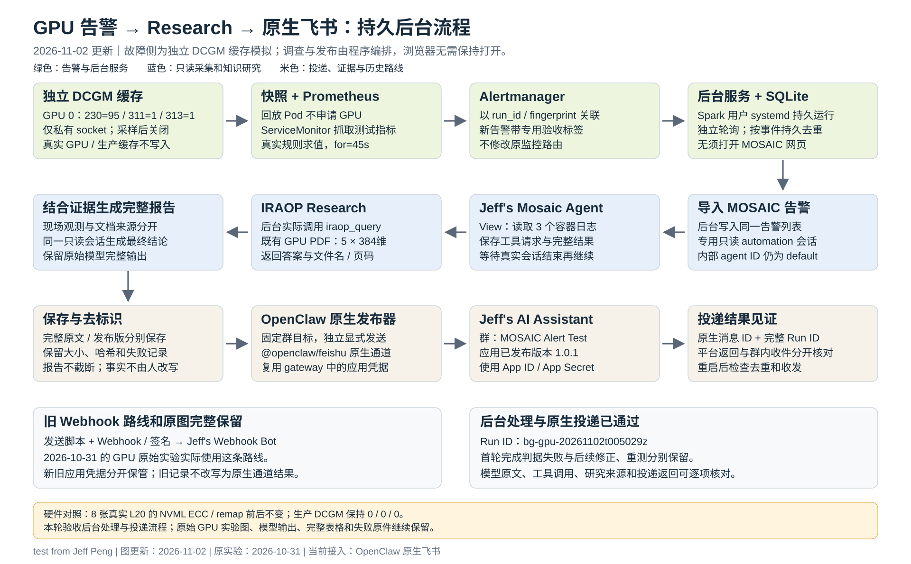

<!-- SPDX-FileCopyrightText: Copyright (c) 2026 NVIDIA CORPORATION & AFFILIATES. All rights reserved. -->
<!-- SPDX-License-Identifier: Apache-2.0 -->

# Spark 持久后台 GPU 告警、IRAOP 与原生飞书实测（2026-11-02）

**当日后续版本：** 本篇保留 `bg-gpu-20261102t005029z` 的群投递实验原件。后续后台已改为 DM，并修复“报告到了、模型却没有上下文”的衔接：自动交接完整真实 Agent 输入后才发送。新 Run ID、配置项、失败原件、重启与清理，以及已完成的真实普通追问和 Qwen 原生回复，见[飞书 DM 上下文修复与验收](spark_feishu_dm_context_validation_20261102.zh-CN.md)。

**后台链路和投递验收已通过。** 新的真实 Prometheus 告警被 Spark 持久服务捕获，自动完成只读取证、实际 IRAOP 咨询、同会话完整报告与 OpenClaw 原生飞书投递。用户已确认完整报告的 Run ID 和 Incident 一致。重启 worker 后没有重复调查或发送；OpenClaw Pod 专门重建后，真实私聊和群 @ 也均有回复。

当前服务只处理同时带 `mosaic_test=true`、`background_validation=true` 的验收告警，每 10 秒轮询一次；**尚未扩大到全部生产告警**。它是另装的持久用户服务，不是启用飞书通道后自动出现的 Helm 默认功能。真实第二身份尚不可用，未授权用户/群只做了明确标注的策略回放。



本篇验证业务流程。错误输入仍是独立 DCGM 缓存，不是物理坏卡；模型原文保留，未由 Codex 修改事实后再外发，也没有据此宣称硬件归因准确率通过。所有时间除明确标注的 systemd 本地日志外均为 UTC。

## 1. 三轮实验与消息身份

| 记录 | Run ID | 错误输入与调查 | 飞书发送身份 |
| --- | --- | --- | --- |
| 2026-10-31 CPU 资源上的应用 Pod | e2e-20261031t075722z | 缺少 /fixture/ready；进程退出 23；手动启动并补充调查 | 群自定义机器人，Webhook + 签名 |
| 2026-10-31 GPU 遥测 | gpu-rca-20261031t121240z | 私有缓存 230=95、311=1、313=1；网页启动 View；原始归因失败保留 | 旧 Webhook 路线；后改名 Jeff's Webhook Bot |
| 2026-11-01 原生通道验收 | feishu-native-20261101-report-01 | 完整旧 CPU 报告重投；没有注入新故障 | 应用机器人；后发布为 Jeff's AI Assistant 1.0.1 |
| 2026-11-02 本轮 | bg-gpu-20261102t005029z | 新私有缓存样本 → 新规则 → 持久后台完整调查 | Jeff's AI Assistant；OpenClaw 官方原生通道 |

旧实验全文分别见 [CPU 应用 Pod 实验](spark_e2e_alert_research_feishu_20261031.zh-CN.md)和 [GPU 原始实验](spark_gpu_alert_research_feishu_20261031.zh-CN.md)。旧图、旧 PDF、历史失败和修改 diff 均不覆盖。

## 2. 谁做什么，怎样持续运行

| 对象 | 本轮动作 | 运行位置/权限 |
| --- | --- | --- |
| 测试管理员 | 采集真实 GPU/内核原件；启动并停止私有 DCGM；创建和删除精确 UID 测试资源 | 目标主机 root；与 agent 权限分开 |
| mosaic-alert-ui-forward.service | 把现有 UI 转发到 Spark 自己的 127.0.0.1:13300 | Spark 用户 systemd；仅本机回环 |
| mosaic-alert-worker.service | 轮询选定 Alertmanager、SQLite 去重、导入告警、调用 headless API、等待真实完成 | Spark 持久用户服务；Linger=yes |
| Jeff's Mosaic Agent | 用实际 run_kubectl 工具获取指定测试 Pod 状态及三个容器日志 | OpenClaw，内部 ID default；专用 automation 会话，View |
| IRAOP Research | 由 worker 明确调用实际 iraop_query；返回知识答案及文件/页码 | 现有 IRAOP 服务；不是 OpenSearch 自己生成答案 |
| OpenSearch / embedding | 提供既有 GPU PDF 的 5 个 384 维 chunks 检索 | 本轮复用集合；没有重新入库，也没有自动扫描其他目录 |
| 同一只读会话的 Qwen | 把已有现场工具结果与完整 Research 响应结合，生成完整报告 | 现有共享模型；没有重启或切换 |
| 独立原生发布器 | 用固定 argv、固定群向已加载的原生通道发送完整文本 | 操作员服务的发布权限；不放宽 agent View |
| Jeff's AI Assistant | 调用飞书应用消息 API 向 MOSAIC Alert Test 群发出报告，并接受白名单互动 | 应用机器人；App ID/App Secret；线上 1.0.1 |
| 收件人 | 在飞书群独立核对报告完整、Run ID 和 Incident 一致 | 用户确认，不以 API 成功替代 |


网页不用保持打开，也不用点击 **Start Investigating**。网页里的 Auto investigate 仍是另一条前端触发逻辑，不能替代此服务；同一类告警交给后台时不要再同时用网页自动调查。后台通过 `agent:default:mosaic-automation-alert-<incident-id>` 的现有只读保护执行调查；发布器的命令和收件群来自配置，模型不能选择外部命令或目标群。HTTP `message` 工具在 View 下实际被拒绝，后台没有为发送通知而切到 Edit/Auto。

## 3. 接手人要拿到哪些资料

| 资料 | 由谁交接/配置 | 本轮状态与用途 |
| --- | --- | --- |
| Spark 地址、SSH 用户、key 或密码 | 部署方通过内部连接资料交付；公开文档用占位符 | 已有 key；在自己电脑建立 SSH；不共享别人的 localhost |
| 目标集群地址/context 与管理员凭据 | 目标主机/集群管理员单独交付 | 用于测试资源创建、日志采样、UID 清理；本轮 root 连接已关闭，密码不保存 |
| MOSAIC UI 用户/密码 | 授权管理员从现有 mosaic-ui-auth 领取 | 打开网页时使用；与 SSH、机器 API token 分开 |
| 现有 UI machineToken 的读取权限 | 部署管理员配置私有 credentials.env | worker 调用 headless API；文件 0600，本文没有 token 值 |
| Alertmanager / Prometheus 网络、鉴权与 CA | 监控管理员提供获准入口 | Spark 复用已有入口；POST 403 不绕过，用真实 PrometheusRule 触发 |
| 飞书应用与群的管理权限 | 客户应用管理员/群管理员 | 应用已发布、已入群；需要 App ID/Secret、群 chat_id、用户 open_id 与白名单 |
| 旧群自定义机器人凭据 | 仅继续使用旧 Webhook 方式时交付 | 不能替代原生通道凭据；两个文件分开保管 |
| IRAOP 集合、可用 embedding/chat 与文档授权 | 知识库和模型服务管理员 | 复用 mosaic-gpu-validation-20261031；本轮无需新的 embedding key 或 PDF |
| 报告的允许分享范围 | 数据/应用负责人确认 | 只向已批准测试群发送；扩展生产标签和接收人要重新配置并验收 |


飞书创建、发布、可用范围、加群、应用权限和组织审批仍由客户本人/管理员操作，MOSAIC 安装不会代办这些审批。实际步骤、全部权限快照、Secret 创建和 Helm 部署命令见[飞书双路线手册第 5–6、12–13 节](spark_feishu_webhook_native_runbook.zh-CN.md)。已有凭据先复用，不要求重新注册应用或把密码发进聊天。

## 4. 登录、观察与操作命令

在自己的电脑上登录 Spark。地址与账号从内部交接取得：

```bash
export SPARK_HOST='spark.example.invalid'
export SPARK_USER='YOUR_SPARK_USER'
ssh -o ServerAliveInterval=15 -o ServerAliveCountMax=3 "$SPARK_USER@$SPARK_HOST"
```

Spark 上检查持久服务及全部事件，不需要启动浏览器：

```bash
systemctl --user status mosaic-alert-ui-forward.service mosaic-alert-worker.service
loginctl show-user "$USER" -p Linger
journalctl --user -u mosaic-alert-worker.service -f
python3 "$HOME/.local/share/mosaic-alert-worker/mosaic-alert-worker.py"   --config "$HOME/.config/mosaic-alert-worker/config.json" --status
```

需要看网页时，在自己电脑另开终端使用已经存在的 Spark 13300 服务：

```bash
ssh -N -o ServerAliveInterval=15 -o ServerAliveCountMax=3   -L 127.0.0.1:13000:127.0.0.1:13300 "$SPARK_USER@$SPARK_HOST"
```

然后访问 `http://127.0.0.1:13000`，使用自己的 UI 登录资料。这里 **13000 是执行者电脑的 SSH 入口，13300 是 Spark 的持久 UI 转发端口**。历史实验里用过的 Spark 13000/13001 端口另有 dated 记录；不要把它们与本轮 13300 混写。后台处理只依赖 Spark 上的服务，关闭电脑隧道不影响它。

从包含 [upstream PR #89](https://github.com/NVIDIA/AI-Factory-Operations-Agent/pull/89) 的代码版本安装后台服务；完整安装和 token 配置步骤见该 PR 的 `docs/background_alert_investigation.md`，配置与 unit 原文也随本篇附件交付：


### mosaic-alert-worker.service 完整 unit

```ini
# SPDX-FileCopyrightText: Copyright (c) 2026 NVIDIA CORPORATION & AFFILIATES. All rights reserved.
# SPDX-License-Identifier: Apache-2.0
[Unit]
Description=MOSAIC background read-only alert investigation and native report delivery
Wants=mosaic-alert-ui-forward.service
After=mosaic-alert-ui-forward.service

[Service]
Type=simple
EnvironmentFile=%h/.config/mosaic-alert-worker/credentials.env
ExecStart=/usr/bin/python3 %h/.local/share/mosaic-alert-worker/mosaic-alert-worker.py --config %h/.config/mosaic-alert-worker/config.json
Restart=on-failure
RestartSec=5
TimeoutStopSec=30
UMask=0077
NoNewPrivileges=true

[Install]
WantedBy=default.target
```


### mosaic-alert-ui-forward.service 完整 unit

```ini
# SPDX-FileCopyrightText: Copyright (c) 2026 NVIDIA CORPORATION & AFFILIATES. All rights reserved.
# SPDX-License-Identifier: Apache-2.0
[Unit]
Description=Loopback-only MOSAIC API connection for the background investigator

[Service]
Type=simple
EnvironmentFile=%h/.config/mosaic-alert-worker/deployment.env
ExecStart=/usr/bin/env ${KUBECTL} --context ${KUBE_CONTEXT} -n ${KUBE_NAMESPACE} --cache-dir=%h/.local/state/mosaic-alert-worker/kubectl-cache port-forward --address=127.0.0.1 svc/mosaic-ui 13300:3000
Restart=always
RestartSec=3
UMask=0077
NoNewPrivileges=true

[Install]
WantedBy=default.target
```


### 当前完整配置（仅身份映射去标识）

```json
{
  "alertmanager_url": "http://192.0.2.44:30093",
  "mosaic_url": "http://127.0.0.1:13300",
  "match_labels": {
    "mosaic_test": "true",
    "background_validation": "true"
  },
  "include_existing": false,
  "poll_seconds": 10,
  "timeout_seconds": 600,
  "research_collections": [
    "mosaic-gpu-validation-20261031"
  ],
  "research_question": "Use only mosaic-gpu-evidence-runbook.pdf to explain the generic GPU evidence procedure: Xid 95, isolated DCGM cache versus live hardware evidence, volatile versus aggregate ECC, kernel-log limitations, and the public retrieval verification code on page 2. Cite filenames and pages. Do not infer this incident or its numeric observations from the document.",
  "state_dir": "/home/DEPLOY_USER/.local/state/mosaic-alert-worker",
  "message_prefix": "test from Jeff Peng",
  "redact_values": [
    "l20-lab",
    "gpu-node-01",
    "gpu-node-01"
  ],
  "delivery": {
    "kubectl": "/home/DEPLOY_USER/.local/bin/kubectl",
    "context": "kind-mosaic-poc",
    "namespace": "mosaic",
    "deployment": "openclaw",
    "container": "gateway",
    "channel": "feishu",
    "target": "chat:oc_00000000000000000000000000000002"
  },
  "collection_context": "Use only registered cluster l20-lab. The alert labels test_namespace and test_pod identify this run. Collect that Pod JSON, its namespace events, and timestamps from exactly these containers: telemetry, nvml-witness, kernel-witness. These logs contain the recorded private DCGM cache, production comparison, and real NVML/kernel snapshots. At most a few directly relevant metric queries are needed. Do not enumerate unrelated cluster incidents or try repairs. Return the observed evidence once these checks finish."
}
```


这份配置可核对本轮实际输入；不要直接使用占位 chat_id/地址部署。`credentials.env` 只保存在 Spark 的私有配置目录，不在附件里。当前过滤器只选择验收标签，`include_existing=false` 让初始基线里的告警只记账；先启动服务，再创建带新 Run ID 的测试告警。

## 5. GPU 错误输入、真实硬件对照和资源

实际注入为 GPU 0 的私有 DCGM 缓存字段 `230=95`、`311=1`、`313=1`：分别对应 Xid、volatile DBE 和 aggregate DBE。Xid 95 表示 uncontained memory error 类别；本实验仅改模拟缓存，不能据此断言真实 GPU 发生了该故障。`--offset 60` 是时间偏移，不是 TTL。生产 `127.0.0.1:5555` 只读采样，未注入。

最初的采样因禁用 NvSwitch 模块后 discovery 返回警告而停在注入前；原失败完整保留。新采样只有在目标 GPU UUID 已确认且错误恰好为预期 NvSwitch 模块未加载时继续。采样完成后私有引擎关闭，再由不申请 GPU、非 root、只读文件系统的三容器 Pod 回放带时间的原件；agent 读取的是这些容器日志，没有直接在宿主机执行 nvidia-smi 或 dmesg。没有启动压力诊断、GPU reset、Hardware Agent、NVDebug 或修复。

本轮全部实际采样命令如下；每一行的完整 stdout、stderr、退出码和耗时均在附件 JSON 对应 `commands` 项，没有删去警告或 introspect 样本。

| 序号 | 开始 UTC | 完整 argv | exitCode | elapsedSeconds |
| --- | --- | --- | --- | --- |
| 1 | 2026-11-02T00:50:29.862055+00:00 | `["hostname"]` | 0 | 0.0008218996226787567 |
| 2 | 2026-11-02T00:50:29.962350+00:00 | `["nvidia-smi", "--query-compute-apps=pid,gpu_uuid,process_name,used_gpu_memory", "--format=csv,noheader"]` | 0 | 0.1002749539911747 |
| 3 | 2026-11-02T00:50:30.983200+00:00 | `["dcgmi", "dmon", "--host", "127.0.0.1:5555", "-i", "0", "-e", "230,311,313", "-c", "2"]` | 0 | 1.0208581797778606 |
| 4 | 2026-11-02T00:50:33.522397+00:00 | `["nvidia-smi", "-q", "-x"]` | 0 | 2.539193008095026 |
| 5 | 2026-11-02T00:50:33.830016+00:00 | `["dcgmi", "discovery", "--host", "unix:///var/tmp/mosaic-bg-gpu-20261102t005029z/engine.sock", "-l"]` | 223 | 0.04809783399105072 |
| 6 | 2026-11-02T00:50:34.849810+00:00 | `["dcgmi", "dmon", "--host", "unix:///var/tmp/mosaic-bg-gpu-20261102t005029z/engine.sock", "-i", "0", "-e", "230,311,313", "-c", "2"]` | 0 | 1.0197860337793827 |
| 7 | 2026-11-02T00:50:34.853965+00:00 | `["dcgmi", "test", "--host", "unix:///var/tmp/mosaic-bg-gpu-20261102t005029z/engine.sock", "--inject", "--gpuid", "0", "-f", "230", "-v", "95", "--offset", "60"]` | 0 | 0.004139319062232971 |
| 8 | 2026-11-02T00:50:34.856812+00:00 | `["dcgmi", "test", "--host", "unix:///var/tmp/mosaic-bg-gpu-20261102t005029z/engine.sock", "--inject", "--gpuid", "0", "-f", "311", "-v", "1", "--offset", "60"]` | 0 | 0.0028440915048122406 |
| 9 | 2026-11-02T00:50:34.859443+00:00 | `["dcgmi", "test", "--host", "unix:///var/tmp/mosaic-bg-gpu-20261102t005029z/engine.sock", "--inject", "--gpuid", "0", "-f", "313", "-v", "1", "--offset", "60"]` | 0 | 0.002628382295370102 |
| 10 | 2026-11-02T00:50:34.862380+00:00 | `["dcgmi", "test", "--host", "unix:///var/tmp/mosaic-bg-gpu-20261102t005029z/engine.sock", "--introspect", "--gpuid", "0", "-f", "230"]` | 0 | 0.002934712916612625 |
| 11 | 2026-11-02T00:50:34.865045+00:00 | `["dcgmi", "test", "--host", "unix:///var/tmp/mosaic-bg-gpu-20261102t005029z/engine.sock", "--introspect", "--gpuid", "0", "-f", "311"]` | 0 | 0.0026642344892024994 |
| 12 | 2026-11-02T00:50:34.867853+00:00 | `["dcgmi", "test", "--host", "unix:///var/tmp/mosaic-bg-gpu-20261102t005029z/engine.sock", "--introspect", "--gpuid", "0", "-f", "313"]` | 0 | 0.0028057433664798737 |
| 13 | 2026-11-02T00:50:36.888131+00:00 | `["dcgmi", "dmon", "--host", "unix:///var/tmp/mosaic-bg-gpu-20261102t005029z/engine.sock", "-i", "0", "-e", "230,311,313", "-c", "3"]` | 0 | 2.0202923081815243 |
| 14 | 2026-11-02T00:50:37.907136+00:00 | `["dcgmi", "dmon", "--host", "127.0.0.1:5555", "-i", "0", "-e", "230,311,313", "-c", "2"]` | 0 | 1.0190037116408348 |
| 15 | 2026-11-02T00:50:40.301578+00:00 | `["nvidia-smi", "-q", "-x"]` | 0 | 2.39443526789546 |
| 16 | 2026-11-02T00:50:40.363293+00:00 | `["dmesg", "--color=never", "--time-format", "iso"]` | 0 | 0.04833186790347099 |


私有引擎由 Popen 启动，环境额外设置 `DCGM_ENABLE_INJECTION_APIS=1`；完整子进程参数、PID 与 socket：

```json
{
  "pid": 3257016,
  "argv": [
    "nv-hostengine",
    "--no-daemon",
    "--domain-socket",
    "/var/tmp/mosaic-bg-gpu-20261102t005029z/engine.sock",
    "--pid",
    "/var/tmp/mosaic-bg-gpu-20261102t005029z/engine.pid",
    "--log-filename",
    "/var/tmp/mosaic-bg-gpu-20261102t005029z/engine.log",
    "--denylist-modules",
    "1,2,3,4,5,6,7,8,9"
  ],
  "socket": "/var/tmp/mosaic-bg-gpu-20261102t005029z/engine.sock"
}
```

采样完成后仅停止该子进程，`privateEngineStopped=true`；没有停止生产 nv-hostengine。


完整原件：[run/gpu-signal-attempt2.json](examples/alert-feishu/background-evidence-20261102/run/gpu-signal-attempt2.json)；注入前失败：[run/gpu-signal.json](examples/alert-feishu/background-evidence-20261102/run/gpu-signal.json)；创建脚本：[scripts/create_gpu_fixture.py.txt.gz](examples/alert-feishu/background-evidence-20261102/scripts/create_gpu_fixture.py.txt.gz)；UID 清理脚本：[scripts/cleanup_fixture.py.txt.gz](examples/alert-feishu/background-evidence-20261102/scripts/cleanup_fixture.py.txt.gz)。


| kind | name | namespace | 精确 UID |
| --- | --- | --- | --- |
| Namespace | mosaic-bg-gpu-20261102t005029z | cluster-scoped | ee533010-337f-4df6-afd8-36b40acc6903 |
| ConfigMap | gpu-evidence | mosaic-bg-gpu-20261102t005029z | 3992261a-e423-44e2-a0be-c93960a3d9bb |
| Pod | gpu-telemetry-fixture | mosaic-bg-gpu-20261102t005029z | 0d2dd268-a7f4-4f4a-95a4-3c09a9c8910d |
| Service | gpu-telemetry-fixture | mosaic-bg-gpu-20261102t005029z | 2e7966ae-e644-4bbb-96d7-3f3d98f30b75 |
| ServiceMonitor | gpu-telemetry-fixture | mosaic-bg-gpu-20261102t005029z | 2cc18d59-dc9d-491d-a135-e63c1d033644 |
| PrometheusRule | mosaic-bg-gpu-20261102t005029z | monitoring | 8ef89713-3640-4385-be34-b69c581c5438 |


三个容器分别为 `telemetry`、`nvml-witness`、`kernel-witness`。ServiceMonitor 的 `spec.fallbackScrapeProtocol=PrometheusText0.0.4` 是顶层字段；真实规则 `MosaicBackgroundGpuTelemetrySimulation` 持续 45 秒后 firing。首次节点大写/小写映射预检失败时没有创建任何资源。完整资源 JSON、后续两次 `background_attempt` 标签 patch 和所有创建响应均在本篇附件。

### 全部 8 张 GPU：所有选定计数、分布和可用性

下表每格顺序为 **注入前 / 注入后 / 清理后最终**，不把 `N/A` 或缺失当成 0。GPU UUID 只做一致身份替换，实际计数不改。选定范围包含全部 ECC、row remap（含 bank 分布）及 retired pages 叶子字段；完整 nvidia-smi XML 另外保留。


#### ecc_errors


| GPU | aggregate/dram_correctable | aggregate/dram_uncorrectable | aggregate/sram_correctable | aggregate/sram_threshold_exceeded |
| --- | --- | --- | --- | --- |
| GPU 0 | 0 / 0 / 0 | 0 / 0 / 0 | 0 / 0 / 0 | No / No / No |
| GPU 1 | 0 / 0 / 0 | 0 / 0 / 0 | 0 / 0 / 0 | No / No / No |
| GPU 2 | 0 / 0 / 0 | 0 / 0 / 0 | 0 / 0 / 0 | No / No / No |
| GPU 3 | 0 / 0 / 0 | 0 / 0 / 0 | 0 / 0 / 0 | No / No / No |
| GPU 4 | 0 / 0 / 0 | 0 / 0 / 0 | 0 / 0 / 0 | No / No / No |
| GPU 5 | 0 / 0 / 0 | 0 / 0 / 0 | 0 / 0 / 0 | No / No / No |
| GPU 6 | 0 / 0 / 0 | 0 / 0 / 0 | 0 / 0 / 0 | No / No / No |
| GPU 7 | 0 / 0 / 0 | 0 / 0 / 0 | 0 / 0 / 0 | No / No / No |

| GPU | aggregate/sram_uncorrectable_parity | aggregate/sram_uncorrectable_secded | aggregate_uncorrectable_sram_sources/sram_l2 | aggregate_uncorrectable_sram_sources/sram_microcontroller |
| --- | --- | --- | --- | --- |
| GPU 0 | 0 / 0 / 0 | 0 / 0 / 0 | 0 / 0 / 0 | 0 / 0 / 0 |
| GPU 1 | 0 / 0 / 0 | 0 / 0 / 0 | 0 / 0 / 0 | 0 / 0 / 0 |
| GPU 2 | 0 / 0 / 0 | 0 / 0 / 0 | 0 / 0 / 0 | 0 / 0 / 0 |
| GPU 3 | 0 / 0 / 0 | 0 / 0 / 0 | 0 / 0 / 0 | 0 / 0 / 0 |
| GPU 4 | 0 / 0 / 0 | 0 / 0 / 0 | 0 / 0 / 0 | 0 / 0 / 0 |
| GPU 5 | 0 / 0 / 0 | 0 / 0 / 0 | 0 / 0 / 0 | 0 / 0 / 0 |
| GPU 6 | 0 / 0 / 0 | 0 / 0 / 0 | 0 / 0 / 0 | 0 / 0 / 0 |
| GPU 7 | 0 / 0 / 0 | 0 / 0 / 0 | 0 / 0 / 0 | 0 / 0 / 0 |

| GPU | aggregate_uncorrectable_sram_sources/sram_other | aggregate_uncorrectable_sram_sources/sram_pcie | aggregate_uncorrectable_sram_sources/sram_sm | volatile/dram_correctable |
| --- | --- | --- | --- | --- |
| GPU 0 | 0 / 0 / 0 | 0 / 0 / 0 | 0 / 0 / 0 | 0 / 0 / 0 |
| GPU 1 | 0 / 0 / 0 | 0 / 0 / 0 | 0 / 0 / 0 | 0 / 0 / 0 |
| GPU 2 | 0 / 0 / 0 | 0 / 0 / 0 | 0 / 0 / 0 | 0 / 0 / 0 |
| GPU 3 | 0 / 0 / 0 | 0 / 0 / 0 | 0 / 0 / 0 | 0 / 0 / 0 |
| GPU 4 | 0 / 0 / 0 | 0 / 0 / 0 | 0 / 0 / 0 | 0 / 0 / 0 |
| GPU 5 | 0 / 0 / 0 | 0 / 0 / 0 | 0 / 0 / 0 | 0 / 0 / 0 |
| GPU 6 | 0 / 0 / 0 | 0 / 0 / 0 | 0 / 0 / 0 | 0 / 0 / 0 |
| GPU 7 | 0 / 0 / 0 | 0 / 0 / 0 | 0 / 0 / 0 | 0 / 0 / 0 |

| GPU | volatile/dram_uncorrectable | volatile/sram_correctable | volatile/sram_uncorrectable_parity | volatile/sram_uncorrectable_secded |
| --- | --- | --- | --- | --- |
| GPU 0 | 0 / 0 / 0 | 0 / 0 / 0 | 0 / 0 / 0 | 0 / 0 / 0 |
| GPU 1 | 0 / 0 / 0 | 0 / 0 / 0 | 0 / 0 / 0 | 0 / 0 / 0 |
| GPU 2 | 0 / 0 / 0 | 0 / 0 / 0 | 0 / 0 / 0 | 0 / 0 / 0 |
| GPU 3 | 0 / 0 / 0 | 0 / 0 / 0 | 0 / 0 / 0 | 0 / 0 / 0 |
| GPU 4 | 0 / 0 / 0 | 0 / 0 / 0 | 0 / 0 / 0 | 0 / 0 / 0 |
| GPU 5 | 0 / 0 / 0 | 0 / 0 / 0 | 0 / 0 / 0 | 0 / 0 / 0 |
| GPU 6 | 0 / 0 / 0 | 0 / 0 / 0 | 0 / 0 / 0 | 0 / 0 / 0 |
| GPU 7 | 0 / 0 / 0 | 0 / 0 / 0 | 0 / 0 / 0 | 0 / 0 / 0 |


#### remapped_rows


| GPU | remapped_row_corr | remapped_row_failure | remapped_row_pending | remapped_row_unc |
| --- | --- | --- | --- | --- |
| GPU 0 | 0 / 0 / 0 | No / No / No | No / No / No | 0 / 0 / 0 |
| GPU 1 | 0 / 0 / 0 | No / No / No | No / No / No | 0 / 0 / 0 |
| GPU 2 | 0 / 0 / 0 | No / No / No | No / No / No | 0 / 0 / 0 |
| GPU 3 | 0 / 0 / 0 | No / No / No | No / No / No | 0 / 0 / 0 |
| GPU 4 | 0 / 0 / 0 | No / No / No | No / No / No | 0 / 0 / 0 |
| GPU 5 | 0 / 0 / 0 | No / No / No | No / No / No | 0 / 0 / 0 |
| GPU 6 | 0 / 0 / 0 | No / No / No | No / No / No | 0 / 0 / 0 |
| GPU 7 | 0 / 0 / 0 | No / No / No | No / No / No | 0 / 0 / 0 |

| GPU | row_remapper_histogram/row_remapper_histogram_high | row_remapper_histogram/row_remapper_histogram_low | row_remapper_histogram/row_remapper_histogram_max | row_remapper_histogram/row_remapper_histogram_none |
| --- | --- | --- | --- | --- |
| GPU 0 | 0 bank(s) / 0 bank(s) / 0 bank(s) | 0 bank(s) / 0 bank(s) / 0 bank(s) | 192 bank(s) / 192 bank(s) / 192 bank(s) | 0 bank(s) / 0 bank(s) / 0 bank(s) |
| GPU 1 | 0 bank(s) / 0 bank(s) / 0 bank(s) | 0 bank(s) / 0 bank(s) / 0 bank(s) | 192 bank(s) / 192 bank(s) / 192 bank(s) | 0 bank(s) / 0 bank(s) / 0 bank(s) |
| GPU 2 | 0 bank(s) / 0 bank(s) / 0 bank(s) | 0 bank(s) / 0 bank(s) / 0 bank(s) | 192 bank(s) / 192 bank(s) / 192 bank(s) | 0 bank(s) / 0 bank(s) / 0 bank(s) |
| GPU 3 | 0 bank(s) / 0 bank(s) / 0 bank(s) | 0 bank(s) / 0 bank(s) / 0 bank(s) | 192 bank(s) / 192 bank(s) / 192 bank(s) | 0 bank(s) / 0 bank(s) / 0 bank(s) |
| GPU 4 | 0 bank(s) / 0 bank(s) / 0 bank(s) | 0 bank(s) / 0 bank(s) / 0 bank(s) | 192 bank(s) / 192 bank(s) / 192 bank(s) | 0 bank(s) / 0 bank(s) / 0 bank(s) |
| GPU 5 | 0 bank(s) / 0 bank(s) / 0 bank(s) | 0 bank(s) / 0 bank(s) / 0 bank(s) | 192 bank(s) / 192 bank(s) / 192 bank(s) | 0 bank(s) / 0 bank(s) / 0 bank(s) |
| GPU 6 | 0 bank(s) / 0 bank(s) / 0 bank(s) | 0 bank(s) / 0 bank(s) / 0 bank(s) | 192 bank(s) / 192 bank(s) / 192 bank(s) | 0 bank(s) / 0 bank(s) / 0 bank(s) |
| GPU 7 | 0 bank(s) / 0 bank(s) / 0 bank(s) | 0 bank(s) / 0 bank(s) / 0 bank(s) | 192 bank(s) / 192 bank(s) / 192 bank(s) | 0 bank(s) / 0 bank(s) / 0 bank(s) |

| GPU | row_remapper_histogram/row_remapper_histogram_partial |
| --- | --- |
| GPU 0 | 0 bank(s) / 0 bank(s) / 0 bank(s) |
| GPU 1 | 0 bank(s) / 0 bank(s) / 0 bank(s) |
| GPU 2 | 0 bank(s) / 0 bank(s) / 0 bank(s) |
| GPU 3 | 0 bank(s) / 0 bank(s) / 0 bank(s) |
| GPU 4 | 0 bank(s) / 0 bank(s) / 0 bank(s) |
| GPU 5 | 0 bank(s) / 0 bank(s) / 0 bank(s) |
| GPU 6 | 0 bank(s) / 0 bank(s) / 0 bank(s) |
| GPU 7 | 0 bank(s) / 0 bank(s) / 0 bank(s) |


#### retired_pages


| GPU | double_bit_retirement/retired_count | double_bit_retirement/retired_pagelist | multiple_single_bit_retirement/retired_count | multiple_single_bit_retirement/retired_pagelist |
| --- | --- | --- | --- | --- |
| GPU 0 | N/A / N/A / N/A | N/A / N/A / N/A | N/A / N/A / N/A | N/A / N/A / N/A |
| GPU 1 | N/A / N/A / N/A | N/A / N/A / N/A | N/A / N/A / N/A | N/A / N/A / N/A |
| GPU 2 | N/A / N/A / N/A | N/A / N/A / N/A | N/A / N/A / N/A | N/A / N/A / N/A |
| GPU 3 | N/A / N/A / N/A | N/A / N/A / N/A | N/A / N/A / N/A | N/A / N/A / N/A |
| GPU 4 | N/A / N/A / N/A | N/A / N/A / N/A | N/A / N/A / N/A | N/A / N/A / N/A |
| GPU 5 | N/A / N/A / N/A | N/A / N/A / N/A | N/A / N/A / N/A | N/A / N/A / N/A |
| GPU 6 | N/A / N/A / N/A | N/A / N/A / N/A | N/A / N/A / N/A | N/A / N/A / N/A |
| GPU 7 | N/A / N/A / N/A | N/A / N/A / N/A | N/A / N/A / N/A | N/A / N/A / N/A |

| GPU | pending_blacklist | pending_retirement |
| --- | --- | --- |
| GPU 0 | N/A / N/A / N/A | N/A / N/A / N/A |
| GPU 1 | N/A / N/A / N/A | N/A / N/A / N/A |
| GPU 2 | N/A / N/A / N/A | N/A / N/A / N/A |
| GPU 3 | N/A / N/A / N/A | N/A / N/A / N/A |
| GPU 4 | N/A / N/A / N/A | N/A / N/A / N/A |
| GPU 5 | N/A / N/A / N/A | N/A / N/A / N/A |
| GPU 6 | N/A / N/A / N/A | N/A / N/A / N/A |
| GPU 7 | N/A / N/A / N/A | N/A / N/A / N/A |


## 6. 三次后台尝试，失败和成功分别记账

前两次均在发布前停止；没有把失败记录手工改成成功，也没有用人工补发冒充后台。修正的是程序的完成判据与响应字段解析，不是修改 Qwen 回答的事实。

| Incident | fingerprint | attempt | 最终调查状态 | 结果/原始失败 | message_id | 源恢复 UTC | UI 清理 UTC |
| --- | --- | --- | --- | --- | --- | --- | --- |
| 7ed674ba17c49a037fe3e651 | 77592864998cc923 | 1 | needs_attention | Collection still has an active run | 无；未发布 | 2026-11-02T01:10:02Z | 2026-11-02T01:10:02Z |
| df5310a8ede1f42b14c421ec | 2a7b9b7784cb45a3 | 2 | needs_attention | IRAOP result has no answer with filename/page references | 无；未发布 | 2026-11-02T01:20:02Z | 2026-11-02T01:20:02Z |
| 2803c2516df6ec7c3eed3f2f | 36d4245c1f32ff02 | 3 | sent | 原生发送成功 | om_x100b614a1e1294acdd7edd5c26d5db6 | 2026-11-02T01:23:52Z | 2026-11-02T01:23:52Z |


全部状态转换（不抽样）：

| sequence | incident_id | UTC | state | 完整 detail_json |
| --- | --- | --- | --- | --- |
| 1 | 7ed674ba17c49a037fe3e651 | 2026-11-02T00:56:11Z | collecting | `{}` |
| 2 | 7ed674ba17c49a037fe3e651 | 2026-11-02T00:56:26Z | needs_attention | `{"error_type": "ValueError"}` |
| 3 | df5310a8ede1f42b14c421ec | 2026-11-02T01:07:31Z | collecting | `{}` |
| 4 | df5310a8ede1f42b14c421ec | 2026-11-02T01:08:02Z | researching | `{}` |
| 5 | df5310a8ede1f42b14c421ec | 2026-11-02T01:08:32Z | needs_attention | `{"error_type": "ValueError"}` |
| 6 | 2803c2516df6ec7c3eed3f2f | 2026-11-02T01:17:21Z | collecting | `{}` |
| 7 | 2803c2516df6ec7c3eed3f2f | 2026-11-02T01:17:59Z | researching | `{}` |
| 8 | 2803c2516df6ec7c3eed3f2f | 2026-11-02T01:18:24Z | synthesizing | `{}` |
| 9 | 2803c2516df6ec7c3eed3f2f | 2026-11-02T01:19:04Z | ready | `{}` |
| 10 | 2803c2516df6ec7c3eed3f2f | 2026-11-02T01:19:04Z | sending | `{}` |
| 11 | 2803c2516df6ec7c3eed3f2f | 2026-11-02T01:19:10Z | sent | `{"message_id": "om_x100b614a1e1294acdd7edd5c26d5db6"}` |


首轮 API 在工具仍运行时返回 success；程序误判已完成而停止。修正后只提交一次 prompt，等待对应原生历史不再 active 且最终 assistant 正常完成，保留每次观察。第二轮 IRAOP 其实已返回两个来源，但来源字段名是 `source_file`，旧解析器拒绝了有效响应。加入实际 envelope 的回归测试后，第三轮完整自动通过。已部署的每版源码完整保存在附件 `worker/source-versions/`，最终 SHA256 为 `50c750c45b00f1ef81628d12d3fa456c5b94511dc0b6f1bf9a9f325634b7c9fa`，与源码 PR #89 的 worker 文件一致。

## 7. 成功轮的每次实际现场工具结果

| 序号 | toolName | toolCallId | isError | timestamp |
| --- | --- | --- | --- | --- |
| 1 | run_kubectl | call_85c05d6a10a94c9ba1536557 | False | 1793582259022 |
| 2 | run_kubectl | call_4e4e52ed99884356ae940b24 | False | 1793582259023 |
| 3 | run_kubectl | call_e81223424bdf4ad9832d97f9 | False | 1793582259024 |
| 4 | run_kubectl | call_923af72867344120b185724e | False | 1793582259025 |
| 5 | run_kubectl | call_2741277f8fd0425e9f5f47e3 | False | 1793582259027 |


[完整原生采集历史](examples/alert-feishu/background-evidence-20261102/worker/incidents/2803c2516df6ec7c3eed3f2f/collection-history.response.json)及[所有工具结果全文](examples/alert-feishu/background-evidence-20261102/worker/incidents/2803c2516df6ec7c3eed3f2f/collection-tool-results.json)保留完整命令、返回数据和时间。现场原件来自本轮三个容器，模型没有自己改变测试资源。

## 8. IRAOP 实际调用与全部文档来源

本轮复用此前已入库的 `mosaic-gpu-evidence-runbook.pdf`：2 页、5 chunks，每个 384 维，集合 `mosaic-gpu-validation-20261031`。这是专门编写的通用 GPU 取证示例，不是完整 NVIDIA 故障知识库，也没有自动获取全部本地文件。上传并入库后检索可自动执行；仅把一个 PDF 复制到目录不等于已经入库。

完整实际请求：

```json
{
  "method": "POST",
  "path": "/api/openclaw/tools/call",
  "body": {
    "name": "iraop_query",
    "arguments": {
      "question": "Use only mosaic-gpu-evidence-runbook.pdf to explain the generic GPU evidence procedure: Xid 95, isolated DCGM cache versus live hardware evidence, volatile versus aggregate ECC, kernel-log limitations, and the public retrieval verification code on page 2. Cite filenames and pages. Do not infer this incident or its numeric observations from the document.",
      "depth": "quick",
      "collections": [
        "mosaic-gpu-validation-20261031"
      ]
    },
    "sessionKey": "agent:default:mosaic-automation-alert-2803c2516df6ec7c3eed3f2f"
  }
}
```

该请求由 worker 的确定阶段发起，sessionKey 与现场调查相同；返回全文再作为下一步同会话 synthesis 的输入。完整返回：[worker/incidents/2803c2516df6ec7c3eed3f2f/research.response.json](examples/alert-feishu/background-evidence-20261102/worker/incidents/2803c2516df6ec7c3eed3f2f/research.response.json)。全部来源如下：

| source_file | page_number | collection | doc_id | url |
| --- | --- | --- | --- | --- |
| mosaic-gpu-evidence-runbook.pdf | 1 | mosaic-gpu-validation-20261031 | mosaic-gpu-evidence-runbook.pdf | /api/v1/documents/mosaic-gpu-evidence-runbook.pdf |
| mosaic-gpu-evidence-runbook.pdf | 2 | mosaic-gpu-validation-20261031 | mosaic-gpu-evidence-runbook.pdf | /api/v1/documents/mosaic-gpu-evidence-runbook.pdf |


文档负责解释方法和验证控制码；当前 GPU 数值、日志与时间来自现场工具记录，不能从 PDF 推断。本轮知识问答与 OpenSearch 数据库承担不同职责，模型、IRAOP 与数据库不混称为同一个 agent。

## 9. 完整报告、原生发送与收件

| 字段 | 实际值 |
| --- | --- |
| modelBytes | 9469 |
| modelSha256 | 4a8a7b357d30283e3d3a476d967d6a7ea5df951e905f73cce1878713a9008483 |
| publishedBytes | 11966 |
| publishedSha256 | dbe7a94cfdc1fd30b96155018e6a104dd9451087183fe4c649a688006ddb8a5f |
| contentTruncated | false |
| modelFactCorrectionsApplied | false |
| incident | 2803c2516df6ec7c3eed3f2f |
| message_id | om_x100b614a1e1294acdd7edd5c26d5db6 |
| 平台消息 readback | code=0；msg_type=post |
| 收件人确认 | 已看到完整报告，Run ID 和 Incident 一致 |


发布使用固定参数数组，完整报告作为一个参数，不经 shell 拼接：

```bash
kubectl --context kind-mosaic-poc -n mosaic   --cache-dir "$HOME/.local/state/mosaic-alert-worker/kubectl-cache"   exec deploy/openclaw -c gateway --   node /app/dist/index.js message send --channel feishu   --target 'chat:APPROVED_CHAT_ID' --message "$COMPLETE_REPORT" --json
```

这段命令解释实际 argv；自动化没有把完整报告放进 shell 变量，而是直接交给 subprocess 的单个参数。实际固定目标、完整文本哈希与原生返回分别在 intent/stdout/receipt 中；公开版只替换身份。应用机器人发送使用已有 App ID/Secret，不调用旧群 Webhook。富文本会规范化 Markdown，因此平台消息不等同于原文件逐字节传输；源报告哈希、平台完整消息和群内独立确认三项一起保留。

完整原件：

- [worker/incidents/2803c2516df6ec7c3eed3f2f/model-report.txt.gz](examples/alert-feishu/background-evidence-20261102/worker/incidents/2803c2516df6ec7c3eed3f2f/model-report.txt.gz)

- [worker/incidents/2803c2516df6ec7c3eed3f2f/published-report.txt.gz](examples/alert-feishu/background-evidence-20261102/worker/incidents/2803c2516df6ec7c3eed3f2f/published-report.txt.gz)

- [worker/incidents/2803c2516df6ec7c3eed3f2f/native-delivery.intent.json](examples/alert-feishu/background-evidence-20261102/worker/incidents/2803c2516df6ec7c3eed3f2f/native-delivery.intent.json)

- [worker/incidents/2803c2516df6ec7c3eed3f2f/native-delivery.stdout.log.gz](examples/alert-feishu/background-evidence-20261102/worker/incidents/2803c2516df6ec7c3eed3f2f/native-delivery.stdout.log.gz)

- [worker/incidents/2803c2516df6ec7c3eed3f2f/native-receipt.json](examples/alert-feishu/background-evidence-20261102/worker/incidents/2803c2516df6ec7c3eed3f2f/native-receipt.json)

- [run/native-and-rebuild-platform-readback.json](examples/alert-feishu/background-evidence-20261102/run/native-and-rebuild-platform-readback.json)
- [run/recipient-confirmation.json](examples/alert-feishu/background-evidence-20261102/run/recipient-confirmation.json)


### 本轮模型报告全文（仅身份去标识，保留原句）

下文用于核对实际发出的原始报告，不把它当作已经逐条复核的硬件真值结论。


>
>
> # GPU 遥测缓存验证 — 完整只读调查报告
>
> ## 一、告警身份
>
> | 字段 | 值 |
> |---|---|
> | 告警名称 | `MosaicBackgroundGpuTelemetrySimulation` |
> | 指纹 | `36d4245c1f32ff02` |
> | 触发时间 | 2026-11-02T01:17:17.202Z |
> | 结束时间 | 2026-11-02T01:21:17.202Z |
> | 更新/状态 | 2026-11-02T01:17:17.203Z · active |
> | 生成器 URL | Prometheus 查询 `mosaic_test_dcgm_xid_error{...simulation="true"} == 95` |
> | 严重性 | warning |
> | 背景尝试 | 3 |
> | 背景验证 | true |
> | 模拟 | true |
> | 证据源标识 | `isolated_dcgm_cache_snapshot` |
>
> ## 二、目标资源
>
> | 字段 | 值 |
> |---|---|
> | 集群 | l20-lab |
> | 命名空间 | `mosaic-bg-gpu-20261102t005029z` |
> | Pod | `gpu-telemetry-fixture` (UID: 0d2dd268-a7f4-4f4a-95a4-3c09a9c8910d) |
> | 节点 | gpu-node-01 (host IP: 192.0.2.44) |
> | Pod IP | 192.0.2.28/32 |
> | GPU 索引 | 0 |
> | GPU UUID | GPU-00000000-0000-0000-0000-000000000005 |
> | GPU 型号 | NVIDIA L20 (PCI: 00000000:1B:00.0) |
> | 实验标签 | `gpu-telemetry-cache` |
> | 运行 ID | `bg-gpu-20261102t005029z` |
>
> ## 三、观察时间线
>
> | UTC 时间 | 来源 | 事件 |
> |---|---|---|
> | 00:54:49 | kubectl (Pod JSON) | Pod 创建 |
> | 00:54:49–00:54:53 | kubectl (事件) | 调度到 gpu-node-01，三个容器创建并启动 |
> | 00:50:33 | dmesg 快照记录 | NVML 采样窗口起点 |
> | 00:50:33.830 | telemetry 容器 | `dcgmi discovery -l` 发现 8 块 L20 GPU |
> | 00:50:34.849 | telemetry 容器 | 注入前 `dmon` 快照：230=0, 311=0, 313=0 |
> | 00:50:34.852 | telemetry 容器 | `dcgmi test --inject -f 230 -v 95` 成功 |
> | 00:50:34.856 | telemetry 容器 | `dcgmi test --inject -f 311 -v 1` 成功 |
> | 00:50:34.859 | telemetry 容器 | `dcgmi test --inject -f 313 -v 1` 成功 |
> | 00:50:34.862 | telemetry 容器 | 字段 230 introspect：新时间戳 2026-11-02 08:51:34 |
> | 00:50:34.865 | telemetry 容器 | 字段 311 introspect：3 个样本 |
> | 00:50:34.867 | telemetry 容器 | 字段 313 introspect：3 个样本 |
> | 00:50:36.888 | telemetry 容器 | 注入后 `dmon` 快照：230=95, 311=1, 313=1 |
> | 00:50:37.907 | telemetry 容器 | 生产 DCGM (127.0.0.1:5555) 快照：230=0, 311=0, 313=0 |
> | 00:50:33.522 | nvml-witness 容器 | NVML 采样窗口起点 |
> | 00:50:40.301 | nvml-witness 容器 | NVML 采样窗口终点 |
> | 00:50:40.363 | kernel-witness 容器 | `dmesg` 快照采集 |
> | 00:54:49+ | kubectl | 当前 Pod 仍为 Running |
>
> ## 四、证据清单
>
> ### 4.1 合成/注入数据（隔离 DCGM 缓存快照）
>
> **来源：** telemetry 容器日志（`dcgm.json` 文件，由 httpd 服务暴露）<br>
> **标签：** `isolated_dcgm_cache_snapshot`<br>
> **工具：** `dcgmi test --inject`
>
> | 注入字段 | 原始值 | 注入值 | 注入后值 |
> |---|---|---|---|
> | 230 (xid_errors) | 0 | 95 | 95 (dmon 确认) |
> | 311 (ecc_dbe_volatile_total) | 0 | 1 | 1 (dmon 确认) |
> | 313 (ecc_dbe_aggregate_total) | 0 | 1 | 1 (dmon 确认) |
>
> **注入方式：** 通过私有 Unix 域 socket `unix:///var/tmp/mosaic-bg-gpu-20261102t005029z/engine.sock` 连接 DCGM 测试引擎。
>
> ### 4.2 实时 NVML 快照
>
> **来源：** nvml-witness 容器日志（`nvml.json`）<br>
> **采集区间：** 2026-11-02T00:50:33.522Z ~ 00:50:40.301Z (约 6.8 秒)
>
> | 计数器 | 注入前 | 注入后 | 说明 |
> |---|---|---|---|
> | volatile.sram_correctable | 0 | 0 | 未变 |
> | volatile.sram_uncorrectable_parity | 0 | 0 | 未变 |
> | volatile.sram_uncorrectable_secded | 0 | 0 | 未变 |
> | volatile.dram_correctable | 0 | 0 | 未变 |
> | volatile.dram_uncorrectable | 0 | 0 | 未变 |
> | aggregate.sram_correctable | 0 | 0 | 未变 |
> | aggregate.sram_uncorrectable_parity | 0 | 0 | 未变 |
> | aggregate.sram_uncorrectable_secded | 0 | 0 | 未变 |
> | aggregate.dram_correctable | 0 | 0 | 未变 |
> | aggregate.dram_uncorrectable | 0 | 0 | 未变 |
> | aggregate.sram_threshold_exceeded | No | No | 未变 |
> | remapped_row_corr | 0 | 0 | 未变 |
> | remapped_row_unc | 0 | 0 | 未变 |
> | remapped_row_pending | No | No | 未变 |
> | remapped_row_failure | No | No | 未变 |
> | **全部 8 块 GPU 计数器** | **一致** | **一致** | `allEightGpuCountersUnchanged: true` |
>
> ### 4.3 内核日志快照
>
> **来源：** kernel-witness 容器日志（`kernel.json`）<br>
> **采集时间：** 2026-11-02T00:50:40.363Z<br>
> **命令：** `dmesg --color=never --time-format=iso`<br>
> **XID 匹配行：** 0 行
>
> | 项目 | 结果 |
> |---|---|
> | NVRM Xid 错误记录 | 未发现 |
> | PCIe AER 错误记录 | 未发现 |
> | 采样完整性 | 快照可能省略已旋转的历史日志 |
>
> ### 4.4 生产 DCGM 对比
>
> **来源：** telemetry 容器 `dcgmi dmon` 连接 127.0.0.1:5555<br>
> **时间戳：** 00:50:37.907
>
> | 字段 | 测试引擎值 | 生产引擎值 |
> |---|---|---|
> | 230 (xid_errors) | 95 | 0 |
> | 311 (ecc_dbe_volatile) | 1 | 0 |
> | 313 (ecc_dbe_aggregate) | 1 | 0 |
>
> ### 4.5 Pod 与事件状态
>
> | 项目 | 结果 |
> |---|---|
> | Pod 阶段 | Running |
> | 容器重启次数 | 0/0/0 (telemetry/nvml/kernel) |
> | 节点条件 | 无异常 |
> | 命名空间事件 | 全部 Normal，无 Warning |
> | Pod 安全 | 非 root，Drop ALL，只读根文件系统 |
>
> ## 五、文档证据引用
>
> | 引用 | 文件 | 页码 | 内容摘要 |
> |---|---|---|---|
> | [1] | `mosaic-gpu-evidence-runbook.pdf` | Page 1 | 通用 GPU 取证流程、Xid 95 定义、ECC 读取原则 |
> | [2] | `mosaic-gpu-evidence-runbook.pdf` | Page 2 | 隔离 DCGM 缓存与实时硬件证据区分、注入不一致时的决策规则、内核日志限制、验证码 GPU-CEDAR-7304 |
>
> 文档核心规则摘要：
>
> - **Xid 95**：严重错误分类，但不单独证明特定内存芯片或可更换卡故障（第 3 节）。
> - **ECC 读取**：volatile 与 aggregate 需分开读取；非零 lifetime aggregate 不等于当前错误增长；SRAM/DRAM 区分必须保留（第 4 节）。
> - **隔离 DCGM vs 实时证据**：注入的 Xid/ECC 样本仅为宿主引擎缓存快照，不是独立的 NVML 或内核证据；必须标记为 `isolated_dcgm_cache_snapshot`（第 5 节）。
> - **不一致决策**：注入样本与 NVML 计数器一致不变且内核日志无 Xid 匹配时，应报告"模拟 GPU 遥测，无足够证据表明存在实时硬件缺陷"（第 6 节）。
> - **内核日志限制**：必须声明观察时间窗口；缺失/旋转的日志可能导致无法关联 Xid 事件（第 7 节）。
>
> ## 六、诊断
>
> ### 结论：模拟 GPU 遥测，无实时硬件缺陷证据
>
> | 维度 | 结果 | 置信度 |
> |---|---|---|
> | DCGM 注入行为 | 通过私有 socket 注入 XID 95、ECC 计数成功，`dmon` 正确反映注入值 | 高（直接日志证据） |
> | 生产 DCGM 对比 | 同一节点 127.0.0.1:5555 所有字段均为 0 | 高 |
> | NVML 实时快照 | 6.8 秒窗口内目标 GPU 全部 ECC 计数器为 0，8 块 GPU 全部未变 | 高 |
> | 内核日志 | dmesg 快照无 XID 错误行 | 中（快照可能不完整） |
> | 告警触发 | Prometheus 查询 `mosaic_test_dcgm_xid_error{simulation="true"} == 95` | 高 |
>
> ### 推理链
>
> 1. Pod `gpu-telemetry-fixture` 是一个受控的遥测缓存验证测试（标签 `simulation=true`, `test_namespace`, `background_validation=true`）。
> 2. `telemetry` 容器通过 `dcgmi test --inject` 向 DCGM 测试引擎手动注入了 XID 95、ECC volatile=1、ECC aggregate=1。
> 3. 注入后 DCGM 测试引擎的 `dmon` 正确返回了注入值 230=95, 311=1, 313=1，验证了缓存机制功能正常。
> 4. 同一节点的**生产 DCGM**（127.0.0.1:5555）所有字段返回 0，表明生产环境无 XID 错误。
> 5. **实时 NVML 快照**在注入时间窗口内全部计数器为 0，且 8 块 GPU 均无变化，与生产 DCGM 一致。
> 6. **内核日志快照**未发现 XID 错误行。
> 7. Prometheus 告警由 `mosaic_test_dcgm_xid_error{simulation="true"} == 95` 规则触发，正是针对注入的 95 值。
>
> ### 依据文档第 6 节
>
> > "When injected DCGM samples disagree with unchanged live NVML ECC/remap counters, and no matching kernel Xid in the available log window, the operator should: Report simulated GPU telemetry and insufficient evidence of a live hardware defect."
>
> 本案例完全符合该决策条件：
> - 注入样本与 NVML 不一致：注入 230=95/311=1/313=1 vs NVML 全部 0
> - 内核日志无 Xid 匹配
> - 因此结论为：**模拟 GPU 遥测，无实时硬件缺陷证据**
>
> ## 七、不确定性
>
> | 不确定性 | 说明 | 影响 |
> |---|---|---|
> | 内核日志窗口限制 | dmesg 快照仅覆盖采集时刻，可能缺少已旋转的历史事件（kernel-witness 日志明确声明此限制） | 中 — 无法完全排除注入窗口之外的历史 Xid 事件 |
> | Prometheus 指标缺失 | 若监控 exporter 的字段列表或 scrape 目标有缺口，缺失的 Xid/ECC 指标为仪器盲区而非真实零值（文档第 4/7 节） | 低 — 本告警已通过 Prometheus 规则触发，证明指标管线在运行 |
> | NvSwitch 不可达 | DCGM discovery 报告 "Cannot get NvSwitch list from remote node. This request is serviced by a module of DCGM that is not currently loaded" | 低 — 影响 NVLink/NvSwitch 诊断，与 GPU 0 的 Xid 分析无直接关联 |
> | 仅单 GPU 分析 | 测试仅注入 GPU 0 的字段，其他 GPU 未做注入对比 | 低 — 告警和目标均为 GPU 0 |
>
> ## 八、验证码
>
> 文档 `mosaic-gpu-evidence-runbook.pdf` 第 2 页包含检索验证码：**GPU-CEDAR-7304**（该码不提供额外访问权限，仅从文档中引用）。
>
> <hr>
>
> **报告结束。本调查仅使用只读工具，未执行任何修复操作。**


## 10. 原生通道补充验收：全部实际用例

| 用例 | 方式 | 实际见证与边界 |
| --- | --- | --- |
| 白名单私聊 | 真实用户消息 | feishu-extra-20261102-dm；入站消息、独立 direct 会话、实际回复、平台读取 code=0 |
| 群不 @ | 真实用户确认发送；观察未触发 | feishu-extra-20261102-no-mention；无对应会话。普通群消息读取返回 230027，不能据此区分平台没推送或插件本地过滤 |
| Pod 重建 | 专门删除 gateway Pod 并等待新 Pod 就绪 | 旧 UID da7cec2b-b7f7-4c1c-b733-dd3f1a209bca → 新 UID 02fad834-25b3-4e87-bfa5-dad4f58876c5；配置/Secret 不变 |
| 重建后私聊 | 真实用户消息和模型回复 | feishu-extra-20261102-restart-dm；回复 Test received. Everything working.；平台消息及对话读取 code=0 |
| 重建后群 @ | 真实用户消息和模型回复 | feishu-extra-20261102-restart-group；回复“收到，Jeff。测试通过。”；原生会话和 gateway 分发见证；精确入站消息读取 code=0 |
| 未授权真实用户/群 | 未完成 | 没有第二账号；不把下列合成身份回放说成真实第二人测试 |


策略回放直接调用已安装 `@openclaw/feishu@2026.6.10` 的导出函数，没有伪造平台入站、发送消息或修改实际白名单。实际模块 SHA256：`845925680409a47fde045349756c9f0f8620ddcbf58f17670f2b1133abccf0ae`。全部 9 行如下，完整 gates、allowlists、reasonCode 和返回字段保留在 JSON：

| 用例 | admission | decision | reasonCode |
| --- | --- | --- | --- |
| allowlisted DM | dispatch | allow | activation_allowed |
| unlisted synthetic DM | drop | block | dm_policy_not_allowlisted |
| disabled DM | drop | block | dm_policy_disabled |
| allowlisted group | dispatch | allow | activation_allowed |
| unlisted synthetic group | drop | block | group_policy_not_allowlisted |
| allowlisted sender with mention | dispatch | allow | activation_allowed |
| unlisted synthetic sender with mention | drop | block | group_policy_not_allowlisted |
| allowlisted sender without mention | skip | allow | activation_skipped |
| unlisted synthetic sender without mention | drop | block | group_policy_not_allowlisted |


完整原件：[run/feishu-policy-replay.json](examples/alert-feishu/background-evidence-20261102/run/feishu-policy-replay.json)、[channel/selected-native-transcripts.json](examples/alert-feishu/background-evidence-20261102/channel/selected-native-transcripts.json)、[run/gateway-extra-logs.txt.gz](examples/alert-feishu/background-evidence-20261102/run/gateway-extra-logs.txt.gz)、[run/post-rebuild-reply-platform.json](examples/alert-feishu/background-evidence-20261102/run/post-rebuild-reply-platform.json)。没有为了验收普通群读取而扩大应用权限。

## 11. 重启去重、自然恢复、清理和共享部署

| 检查 | 实际结果 |
| --- | --- |
| sameIncident | True |
| sameMessageId | True |
| sameEventRows | True |
| sameEvidenceHashes | True |
| serviceState | active |
| DELETE UID 前置条件 | 6 |
| 原监控规则 UID/spec 哈希 | 全部保持 |
| 源 Alertmanager 告警 | 0；自然恢复，未手工伪造 |
| worker 自身 UI 卡片 | 三次均自动清理，调查/报告原件保留 |
| Helm revision | 18 |
| Ready Pods | 7 |
| 应用 Secret 指纹 | 全部保持 |
| 共享模型 PID | 128852 |
| 共享模型 StartedAt | 2026-09-15T07:17:31.481993911Z |
| 8 GPU ECC/remap 前后 | 全部保持；完整字段和分布见第 5 节 |
| L20 root ControlMaster | 已关闭；复查 socket 不存在，control check 失败 |
| Spark 后台服务 | 继续 enabled/active；只处理上述验收标签 |


[run/worker-restart-deduplication.json](examples/alert-feishu/background-evidence-20261102/run/worker-restart-deduplication.json)保留重启前后每一条事件、所有证据哈希和消息 ID。清理的每次 API 路径、DeleteOptions UID 前置条件、响应，以及原规则完整 before/after 哈希表见[run/cleanup.json](examples/alert-feishu/background-evidence-20261102/run/cleanup.json)。全部恢复观察样本见[worker/validation-20261102/resolution.json](examples/alert-feishu/background-evidence-20261102/worker/validation-20261102/resolution.json)。

## 12. 复现与停止

1. 从内部交接取得第 3 节资料，确认目标与授权；复用已有飞书应用、知识集合和模型。
2. 按源码 PR #89 的完整指南安装两个服务，检查初始 last-poll 与 Linger；关闭该类告警的网页 Auto investigate。
3. 在批准的独立 namespace 创建新 Run ID 的安全模拟，保留全部实际采样、创建 JSON 和 UID。创建脚本在附件；旧脚本带固定旧 Run ID/不存在性断言，不能原样重复使用。
4. 只观察 journal 和状态目录，不能再人工发 headless prompt、补咨询或手动发送来代替后台阶段。
5. 核对 pending/firing、fingerprint、所有现场 toolResult、真实 Research response、完整模型原文和原生 receipt；让收件人独立核对。
6. 同一告警仍 firing 时重启 worker，比较 SQLite 全部事件、证据哈希和消息 ID；不要清空账本强制重发。
7. 用原始 UID 清理资源，等待源自然恢复及 worker UI 卡片清理；关闭管理员 root 连接，保留全部会话和失败。

需要停用时，保留证据后执行：

```bash
systemctl --user disable --now mosaic-alert-worker.service mosaic-alert-ui-forward.service
```

调查中断会停为 needs_attention；发送超时或中断会停为 delivery_unknown，先查平台再决定重试，不能无条件重发。扩展生产告警需要重新选择标签、接收群、数据分享范围及维护责任；当前没有全量外发。

## 13. 文件、完整性和源码 PR

[上游源码 PR #89](https://github.com/NVIDIA/AI-Factory-Operations-Agent/pull/89)提交 worker、28 项 Python 测试、Node 集成、完整安装文档和 systemd units。仓库检查 228 项：226 通过、2 个既有可选 skip；inference 4 项通过，两个 Helm lint 和严格 Sphinx 通过。完整检查日志在本篇证据目录。

[公开附件 manifest](examples/alert-feishu/background-evidence-20261102/manifest.json)列出全部选定文件的原始/公开/存储字节数与 SHA256。gzip 保留原始换行和错误输出；数字、时间、精确资源 UID、告警指纹与消息 ID 不改，只对地址、账号、GPU 身份和应用/群/用户 ID 作一致替换。私有 SQLite 的所有表、行和列在 ledger.json；认证值和无关会话不在公开包。原 2026-10-31/11-01 的证据附件另行做哈希校验，保持原样。

官方字段语义参考 [DCGM Field IDs](https://docs.nvidia.com/datacenter/dcgm/latest/dcgm-api/dcgm-api-field-ids.html)和 [Xid Catalog](https://docs.nvidia.com/deploy/xid-errors/analyzing-xid-catalog.html)。实际版本的源码、工具响应和现场观测优先于对最新软件的推断。
