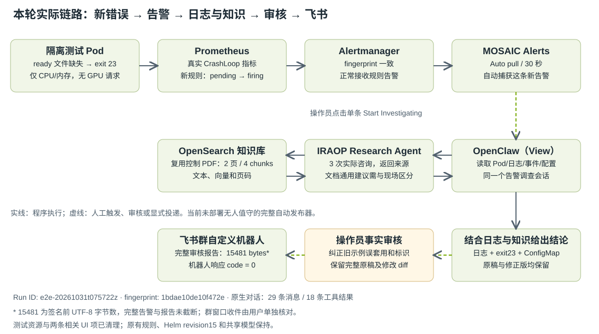

<!-- SPDX-FileCopyrightText: Copyright (c) 2026 NVIDIA CORPORATION & AFFILIATES. All rights reserved. -->
<!-- SPDX-License-Identifier: Apache-2.0 -->


# 新故障到飞书：完整链路实测与接手人操作（2026-10-31）


**这次实际新建了隔离工作负载故障，由真实CrashLoop指标触发新PrometheusRule，经Alertmanager和MOSAIC轮询进入同一调查会话；agent读取现场日志/事件/配置并调用IRAOP，审核后的完整报告已发送飞书。** 机器人API成功；本轮群窗口收件确认仍待用户回复。原始两轮研究有事实误归因，经过操作员复核纠正；本记录同时保留错误、补充查询和完整修改diff，不能将其写成无人值守验收通过。


Run ID：`e2e-20261031t075722z`；主fingerprint：`1bdae10de10f472e`。此前飞书报告`feishu-continued-validation-20261031T071049Z`的用户确认属于另一条报告，不能复用作本轮收件确认。


本文为给接手人的公开脱敏版。真实主机/账号/维护人和凭据取用位置通过内部连接资料交付。全部选定字段、行、样本、原始回答与失败原件均有完整附件；未公开的无关告警/镜像/会话清单和带内网身份的UI截图/DOM保留在内部包。[完整文件/哈希/脱敏清单](examples/alert-feishu/e2e-evidence-20261031/manifest.json)记录每个原件与公开版本的字节数和SHA256。





## 1. 实际做成的事情与边界


| 环节 | 实际结果 | 完整证据 |

| --- | --- | --- |

| 隔离错误 | 新Pod因/fixture/ready缺失而exit23；只申请CPU/内存，无GPU资源请求 | [isolated-error-fixture.applied-input.json](examples/alert-feishu/e2e-evidence-20261031/isolated-error-fixture.applied-input.json) |

| 规则发现与执行 | 真实新规则已加载，health=ok；采样记录pending和firing | [prometheus-loaded-test-group.json](examples/alert-feishu/e2e-evidence-20261031/prometheus-loaded-test-group.json)；[chain-samples.jsonl](examples/alert-feishu/e2e-evidence-20261031/chain-samples.jsonl) |

| Alertmanager→MOSAIC | 同run_id、Pod UID和fingerprint关联，MOSAIC自动轮询30秒 | [first-mosaic-alert.json](examples/alert-feishu/e2e-evidence-20261031/first-mosaic-alert.json)；[e2e-verification.json](examples/alert-feishu/e2e-evidence-20261031/e2e-verification.json) |

| 只读调查 | 点击单条Start Investigating后agent自行采集并调用IRAOP；后续同会话补充取证 | [browser/posts.json](examples/alert-feishu/e2e-evidence-20261031/browser/posts.json)；[browser/initial-history-gateway.json](examples/alert-feishu/e2e-evidence-20261031/browser/initial-history-gateway.json) |

| 现场采集 | 13次run_kubectl：12次成功，1次get --timeout参数错误；全部请求和输出保留 | [native/tool-index.json](examples/alert-feishu/e2e-evidence-20261031/native/tool-index.json) |

| 知识调用 | 3次实际iraop_query，每次2个来源；日志先返回，才提交首个研究问题 | [research/iraop-response-1.json](examples/alert-feishu/e2e-evidence-20261031/research/iraop-response-1.json)；[research/iraop-response-2.json](examples/alert-feishu/e2e-evidence-20261031/research/iraop-response-2.json)；[research/iraop-response-3.json](examples/alert-feishu/e2e-evidence-20261031/research/iraop-response-3.json) |

| 研究内容质量 | 前两次错误地把当前实现归因PDF/套用旧注入方法；第三次限定文档通用指令后分开 | [knowledge-grounding-check.json](examples/alert-feishu/e2e-evidence-20261031/knowledge-grounding-check.json) |

| 完整报告审核 | 原始模型全文、完整操作员修改diff和完整发送版都保留 | [review-api/model-corrected-report.zh-CN.txt](examples/alert-feishu/e2e-evidence-20261031/review-api/model-corrected-report.zh-CN.txt)；[analysis-review.full.diff](examples/alert-feishu/e2e-evidence-20261031/analysis-review.full.diff)；[analysis-reviewed.zh-CN.txt](examples/alert-feishu/e2e-evidence-20261031/analysis-reviewed.zh-CN.txt) |

| 飞书发送 | 仅一次；签名前15481bytes；StatusCode=0、code=0，无截断 | [feishu-payload-reviewed.json](examples/alert-feishu/e2e-evidence-20261031/feishu-payload-reviewed.json)；[feishu-response-attempt1.json](examples/alert-feishu/e2e-evidence-20261031/feishu-response-attempt1.json) |

| 群内收件 | 机器人API成功；本轮群窗口收件确认仍待用户回复 | [feishu-send-result.json](examples/alert-feishu/e2e-evidence-20261031/feishu-send-result.json) |

| 清理 | 按原UID删除本轮4资源；旧smoke rule UID未变，源Prometheus/AM最终均0 | [cleanup-result.json](examples/alert-feishu/e2e-evidence-20261031/cleanup-result.json)；[root-final-preservation.json](examples/alert-feishu/e2e-evidence-20261031/root-final-preservation.json)；[related-final.json](examples/alert-feishu/e2e-evidence-20261031/related-final.json) |

| UI历史与访问 | 源头清理后仅Resolve本轮两条UI卡；29条消息仍可读取，访问200/401/200 | [ui-cleanup/summary.json](examples/alert-feishu/e2e-evidence-20261031/ui-cleanup/summary.json)；[ui-cleanup/retained-history-api.json](examples/alert-feishu/e2e-evidence-20261031/ui-cleanup/retained-history-api.json) |

| 共享部署 | 仍为Helm revision15、7个Pod；共享模型PID128852及StartedAt不变；root连接已关闭 | [spark-final-runtime.json](examples/alert-feishu/e2e-evidence-20261031/spark-final-runtime.json)；[root-control-closed.json](examples/alert-feishu/e2e-evidence-20261031/root-control-closed.json) |


**自动步骤：** 容器重启、指标采集、规则评估、Alertmanager接收、MOSAIC Auto pull；单条调查提交后，agent运行读取工具和IRAOP。**人工/操作员编排步骤：** 创建隔离资源、点击单条调查、补充取证与事实审核、显式调用飞书发送脚本、清理。当前没有后台无人值守的“告警→研究→审核→发布”调度器；Auto investigate本轮保持false，避免为其他既有告警启动调查。


## 2. 接手人需要拿到什么


| 交接项 | 本次现状 | 交付者需要交给接手人的内容 |

| --- | --- | --- |

| Spark访问 | 维护者自己的SSH key可用；UI沿用两层转发 | 接手人本人的SSH授权、实际地址/账号、网络/主机指纹、转发责任人；不能借用前任的私钥 |

| 目标集群管理员 | 本轮由用户单独提供root密码完成一次SSH认证，密码不保存，连接已关闭 | 可创建/清理隔离资源的管理员登录方式，或明确由谁代执行；地址/context/测试节点从内部映射取得 |

| MOSAIC UI | 已有mosaic-ui-auth Secret；界面仍可访问 | UI账号及受控密码取用授权，或指定管理员代取；公开文档不交密码值 |

| 飞书 | MOSAIC Alert Test群及自定义机器人已有，本次已投递 | 把接手人加入群，提供机器人维护人及Webhook/签名密钥的凭据库授权。维护者本机文件路径不等于接手人已有访问权 |

| Research/模型 | IRAOP/OpenSearch/CPU embedding及模型已部署，无需再注册服务或下载新模型 | 允许查询现有控制集合和读取来源PDF的权限。业务PDF与使用许可是后续独立输入 |

| 制品与证据 | 真实chart/values留在Spark保护目录，完整内网证据在内部包 | 授予接手人制品/值文件、内部证据包和长期共享位置的访问权限；公开PR单独不能代替运行修复或凭据 |


基础访问和断线恢复完整命令见[操作手册第3章](spark_alert_feishu_runbook.zh-CN.md)。本轮代码部署仍沿用fork代码PR #2的回填chart；上游[PR #86](https://github.com/NVIDIA/AI-Factory-Operations-Agent/pull/86)尚未合并，文档PR本身不安装运行修复。


## 3. 隔离故障如何创建和触发告警


本轮没有改DCGM、GPU温度/驱动、既有业务Pod或集群RBAC。显式创建下面4个带run_id的对象，Pod使用节点上已缓存的固定BusyBox digest，imagePullPolicy=Never，非root用户、只读根文件系统和ConfigMap、无ServiceAccount token。缺少ready键使启动脚本真实退出23；并非vector(1)规则或直接Alertmanager POST。


| kind | namespace | name | UID | creationTimestamp |

| --- | --- | --- | --- | --- |

| Namespace | cluster-scoped | mosaic-e2e-20261031t075722z | c49e70b7-674b-45fd-b7d7-39087b2e93e2 | 2026-10-31T08:21:41Z |

| ConfigMap | mosaic-e2e-20261031t075722z | fixture-input | 403b73e5-b19e-4276-bb0a-ff64c9dc0162 | 2026-10-31T08:21:42Z |

| Pod | mosaic-e2e-20261031t075722z | mosaic-log-fixture | 82953a81-6578-4cbe-b638-ef3de927279a | 2026-10-31T08:21:42Z |

| PrometheusRule | monitoring | mosaic-e2e-20261031t075722z | 0faf5f01-a21e-439f-b4f6-c6da8d5c219d | 2026-10-31T08:21:42Z |


实际完整创建输入（4对象，无省略）：


```json
{
  "apiVersion": "v1",
  "kind": "List",
  "items": [
    {
      "apiVersion": "v1",
      "kind": "Namespace",
      "metadata": {
        "name": "mosaic-e2e-20261031t075722z",
        "labels": {
          "mosaic_test": "true",
          "run_id": "e2e-20261031t075722z",
          "app.kubernetes.io/part-of": "mosaic-e2e-validation"
        }
      }
    },
    {
      "apiVersion": "v1",
      "kind": "ConfigMap",
      "metadata": {
        "name": "fixture-input",
        "namespace": "mosaic-e2e-20261031t075722z",
        "labels": {
          "mosaic_test": "true",
          "run_id": "e2e-20261031t075722z",
          "app.kubernetes.io/part-of": "mosaic-e2e-validation"
        }
      },
      "data": {
        "README": "Deliberately omit ready for a bounded startup-failure test. No production service is modified."
      }
    },
    {
      "apiVersion": "v1",
      "kind": "Pod",
      "metadata": {
        "name": "mosaic-log-fixture",
        "namespace": "mosaic-e2e-20261031t075722z",
        "labels": {
          "mosaic_test": "true",
          "run_id": "e2e-20261031t075722z",
          "app.kubernetes.io/part-of": "mosaic-e2e-validation"
        }
      },
      "spec": {
        "automountServiceAccountToken": false,
        "restartPolicy": "Always",
        "terminationGracePeriodSeconds": 5,
        "securityContext": {
          "runAsNonRoot": true,
          "runAsUser": 65534,
          "runAsGroup": 65534,
          "seccompProfile": {
            "type": "RuntimeDefault"
          }
        },
        "containers": [
          {
            "name": "fixture",
            "image": "docker.io/library/busybox@sha256:fd7dc98638c8e305f4dc34e979f1c0fdfdcaeb0fbf8fcff77ae834b6da3d7e6e",
            "imagePullPolicy": "Never",
            "command": [
              "/bin/sh",
              "-c",
              "printf 'timestamp=%s run_id=%s component=mosaic-log-fixture event=startup test_from=\"test from Jeff Peng\"\\n' \"$(date -u +%FT%TZ)\" \"$RUN_ID\"\nif [ ! -f /fixture/ready ]; then\n  printf 'timestamp=%s run_id=%s event=startup_failed error=REQUIRED_FILE_MISSING path=/fixture/ready exit_code=23 test_from=\"test from Jeff Peng\"\\n' \"$(date -u +%FT%TZ)\" \"$RUN_ID\"\n  exit 23\nfi\nprintf 'timestamp=%s run_id=%s event=ready\\n' \"$(date -u +%FT%TZ)\" \"$RUN_ID\"\nwhile :; do sleep 3600; done\n"
            ],
            "env": [
              {
                "name": "RUN_ID",
                "value": "e2e-20261031t075722z"
              }
            ],
            "resources": {
              "requests": {
                "cpu": "5m",
                "memory": "8Mi"
              },
              "limits": {
                "cpu": "50m",
                "memory": "32Mi"
              }
            },
            "securityContext": {
              "allowPrivilegeEscalation": false,
              "readOnlyRootFilesystem": true,
              "capabilities": {
                "drop": [
                  "ALL"
                ]
              }
            },
            "volumeMounts": [
              {
                "name": "input",
                "mountPath": "/fixture",
                "readOnly": true
              }
            ]
          }
        ],
        "volumes": [
          {
            "name": "input",
            "configMap": {
              "name": "fixture-input"
            }
          }
        ],
        "nodeSelector": {
          "kubernetes.io/hostname": "target-node-1"
        },
        "tolerations": [
          {
            "key": "node-role.kubernetes.io/control-plane",
            "operator": "Exists",
            "effect": "NoSchedule"
          }
        ]
      }
    },
    {
      "apiVersion": "monitoring.coreos.com/v1",
      "kind": "PrometheusRule",
      "metadata": {
        "name": "mosaic-e2e-20261031t075722z",
        "namespace": "monitoring",
        "labels": {
          "mosaic_test": "true",
          "run_id": "e2e-20261031t075722z",
          "app.kubernetes.io/part-of": "mosaic-e2e-validation",
          "release": "kube-prometheus-stack"
        }
      },
      "spec": {
        "groups": [
          {
            "name": "e2e-20261031t075722z",
            "interval": "10s",
            "rules": [
              {
                "alert": "MosaicInjectedWorkloadFailure",
                "expr": "max_over_time(kube_pod_container_status_waiting_reason{namespace=\"mosaic-e2e-20261031t075722z\",pod=\"mosaic-log-fixture\",container=\"fixture\",reason=\"CrashLoopBackOff\"}[2m]) > 0",
                "for": "10s",
                "labels": {
                  "severity": "warning",
                  "mosaic_test": "true",
                  "run_id": "e2e-20261031t075722z",
                  "test_namespace": "mosaic-e2e-20261031t075722z",
                  "test_pod": "mosaic-log-fixture"
                },
                "annotations": {
                  "test_from": "test from Jeff Peng",
                  "summary": "Isolated test workload repeatedly fails to start",
                  "description": "test from Jeff Peng. Run e2e-20261031t075722z. Read the actual Pod status, previous/current logs and events in mosaic-e2e-20261031t075722z; correlate with this exact alert and consult the indexed runbook. This is a bounded validation workload; no GPU fault was injected."
                }
              }
            ]
          }
        ]
      }
    }
  ]
}
```


启动脚本输出中的关键原始日志，保留原时区和UTC字段：


```text
2026-10-31T16:23:13.233886461+08:00 timestamp=2026-10-31T08:23:13Z run_id=e2e-20261031t075722z component=mosaic-log-fixture event=startup test_from="test from Jeff Peng"
2026-10-31T16:23:13.234586255+08:00 timestamp=2026-10-31T08:23:13Z run_id=e2e-20261031t075722z event=startup_failed error=REQUIRED_FILE_MISSING path=/fixture/ready exit_code=23 test_from="test from Jeff Peng"
```


Kubernetes Pod phase可为Running，同时container为CrashLoopBackOff且Ready=false；不能只看phase。瞬时waiting指标在容器短暂重启时也可能暂缺，规则的2分钟max_over_time窗口使告警持续。完整状态/事件/当前与previous日志见[root-after-injection.json](examples/alert-feishu/e2e-evidence-20261031/root-after-injection.json)、[root-before-cleanup.json](examples/alert-feishu/e2e-evidence-20261031/root-before-cleanup.json)。节点只保留了采集时可取得的容器日志文件；[all-attempt-logs.json](examples/alert-feishu/e2e-evidence-20261031/all-attempt-logs.json)记录这些文件以及筛选本Pod UID的完整kubelet JSON行，不声称已恢复被运行时清掉的每一次历史重启日志。


### 复用本轮方法时的命令


在接手人本机设置内部映射，再生成新run_id；不要重复使用本轮已清理的名字。以下模板保留全部资源字段，只替换run/node/image。FIXTURE_IMAGE须由目标管理员现场确认在指定节点缓存可用，示例digest是本轮实际使用值。


```bash
export RUN_ID="e2e-$(date -u +%Y%m%dt%H%M%Sz)"
export TARGET_CONTEXT='kubernetes-admin@kubernetes'
export TARGET_TEST_NODE_NAME='FILL_FROM_INTERNAL_MAPPING'
export FIXTURE_IMAGE='docker.io/library/busybox@sha256:fd7dc98638c8e305f4dc34e979f1c0fdfdcaeb0fbf8fcff77ae834b6da3d7e6e'
export TEST_NS="mosaic-$RUN_ID"
export EVIDENCE_DIR="$PWD/evidence-$RUN_ID"
mkdir -m 700 "$EVIDENCE_DIR"
python3 - <<'PY_TEMPLATE'
import json,os,pathlib,re
run=os.environ['RUN_ID'];assert re.fullmatch(r'e2e-[a-z0-9-]+',run)
p=pathlib.Path('docs/examples/alert-feishu/e2e-evidence-20261031/isolated-error-fixture.applied-input.json')
text=p.read_text().replace('e2e-20261031t075722z',run)
m=json.loads(text);pod=m['items'][2]
pod['spec']['nodeSelector']={'kubernetes.io/hostname':os.environ['TARGET_TEST_NODE_NAME']}
pod['spec']['containers'][0]['image']=os.environ['FIXTURE_IMAGE']
out=pathlib.Path(os.environ['EVIDENCE_DIR'])
(out/'fixture.json').write_text(json.dumps(m,indent=2)+'\n')
(out/'namespace.json').write_text(json.dumps(m['items'][0],indent=2)+'\n')
(out/'remaining.json').write_text(json.dumps({'apiVersion':'v1','kind':'List','items':m['items'][1:]},indent=2)+'\n')
PY_TEMPLATE
```


通过已授权SSH将这些无密码的JSON交给目标管理员，在其私有目录保存；管理员在目标集群执行以下命令并保存完整stdout/stderr。先核对context、节点Ready/pressure和Prometheus ruleSelector；若名字已存在，停止。首次create namespace失败时不能继续。


```bash
set -e
kubectl config current-context
kubectl --context "$TARGET_CONTEXT" get nodes -o wide
kubectl --context "$TARGET_CONTEXT" get node "$TARGET_TEST_NODE_NAME" -o json
kubectl --context "$TARGET_CONTEXT" get prometheus -n monitoring -o json
kubectl --context "$TARGET_CONTEXT" get namespace "$TEST_NS" --ignore-not-found -o json
kubectl --context "$TARGET_CONTEXT" get prometheusrule "mosaic-$RUN_ID" -n monitoring --ignore-not-found -o json
# 上面两个名字必须不存在；本轮selector要求release=kube-prometheus-stack。
kubectl --context "$TARGET_CONTEXT" create -f "$EVIDENCE_DIR/namespace.json" -o json
kubectl --context "$TARGET_CONTEXT" create --dry-run=server -f "$EVIDENCE_DIR/remaining.json" -o json
kubectl --context "$TARGET_CONTEXT" create -f "$EVIDENCE_DIR/remaining.json" -o json
kubectl --context "$TARGET_CONTEXT" get pod mosaic-log-fixture -n "$TEST_NS" -o json
kubectl --context "$TARGET_CONTEXT" get prometheusrule "mosaic-$RUN_ID" -n monitoring -o json
```


实际执行脚本及全部14次检查/创建/readback命令与stdin：[create_fixture.py](examples/alert-feishu/e2e-evidence-20261031/create_fixture.py)、[create-fixture-result.json](examples/alert-feishu/e2e-evidence-20261031/create-fixture-result.json)。这些脚本是本轮完整脱敏取证副本，含本轮路径与固定断言；接手人优先按上面变量化步骤操作，复用脚本前须替换现场映射和新run。


## 4. 从指标到MOSAIC的逐跳见证


| 阶段 | 首次采样观察时间（UTC） | 证据值 |

| --- | --- | --- |

| CrashLoop指标 | 2026-10-31T08:22:54.542782+00:00 | value=1，Pod UID=82953a81-6578-4cbe-b638-ef3de927279a |

| Prometheus pending | 2026-10-31T08:23:05.488306+00:00 | ALERTS{alertstate="pending",run_id="e2e-20261031t075722z"} |

| Prometheus firing | 2026-10-31T08:23:16.572684+00:00 | ALERTS{alertstate="firing"} |

| Alertmanager | 2026-10-31T08:23:16.593723+00:00 | fingerprint=1bdae10de10f472e |

| MOSAIC首次含该对象的采样起点 | 2026-10-31T08:23:36.895519+00:00 | Alertmanager来源、相同fingerprint/run_id/Pod UID |


时间表中的观察时刻是采样记录，不是各服务内部收包时刻；MOSAIC对象createdAt与来源startsAt相同，本轮不据此推算网络延迟。完整105条样本含全部查询、series labels/数值、选定告警和失败信息，见[chain-samples.jsonl](examples/alert-feishu/e2e-evidence-20261031/chain-samples.jsonl)。公开副本仅剔除无关告警，逐样本保留原总数与选定数，原始全量响应保留内部。


在监控可达的终端执行，逐次保存完整JSON；Prom/AM经Spark访问或用手册中的独立转发。


```bash
curl -fsS -G "$PROM_URL/api/v1/query" --data-urlencode "query=ALERTS{run_id=\"$RUN_ID\"}"
curl -fsS -G "$AM_URL/api/v2/alerts" --data-urlencode "filter=run_id=\"$RUN_ID\""
curl -fsS -u "$MOSAIC_USER" "$MOSAIC_URL/api/alerts/alertmanager"
curl -fsS -u "$MOSAIC_USER" "$MOSAIC_URL/api/alerts"
```


curl -u仅给用户名时会提示隐藏输入密码；不把完整Basic Auth或密码写入命令/证据。按run_id/namespace/Pod UID/fingerprint核对这条告警，不能用总数增长替代。实际采集程序：[watch_chain.py](examples/alert-feishu/e2e-evidence-20261031/watch_chain.py)。


## 5. 如何查看现场采集和研究过程


本轮界面操作为：保持Auto pull开启、Auto investigate关闭 → 找到本轮MosaicInjectedWorkloadFailure卡 → Start Investigating。默认prompt携带完整告警上下文；首轮agent自行读取Pod及日志、查询ConfigMap/事件并调用IRAOP，没有把一份手写报告冒充模型调查。第一阶段和补充阶段实际请求在[browser/posts.json](examples/alert-feishu/e2e-evidence-20261031/browser/posts.json)。


重新打开历史时：**Conversations → Alert Alertmanager 1bdae10de10f472e（sessionKey同下表）**。本轮鼠标曾被新告警toast挡住，聚焦该会话条目后按Enter成功打开，看到修正版；可展开Kubernetes Agent/AI Factory Operations Agent工具完成卡。不要为查看旧证据再次点Start Investigating，它可能启动新一轮。实际页面/DOM/截图在内部包，公开[conversations-reopen-proof.json](examples/alert-feishu/e2e-evidence-20261031/conversations-reopen-proof.json)记录选定条目、原件哈希和已通过的标题断言。


| 字段 | 完整值 |

| --- | --- |

| sessionKey | agent:default:alert-alertmanager-1bdae10de10f472e |

| sessionId | ed4679e0-f8b4-494c-852e-f63d2f9b76ab |

| 原生消息数 | 29 |

| 工具结果数 | 18 |

| 首轮秒 | 113.56239837501198 |

| 补充取证/研究秒 | 98.34070049994625 |

| 人工纠正后研究秒 | 86.42817416699836 |


需要机器可核验的过程时，从聊天API读取同sessionKey；chat.history会省略assistant toolCall详情，完整参数和持久化details应从选定原生JSONL导出。


```bash
export SESSION_KEY='agent:default:alert-alertmanager-1bdae10de10f472e'
curl -fsS -u "$MOSAIC_USER" -G "$MOSAIC_URL/api/openclaw/chat" --data-urlencode "sessionKey=$SESSION_KEY" --data-urlencode 'limit=1000'
```


本轮原生导出程序[export_native_evidence.py](examples/alert-feishu/e2e-evidence-20261031/export_native_evidence.py)只读指定sessionId。全部原生记录在[native/ed4679e0-f8b4-494c-852e-f63d2f9b76ab.jsonl](examples/alert-feishu/e2e-evidence-20261031/native/ed4679e0-f8b4-494c-852e-f63d2f9b76ab.jsonl)，逐工具完整输出在[native/tool-results.jsonl](examples/alert-feishu/e2e-evidence-20261031/native/tool-results.jsonl)；下表保留全部18条，不按工具类型合并。


| # | toolName | toolCallId | requestAt | resultAt | isError | exitCode | details缩为元数据 | originalDetailsBytesAtLeast |

| --- | --- | --- | --- | --- | --- | --- | --- | --- |

| 1 | run_kubectl | call_95f49e4b1b3440f5b44b0fd1 | 2026-10-31T08:23:40.918Z | 2026-10-31T08:23:41.892Z | False | 0 | False | 无该字段 |

| 2 | run_kubectl | call_e4b8e9037e384f98b4b2e74e | 2026-10-31T08:23:40.918Z | 2026-10-31T08:23:41.894Z | False | 0 | False | 无该字段 |

| 3 | run_kubectl | call_edadd5e0c13b46018edde9d4 | 2026-10-31T08:23:40.918Z | 2026-10-31T08:23:41.895Z | False | 0 | False | 无该字段 |

| 4 | run_kubectl | call_dd2491e6bef34164be582cca | 2026-10-31T08:23:40.918Z | 2026-10-31T08:23:41.896Z | True | 1 | False | 无该字段 |

| 5 | memory_search | call_20669143584443f3ad33e626 | 2026-10-31T08:23:40.918Z | 2026-10-31T08:23:41.897Z | False | 非进程结果 | False | 无该字段 |

| 6 | iraop_list_collections | call_b805957079994687bf9eab69 | 2026-10-31T08:23:40.918Z | 2026-10-31T08:23:41.898Z | False | 非进程结果 | False | 无该字段 |

| 7 | run_kubectl | call_ff08d966f1bb4d458fde7084 | 2026-10-31T08:23:45.783Z | 2026-10-31T08:25:19.295Z | False | 0 | False | 无该字段 |

| 8 | run_kubectl | call_7724176251464e59b136a5a8 | 2026-10-31T08:23:45.783Z | 2026-10-31T08:25:19.298Z | False | 0 | False | 无该字段 |

| 9 | iraop_query | call_f1022a1955e84f868de2e10b | 2026-10-31T08:23:45.783Z | 2026-10-31T08:25:19.300Z | False | 非进程结果 | True | 8193 |

| 10 | run_kubectl | call_3c20b34249a04614922759b9 | 2026-10-31T08:25:34.632Z | 2026-10-31T08:25:35.510Z | False | 0 | True | 8551 |

| 11 | run_kubectl | call_5ef19b1844d24b0892eab6f7 | 2026-10-31T08:25:34.632Z | 2026-10-31T08:25:35.513Z | False | 0 | False | 无该字段 |

| 12 | run_kubectl | call_ee1dab0918ef4910936741b0 | 2026-10-31T08:25:34.632Z | 2026-10-31T08:25:35.514Z | False | 0 | False | 无该字段 |

| 13 | run_kubectl | call_aaf3236af6934910aa3c3d1d | 2026-10-31T08:25:34.632Z | 2026-10-31T08:25:35.516Z | False | 0 | False | 无该字段 |

| 14 | run_kubectl | call_a3ea30a1b25b4f2bb7421a62 | 2026-10-31T08:25:34.632Z | 2026-10-31T08:25:35.518Z | False | 0 | False | 无该字段 |

| 15 | run_kubectl | call_9a514b9ae4cc433d9ec68294 | 2026-10-31T08:25:34.632Z | 2026-10-31T08:25:35.520Z | False | 0 | False | 无该字段 |

| 16 | run_kubectl | call_9ec4548521ba41a49f570485 | 2026-10-31T08:25:34.632Z | 2026-10-31T08:25:35.523Z | False | 0 | True | 8193 |

| 17 | iraop_query | call_bbc78e57c1f140f4aa85dba9 | 2026-10-31T08:25:44.414Z | 2026-10-31T08:26:33.637Z | False | 非进程结果 | True | 8193 |

| 18 | iraop_query | call_6d4b768ae3c14fe4bcd1e4c8 | 2026-10-31T08:32:34.648Z | 2026-10-31T08:33:10.043Z | False | 非进程结果 | True | 8193 |


### 第1条：call_95f49e4b1b3440f5b44b0fd1


```json
{
  "args": [
    "get",
    "pod",
    "mosaic-log-fixture",
    "-n",
    "mosaic-e2e-20261031t075722z",
    "-o",
    "yaml"
  ]
}
```


### 第2条：call_e4b8e9037e384f98b4b2e74e


```json
{
  "args": [
    "logs",
    "mosaic-log-fixture",
    "-n",
    "mosaic-e2e-20261031t075722z",
    "--previous"
  ]
}
```


### 第3条：call_edadd5e0c13b46018edde9d4


```json
{
  "args": [
    "logs",
    "mosaic-log-fixture",
    "-n",
    "mosaic-e2e-20261031t075722z"
  ]
}
```


### 第4条：call_dd2491e6bef34164be582cca


```json
{
  "args": [
    "get",
    "pod",
    "mosaic-log-fixture",
    "-n",
    "mosaic-e2e-20261031t075722z",
    "-w",
    "--watch-only",
    "--timeout=5s"
  ]
}
```


```text
error: unknown flag: --timeout
See 'kubectl get --help' for usage.
```


### 第5条：call_20669143584443f3ad33e626


```json
{
  "query": "MosaicInjectedWorkloadFailure runbook e2e test failure"
}
```


### 第6条：call_b805957079994687bf9eab69


```json
{}
```


### 第7条：call_ff08d966f1bb4d458fde7084


```json
{
  "args": [
    "get",
    "events",
    "-n",
    "mosaic-e2e-20261031t075722z",
    "--field-selector",
    "reason=BackOff",
    "--sort-by=.lastTimestamp"
  ]
}
```


### 第8条：call_7724176251464e59b136a5a8


```json
{
  "args": [
    "get",
    "configmap",
    "fixture-input",
    "-n",
    "mosaic-e2e-20261031t075722z",
    "-o",
    "yaml"
  ]
}
```


### 第9条：call_f1022a1955e84f868de2e10b


```json
{
  "question": "MosaicInjectedWorkloadFailure runbook — what causes a log-fixture pod to exit 23 with REQUIRED_FILE_MISSING error on /fixture/ready, and how to remediate?"
}
```


### 第10条：call_3c20b34249a04614922759b9


```json
{
  "args": [
    "get",
    "pod",
    "mosaic-log-fixture",
    "-n",
    "mosaic-e2e-20261031t075722z",
    "-o",
    "json"
  ]
}
```


### 第11条：call_5ef19b1844d24b0892eab6f7


```json
{
  "args": [
    "describe",
    "pod",
    "mosaic-log-fixture",
    "-n",
    "mosaic-e2e-20261031t075722z"
  ]
}
```


### 第12条：call_ee1dab0918ef4910936741b0


```json
{
  "args": [
    "logs",
    "mosaic-log-fixture",
    "-c",
    "fixture",
    "-n",
    "mosaic-e2e-20261031t075722z",
    "--previous",
    "--timestamps"
  ]
}
```


### 第13条：call_aaf3236af6934910aa3c3d1d


```json
{
  "args": [
    "logs",
    "mosaic-log-fixture",
    "-c",
    "fixture",
    "-n",
    "mosaic-e2e-20261031t075722z",
    "--timestamps"
  ]
}
```


### 第14条：call_a3ea30a1b25b4f2bb7421a62


```json
{
  "args": [
    "get",
    "events",
    "-n",
    "mosaic-e2e-20261031t075722z",
    "-o",
    "json"
  ]
}
```


### 第15条：call_9a514b9ae4cc433d9ec68294


```json
{
  "args": [
    "get",
    "configmap",
    "fixture-input",
    "-n",
    "mosaic-e2e-20261031t075722z",
    "-o",
    "json"
  ]
}
```


### 第16条：call_9ec4548521ba41a49f570485


```json
{
  "args": [
    "get",
    "node",
    "target-node-1",
    "-o",
    "json"
  ]
}
```


### 第17条：call_bbc78e57c1f140f4aa85dba9


```json
{
  "question": "Pod \"mosaic-log-fixture\" in namespace \"mosaic-e2e-20261031t075722z\", container \"fixture\", exits with exit code 23 and error \"REQUIRED_FILE_MISSING\" at path \"/fixture/ready\". The ConfigMap \"fixture-input\" has only a README key (value: \"Deliberately omit ready for a bounded startup-failure test. No production service is modified.\"). The pod spec mounts this ConfigMap read-only at /fixture. The startup script checks: if [ ! -f /fixture/ready ]; then exit 23. This pod is a MOSAIC e2e validation test (run_id=e2e-20261031t075722z). According to mosaic-validation-control.pdf (MOSAIC-KB-20261031), what is the applicable diagnostic procedure for this error? What are the read-only investigation limits for this scenario? Distinguish between generic runbook advice and direct evidence specific to this Pod.",
  "depth": "quick",
  "collections": [
    "mosaic-validation-20261031"
  ]
}
```


### 第18条：call_6d4b768ae3c14fe4bcd1e4c8


```json
{
  "collections": [
    "mosaic-validation-20261031"
  ],
  "depth": "quick",
  "question": "In mosaic-validation-control.pdf (MOSAIC-KB-20261031), retrieve the exact general instructions about: (a) reading service state and logs before repair, (b) automatic alert investigations being read-only, and (c) required completion evidence (e.g. what items must be recorded). Cite the exact file name, section headings, and page numbers. Also note any older examples the PDF discusses (such as vector(1) alert injection or direct Alertmanager posting) — explicitly label those as different examples that are not the current live Kubernetes Pod case. Do NOT attempt to diagnose any specific live Pod; the current live case is a separate Kubernetes example with a Pod named \"mosaic-log-fixture\" in namespace \"mosaic-e2e-20261031t075722z\" that exits with code 23."
}
```


全部返回content与实际可取得details都在上述JSONL/tool-index中。**5条大details由OpenClaw持久化层缩成元数据**，表中8193/8551等是记录的下界，不能当精确原长度；可见content全文保留。本轮没有抓取完整未裁剪MCP wire envelope或IRAOP内部每一步模型推理。普通session/tool完成消息也不能冒充独立子代理实时进度。


## 6. IRAOP真的参与了什么，哪些回答不正确


OpenSearch是文档/向量检索后端，IRAOP是Research应用；本轮复用先前2页/4chunks控制PDF，没有另行入库。首轮研究参数包含日志读回的REQUIRED_FILE_MISSING、exit23和路径，调用时间在日志结果之后，证明这次确实把现场现象交给了研究工具。完整3次请求、答案和全部来源逐份保留：


### IRAOP第1次


```json
{
  "question": "MosaicInjectedWorkloadFailure runbook — what causes a log-fixture pod to exit 23 with REQUIRED_FILE_MISSING error on /fixture/ready, and how to remediate?"
}
```


| source_file | page_number | collection | doc_id | url |

| --- | --- | --- | --- | --- |

| mosaic-validation-control.pdf | 2 | mosaic-validation-20261031 | mosaic-validation-control.pdf | /api/v1/documents/mosaic-validation-control.pdf |

| mosaic-validation-control.pdf | 1 | mosaic-validation-20261031 | mosaic-validation-control.pdf | /api/v1/documents/mosaic-validation-control.pdf |


[完整原始answer、全部字段及来源](examples/alert-feishu/e2e-evidence-20261031/research/iraop-response-1.json)。


### IRAOP第2次


```json
{
  "question": "Pod \"mosaic-log-fixture\" in namespace \"mosaic-e2e-20261031t075722z\", container \"fixture\", exits with exit code 23 and error \"REQUIRED_FILE_MISSING\" at path \"/fixture/ready\". The ConfigMap \"fixture-input\" has only a README key (value: \"Deliberately omit ready for a bounded startup-failure test. No production service is modified.\"). The pod spec mounts this ConfigMap read-only at /fixture. The startup script checks: if [ ! -f /fixture/ready ]; then exit 23. This pod is a MOSAIC e2e validation test (run_id=e2e-20261031t075722z). According to mosaic-validation-control.pdf (MOSAIC-KB-20261031), what is the applicable diagnostic procedure for this error? What are the read-only investigation limits for this scenario? Distinguish between generic runbook advice and direct evidence specific to this Pod.",
  "depth": "quick",
  "collections": [
    "mosaic-validation-20261031"
  ]
}
```


| source_file | page_number | collection | doc_id | url |

| --- | --- | --- | --- | --- |

| mosaic-validation-control.pdf | 1 | mosaic-validation-20261031 | mosaic-validation-control.pdf | /api/v1/documents/mosaic-validation-control.pdf |

| mosaic-validation-control.pdf | 2 | mosaic-validation-20261031 | mosaic-validation-control.pdf | /api/v1/documents/mosaic-validation-control.pdf |


[完整原始answer、全部字段及来源](examples/alert-feishu/e2e-evidence-20261031/research/iraop-response-2.json)。


### IRAOP第3次


```json
{
  "collections": [
    "mosaic-validation-20261031"
  ],
  "depth": "quick",
  "question": "In mosaic-validation-control.pdf (MOSAIC-KB-20261031), retrieve the exact general instructions about: (a) reading service state and logs before repair, (b) automatic alert investigations being read-only, and (c) required completion evidence (e.g. what items must be recorded). Cite the exact file name, section headings, and page numbers. Also note any older examples the PDF discusses (such as vector(1) alert injection or direct Alertmanager posting) — explicitly label those as different examples that are not the current live Kubernetes Pod case. Do NOT attempt to diagnose any specific live Pod; the current live case is a separate Kubernetes example with a Pod named \"mosaic-log-fixture\" in namespace \"mosaic-e2e-20261031t075722z\" that exits with code 23."
}
```


| source_file | page_number | collection | doc_id | url |

| --- | --- | --- | --- | --- |

| mosaic-validation-control.pdf | 2 | mosaic-validation-20261031 | mosaic-validation-control.pdf | /api/v1/documents/mosaic-validation-control.pdf |

| mosaic-validation-control.pdf | 1 | mosaic-validation-20261031 | mosaic-validation-control.pdf | /api/v1/documents/mosaic-validation-control.pdf |


[完整原始answer、全部字段及来源](examples/alert-feishu/e2e-evidence-20261031/research/iraop-response-3.json)。


| 被声称来自PDF的具体内容 | 实际索引文本出现次数 |

| --- | --- |

| mosaic-log-fixture | 0 |

| fixture-input | 0 |

| REQUIRED_FILE_MISSING | 0 |

| /fixture/ready | 0 |

| e2e-20261031t075722z | 0 |

| vector(1) | 1 |

| Alertmanager API | 1 |


前两次回答将输入问题中的Pod/ConfigMap/错误/路径说成PDF记载，并把本轮真实规则错说成vector(1)/直接AM注入。来源存在不等于每个结论被来源支持。[knowledge-grounding-check.json](examples/alert-feishu/e2e-evidence-20261031/knowledge-grounding-check.json)包含全部4个原文chunk，[mosaic-validation-control.pdf](examples/alert-feishu/e2e-evidence-20261031/mosaic-validation-control.pdf)为同SHA256的完整源PDF；向量全部坐标保留在[先前完整向量证据](examples/alert-feishu/continued-evidence-20261031/vector-storage-proof.json)。第三次限定只问文档通用指令，才将旧例子与当前故障分开。


本轮正确的归因来自当前日志+Pod终止状态+ConfigMap/只读挂载+启动脚本：缺少ready → 检查失败 → exit23 → 重启/CrashLoop → 指标规则触发。PDF提供的是读取日志、只读调查及完成证据要求。当前控制语料验证不能代替客户业务知识库/复杂deep研究质量验收。


另外保留并纠正：Pod UID不是告警UID，sessionId不是sessionKey；只读ConfigMap内touch不适用；当前Kubernetes写后端关闭，选择Edit/Auto不能授予patch权限；节点条件不能证明全面GPU健康。模型原稿[review-api/model-corrected-report.zh-CN.txt](examples/alert-feishu/e2e-evidence-20261031/review-api/model-corrected-report.zh-CN.txt)、完整审阅修改[analysis-review.full.diff](examples/alert-feishu/e2e-evidence-20261031/analysis-review.full.diff)和完整发送报告[analysis-reviewed.zh-CN.txt](examples/alert-feishu/e2e-evidence-20261031/analysis-reviewed.zh-CN.txt)均保留，未覆盖原件。


## 7. 飞书投递及窗口验收


本次使用既有MOSAIC Alert Test群自定义机器人；未安装原生双向飞书通道。凭据通过受保护文件在内存读取，只保存取用引用，不进入Git/截图/日志。本次仅发送一次，签名前15481bytes。完整payload含完整脱敏告警、完整审阅报告与18条工具索引，没有截断。


```json
{
  "StatusCode": 0,
  "StatusMessage": "success",
  "code": 0,
  "data": {},
  "msg": "success"
}
```


```json
{
  "at": "2026-10-31T08:36:54.952359+00:00",
  "group": "MOSAIC Alert Test",
  "runId": "e2e-20261031t075722z",
  "botApiAccepted": true,
  "groupReceiptConfirmed": false,
  "completeResponseFile": "feishu-response-attempt1.json",
  "credentialValuesSaved": false
}
```


完整[feishu-payload-reviewed.json](examples/alert-feishu/e2e-evidence-20261031/feishu-payload-reviewed.json)、[feishu-send-attempt1-started.json](examples/alert-feishu/e2e-evidence-20261031/feishu-send-attempt1-started.json)、[feishu-send-attempt1.log](examples/alert-feishu/e2e-evidence-20261031/feishu-send-attempt1.log)。prepared-not-sent元数据是发送前历史快照，最终状态以send-result及用户确认文件为准。接手人到群里核对test from Jeff Peng、Run ID e2e-20261031t075722z、fingerprint1bdae10de10f472e和末尾18条索引；若未见，先查业务code/群与bot身份，不盲目重复发送。


## 8. 清理、关联告警与历史保存


本轮还触发了既有KubePodCrashLooping规则，相关告警完整列出，未改既有规则。[相关原规则的完整字段](examples/alert-feishu/e2e-evidence-20261031/prometheus-baseline-selected-rules.json)与旧smoke规则一并保留，其他无关规则/告警原件留内部。新规则删除后自身firing先消失，Alertmanager在endsAt到期后退出；既有规则按自身时间窗口消退，最后两类源告警都为0。


| alertname | fingerprint | MOSAIC id | namespace | pod |

| --- | --- | --- | --- | --- |

| MosaicInjectedWorkloadFailure | 1bdae10de10f472e | alertmanager:1bdae10de10f472e | mosaic-e2e-20261031t075722z | mosaic-log-fixture |

| KubePodCrashLooping | b2ee16df078aed62 | alertmanager:b2ee16df078aed62 | mosaic-e2e-20261031t075722z | mosaic-log-fixture |


清理脚本[cleanup_fixture.py](examples/alert-feishu/e2e-evidence-20261031/cleanup_fixture.py)先检查4个原始UID/run_id，只删除本轮对象。完整12条命令/readback均在[cleanup-result.json](examples/alert-feishu/e2e-evidence-20261031/cleanup-result.json)：


| # | UTC | argv | exitCode |

| --- | --- | --- | --- |

| 1 | 2026-10-31T08:37:47.333617+00:00 | kubectl --context kubernetes-admin@kubernetes get namespace mosaic-e2e-20261031t075722z -o json | 0 |

| 2 | 2026-10-31T08:37:47.378796+00:00 | kubectl --context kubernetes-admin@kubernetes get configmap fixture-input -n mosaic-e2e-20261031t075722z -o json | 0 |

| 3 | 2026-10-31T08:37:47.424673+00:00 | kubectl --context kubernetes-admin@kubernetes get pod mosaic-log-fixture -n mosaic-e2e-20261031t075722z -o json | 0 |

| 4 | 2026-10-31T08:37:47.469768+00:00 | kubectl --context kubernetes-admin@kubernetes get prometheusrule mosaic-e2e-20261031t075722z -n monitoring -o json | 0 |

| 5 | 2026-10-31T08:37:47.517982+00:00 | kubectl --context kubernetes-admin@kubernetes delete prometheusrule mosaic-e2e-20261031t075722z -n monitoring --wait=true --timeout=60s | 0 |

| 6 | 2026-10-31T08:37:48.095836+00:00 | kubectl --context kubernetes-admin@kubernetes delete pod mosaic-log-fixture -n mosaic-e2e-20261031t075722z --wait=true --timeout=60s | 0 |

| 7 | 2026-10-31T08:37:48.147215+00:00 | kubectl --context kubernetes-admin@kubernetes delete configmap fixture-input -n mosaic-e2e-20261031t075722z --wait=true --timeout=60s | 0 |

| 8 | 2026-10-31T08:37:53.425298+00:00 | kubectl --context kubernetes-admin@kubernetes delete namespace mosaic-e2e-20261031t075722z --wait=true --timeout=60s | 0 |

| 9 | 2026-10-31T08:37:53.470854+00:00 | kubectl --context kubernetes-admin@kubernetes get namespace mosaic-e2e-20261031t075722z --ignore-not-found -o json | 0 |

| 10 | 2026-10-31T08:37:53.515111+00:00 | kubectl --context kubernetes-admin@kubernetes get configmap fixture-input -n mosaic-e2e-20261031t075722z --ignore-not-found -o json | 0 |

| 11 | 2026-10-31T08:37:53.560922+00:00 | kubectl --context kubernetes-admin@kubernetes get pod mosaic-log-fixture -n mosaic-e2e-20261031t075722z --ignore-not-found -o json | 0 |

| 12 | 2026-10-31T08:37:53.604591+00:00 | kubectl --context kubernetes-admin@kubernetes get prometheusrule mosaic-e2e-20261031t075722z -n monitoring --ignore-not-found -o json | 0 |


源头全部清理后才对这两条UI卡点Resolve，页面中本轮相关项为0，29条对话仍可由Conversations/API查看。Resolve仅处理UI项，不代替源头清理或故障修复。本轮UI记录器保留DELETE /api/alerts的method/path而未记录query字符串；精确对象通过操作前ID/命名空间筛选和操作后结果确认，这项观测限制不补造为线级请求。[ui-cleanup/before.json](examples/alert-feishu/e2e-evidence-20261031/ui-cleanup/before.json)、[ui-cleanup/posts.json](examples/alert-feishu/e2e-evidence-20261031/ui-cleanup/posts.json)、[ui-cleanup/after.json](examples/alert-feishu/e2e-evidence-20261031/ui-cleanup/after.json)和[ui-cleanup/retained-history-api.json](examples/alert-feishu/e2e-evidence-20261031/ui-cleanup/retained-history-api.json)保留全过程。


新一轮接手人清理同样先核对自己创建对象的UID和run_id，删除仅新建规则/Pod/ConfigMap/namespace，并等待源Prometheus/Alertmanager消退；不要删除此前mosaic-alert-smoke-test，也不要先Resolve页面却留下源规则。


## 9. 失败、限制和下一步改进


| 问题 | 实际影响 | 证据/处理 |

| --- | --- | --- |

| kubectl get --timeout=5s | 1条只读工具失败；不能写成18条全部成功 | [native/tool-index.json](examples/alert-feishu/e2e-evidence-20261031/native/tool-index.json)；后续用一次性get/限定次数轮询 |

| 新浏览器没有Open Chat按钮 | 人工复核首次UI尝试0提交，未重启调查 | [browser-review.log](examples/alert-feishu/e2e-evidence-20261031/browser-review.log)；[review/posts.json](examples/alert-feishu/e2e-evidence-20261031/review/posts.json) |

| Spark新SSH连接超时 | 第一次补充API复核0提交，恢复ControlMaster后重试成功 | [review-native-api-attempt1.log](examples/alert-feishu/e2e-evidence-20261031/review-native-api-attempt1.log)；[review-native-api-attempt2.log](examples/alert-feishu/e2e-evidence-20261031/review-native-api-attempt2.log) |

| 会话条目被toast遮挡 | 鼠标打开失败，改聚焦条目+Enter成功；无新模型调用 | [reopened-session.log](examples/alert-feishu/e2e-evidence-20261031/reopened-session.log)；[conversations-reopen-proof.json](examples/alert-feishu/e2e-evidence-20261031/conversations-reopen-proof.json) |

| 研究事实误归因 | 2份有来源回答仍误用旧案例；需要事实审核/限制引用归属 | [knowledge-grounding-check.json](examples/alert-feishu/e2e-evidence-20261031/knowledge-grounding-check.json)及3份完整research响应 |

| 大details持久化裁剪 | 5条仅保留元数据；content完整可取，但不能宣称全部wire细节 | [native/tool-index.json](examples/alert-feishu/e2e-evidence-20261031/native/tool-index.json) |

| 自动化范围 | 需要单条调查触发、审核和显式投递；未验无人值守服务 | [browser/posts.json](examples/alert-feishu/e2e-evidence-20261031/browser/posts.json)；[send_reviewed_feishu_once.py](examples/alert-feishu/e2e-evidence-20261031/send_reviewed_feishu_once.py) |


建议下一步为服务器侧告警订阅/工作流、明确现场事实与文档证据的来源归属、发布前核验规则/UID/权限、实际业务PDF验证，以及按会话保存必要的原始MCP响应。Research生成质量问题属于后续工作，不把上游PR #86的无来源/工具协议修复描述成已解决这些问题。


完整[证据清单](examples/alert-feishu/e2e-evidence-20261031/manifest.json)同时列出每个公开附件的原始/公开字节与SHA256，以及内部原件元数据。原始截图、完整无关告警与私有身份只在内部包交付给获准接手人。
