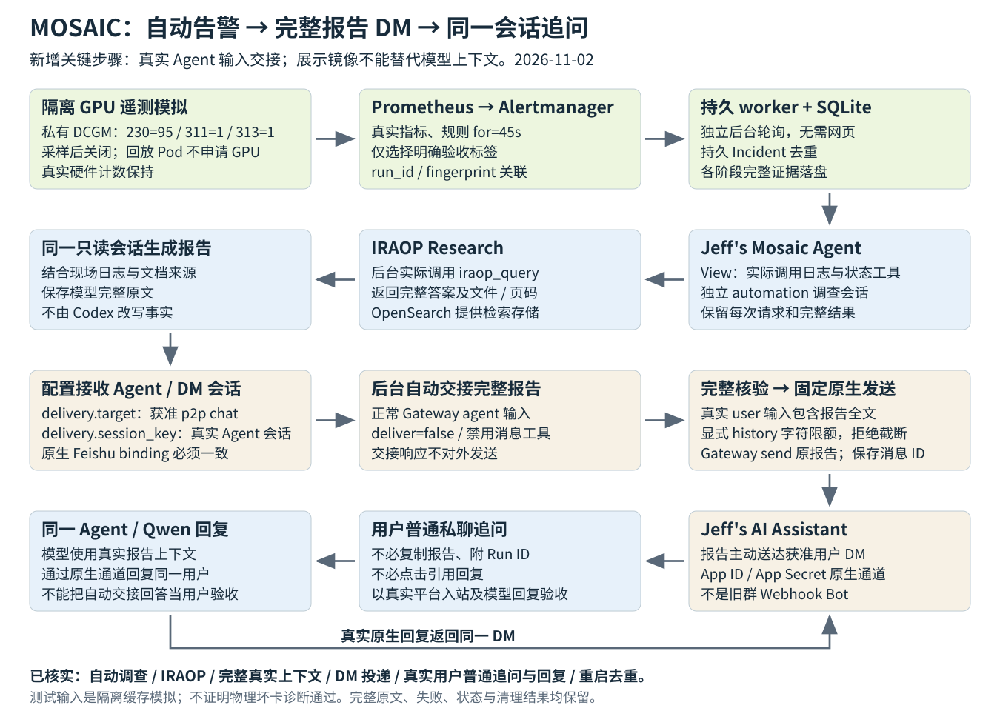

<!-- SPDX-FileCopyrightText: Copyright (c) 2026 NVIDIA CORPORATION & AFFILIATES. All rights reserved. -->
<!-- SPDX-License-Identifier: Apache-2.0 -->

# Spark 飞书 DM 报告上下文修复与自动链路验收（2026-11-02）

主动消息送到飞书，并不代表后续 Qwen 推理能看到报告。此次修复在后台发布前，先通过正常 Agent 接口把完整报告交给同一个用户的真实 DM 会话，核验完整输入记录，再原样投递。收件人不用复制报告、附 Run ID 或点击“引用回复”。

本轮调查、IRAOP、上下文交接、发送均由 Spark 持久服务自行执行。Codex 在运行验收中只创建/清理隔离测试、读取证据，没有代发调查 prompt、Research、上下文或报告，也没有替用户追问或改写模型事实。代码开发期间另有明确标记的隔离双轮组件探测，不能替代真实用户验收。

**当前真实追问状态：** 已读取到实际用户入站及后续模型回复；完整平台/会话记录见下文。


## 1. 故障原因与修复结构



完整 Mermaid 图描述（保留为文本，便于支持 Mermaid 的工具复用）：

```text
flowchart TD
  A[私有 DCGM 缓存模拟 / CPU-only 回放 Pod] --> B[Prometheus 真实规则 / Alertmanager]
  B --> C[持久 worker / SQLite]
  C --> D[View 调查会话 / 真实日志工具]
  D --> E[实际 IRAOP / 文档与页码]
  E --> F[同一只读调查会话生成完整报告]
  F --> G[delivery.session_key 指定接收 Agent 的 DM 会话]
  G --> H[正常 Gateway agent 输入完整报告 / deliver=false]
  H --> I[读回完整真实 user 输入 / 排除展示镜像]
  I --> J[固定目标 Gateway send / 原报告不变]
  J --> K[Jeff's AI Assistant / 用户 DM]
  K --> L[真实用户普通追问]
  L --> M[原生 Feishu binding / 同一 Agent 与会话]
  M --> N[Qwen 读取报告上下文并回复 / 原生通道投递]
```

OpenClaw 2026.6.10 的 `delivery-mirror` 和 `gateway-injected` 是展示/记录用途，单独出现不构成可供模型回放的输入。修复没有采用 `chat.inject`，没有直接修改 transcript，也没有用人工摘要替换报告。`chat.history` 默认只展示 8,000 字符；本轮显式请求足够字符，拒绝截断或错误会话的记录。

一次性 Gateway 发布身份还需要 `operator.read` 与 `operator.write`。授权由 Spark 管理者在部署阶段完成，此后每次告警不需要人工审批。本轮使用 OpenClaw CLI 自身的本机恢复 helper，最终只授予读写，没有授予 publisher `operator.admin`/`operator.pairing`，其他 device 记录保持。完整原始审批步骤结果：

[diagnosis/publisher-scope-recovery-attempt2.json](examples/alert-feishu/dm-context-evidence-20261102/diagnosis/publisher-scope-recovery-attempt2.json)。

## 2. 全部历史尝试与账本


| Incident | Run ID | 调查/发布状态 | 平台 message_id | 错误类型 | resolved_at | ui_cleared_at |
| --- | --- | --- | --- | --- | --- | --- |
| 7ed674ba17c49a037fe3e651 | bg-gpu-20261102t005029z | needs_attention | None | ValueError | 2026-11-02T01:10:02Z | 2026-11-02T01:10:02Z |
| df5310a8ede1f42b14c421ec | bg-gpu-20261102t005029z | needs_attention | None | ValueError | 2026-11-02T01:20:02Z | 2026-11-02T01:20:02Z |
| 2803c2516df6ec7c3eed3f2f | bg-gpu-20261102t005029z | sent | om_x100b614a1e1294acdd7edd5c26d5db6 | None | 2026-11-02T01:23:52Z | 2026-11-02T01:23:52Z |
| 828bd358db0367b7497479b3 | dm-gpu-20261102t072211z | sent | om_x100b61b7ff0548b4c0e6162761e5cd5 | None | 2026-11-02T07:35:41Z | 2026-11-02T07:35:41Z |
| 04877ab39d895ba2ca39b31d | dm-gpu-20261102t074202z | sent | om_x100b61b7b38da0a4de0c7f1c0513b24 | None | None | None |
| d6744ea94383791092be4bba | ctx-gpu-20261102t080454z | delivery_unknown | None | RuntimeError | None | None |
| 703e20f33e3d9c2654404061 | autoctx-gpu-20261102t082721z | delivery_unknown | None | RuntimeError | None | None |
| 3b0084bf90af7f0901912918 | handoff-gpu-20261102t085400z | sent | om_x100b61b14468f570dd6b4d1203771ad | None | 2026-11-02T09:05:03Z | 2026-11-02T09:05:03Z |

表格用于定位；**全部原始列、原始 alert_json、所有 meta/incidents/events 行均保留**于 [worker/ledger.json](examples/alert-feishu/dm-context-evidence-20261102/worker/ledger.json)，没有把失败行改成成功。两次旧 CLI DM 已发送但无上下文；第一次 Gateway 候选被读写 scope 阻塞；获授权后的展示镜像候选虽送达，仍不能支持模型追问，还暴露历史显示截断问题。最终使用新的 Incident 重测，不重放这些模糊投递。

本轮全部阶段转换：

| sequence | incident_id | at | state | 完整 detail_json |
| --- | --- | --- | --- | --- |
| 36 | 3b0084bf90af7f0901912918 | 2026-11-02T08:55:52Z | collecting | {} |
| 37 | 3b0084bf90af7f0901912918 | 2026-11-02T08:56:16Z | researching | {} |
| 38 | 3b0084bf90af7f0901912918 | 2026-11-02T08:57:02Z | synthesizing | {} |
| 39 | 3b0084bf90af7f0901912918 | 2026-11-02T08:57:57Z | ready | {} |
| 40 | 3b0084bf90af7f0901912918 | 2026-11-02T08:57:57Z | sending | {} |
| 41 | 3b0084bf90af7f0901912918 | 2026-11-02T08:58:19Z | sent | {"message_id": "om_x100b61b14468f570dd6b4d1203771ad"} |


## 3. 实际注入、全部命令与现场结果

本轮仍是独立缓存 GPU 遥测模拟：GPU 0 的 `230=95`、`311=1`、`313=1`，不是物理坏卡，也不是 CPU Pod 退出实验。生产 DCGM 只读，8 张真实 GPU 的 ECC/remap 全部前后一致；测试引擎采样后关闭。全量 nvidia-smi XML、全部 GPU 数值/分布、dmesg 原文、警告、退出码都在 [run/gpu-signal-attempt2.json](examples/alert-feishu/dm-context-evidence-20261102/run/gpu-signal-attempt2.json.gz)。

全部实际采样命令（stdout/stderr 完整保存在同一原件）：

| 序号 | at | 完整 argv | exitCode | elapsedSeconds |
| --- | --- | --- | --- | --- |
| 1 | 2026-11-02T08:54:02.460817+00:00 | `["hostname"]` | 0 | 0.0007652901113033295 |
| 2 | 2026-11-02T08:54:02.538507+00:00 | `["nvidia-smi", "--query-compute-apps=pid,gpu_uuid,process_name,used_gpu_memory", "--format=csv,noheader"]` | 0 | 0.07765583321452141 |
| 3 | 2026-11-02T08:54:03.558132+00:00 | `["dcgmi", "dmon", "--host", "127.0.0.1:5555", "-i", "0", "-e", "230,311,313", "-c", "2"]` | 0 | 1.0196320824325085 |
| 4 | 2026-11-02T08:54:06.399900+00:00 | `["nvidia-smi", "-q", "-x"]` | 0 | 2.841768801212311 |
| 5 | 2026-11-02T08:54:06.704715+00:00 | `["dcgmi", "discovery", "--host", "unix:///var/tmp/mosaic-handoff-gpu-20261102t085400z/engine.sock", "-l"]` | 223 | 0.045496195554733276 |
| 6 | 2026-11-02T08:54:07.723553+00:00 | `["dcgmi", "dmon", "--host", "unix:///var/tmp/mosaic-handoff-gpu-20261102t085400z/engine.sock", "-i", "0", "-e", "230,311,313", "-c", "2"]` | 0 | 1.018835175782442 |
| 7 | 2026-11-02T08:54:07.726831+00:00 | `["dcgmi", "test", "--host", "unix:///var/tmp/mosaic-handoff-gpu-20261102t085400z/engine.sock", "--inject", "--gpuid", "0", "-f", "230", "-v", "95", "--offset", "60"]` | 0 | 0.0032533854246139526 |
| 8 | 2026-11-02T08:54:07.729732+00:00 | `["dcgmi", "test", "--host", "unix:///var/tmp/mosaic-handoff-gpu-20261102t085400z/engine.sock", "--inject", "--gpuid", "0", "-f", "311", "-v", "1", "--offset", "60"]` | 0 | 0.0028978772461414337 |
| 9 | 2026-11-02T08:54:07.732477+00:00 | `["dcgmi", "test", "--host", "unix:///var/tmp/mosaic-handoff-gpu-20261102t085400z/engine.sock", "--inject", "--gpuid", "0", "-f", "313", "-v", "1", "--offset", "60"]` | 0 | 0.0027416162192821503 |
| 10 | 2026-11-02T08:54:07.735341+00:00 | `["dcgmi", "test", "--host", "unix:///var/tmp/mosaic-handoff-gpu-20261102t085400z/engine.sock", "--introspect", "--gpuid", "0", "-f", "230"]` | 0 | 0.0028623677790164948 |
| 11 | 2026-11-02T08:54:07.738267+00:00 | `["dcgmi", "test", "--host", "unix:///var/tmp/mosaic-handoff-gpu-20261102t085400z/engine.sock", "--introspect", "--gpuid", "0", "-f", "311"]` | 0 | 0.0029344595968723297 |
| 12 | 2026-11-02T08:54:07.741154+00:00 | `["dcgmi", "test", "--host", "unix:///var/tmp/mosaic-handoff-gpu-20261102t085400z/engine.sock", "--introspect", "--gpuid", "0", "-f", "313"]` | 0 | 0.0028799884021282196 |
| 13 | 2026-11-02T08:54:09.760645+00:00 | `["dcgmi", "dmon", "--host", "unix:///var/tmp/mosaic-handoff-gpu-20261102t085400z/engine.sock", "-i", "0", "-e", "230,311,313", "-c", "3"]` | 0 | 2.0195000544190407 |
| 14 | 2026-11-02T08:54:10.779491+00:00 | `["dcgmi", "dmon", "--host", "127.0.0.1:5555", "-i", "0", "-e", "230,311,313", "-c", "2"]` | 0 | 1.0188407003879547 |
| 15 | 2026-11-02T08:54:13.045636+00:00 | `["nvidia-smi", "-q", "-x"]` | 0 | 2.2661404721438885 |
| 16 | 2026-11-02T08:54:13.107118+00:00 | `["dmesg", "--color=never", "--time-format", "iso"]` | 0 | 0.048260580748319626 |


私有引擎完整参数：
```json
{
  "pid": 605482,
  "argv": [
    "nv-hostengine",
    "--no-daemon",
    "--domain-socket",
    "/var/tmp/mosaic-handoff-gpu-20261102t085400z/engine.sock",
    "--pid",
    "/var/tmp/mosaic-handoff-gpu-20261102t085400z/engine.pid",
    "--log-filename",
    "/var/tmp/mosaic-handoff-gpu-20261102t085400z/engine.log",
    "--denylist-modules",
    "1,2,3,4,5,6,7,8,9"
  ],
  "socket": "/var/tmp/mosaic-handoff-gpu-20261102t085400z/engine.sock"
}
```

实际创建的全部六个资源与 UID：

| kind | name | namespace | uid |
| --- | --- | --- | --- |
| Namespace | mosaic-handoff-gpu-20261102t085400z | None | cdde774a-d55f-472c-8b38-73cbd85b32f5 |
| ConfigMap | gpu-evidence | mosaic-handoff-gpu-20261102t085400z | f1248b12-2c47-4190-87ac-95814aa11051 |
| Pod | gpu-telemetry-fixture | mosaic-handoff-gpu-20261102t085400z | 55e7e53c-974e-41cf-83f1-2da6e7d30975 |
| Service | gpu-telemetry-fixture | mosaic-handoff-gpu-20261102t085400z | 304742b2-fb87-41dc-95e8-bf8a261a8074 |
| ServiceMonitor | gpu-telemetry-fixture | mosaic-handoff-gpu-20261102t085400z | de2b3e65-ea50-4947-83fc-407f749e3cde |
| PrometheusRule | mosaic-handoff-gpu-20261102t085400z | monitoring | 9f48e280-6711-408e-8414-e8bc438cecf5 |


[完整资源 JSON](examples/alert-feishu/dm-context-evidence-20261102/run/fixture-input.json)；[所有 dry-run/create 命令、输入和原始响应](examples/alert-feishu/dm-context-evidence-20261102/run/fixture-created.json.gz)。规则 `for=45s`，另有发现、采集、IRAOP 和生成耗时，不能把轮询间隔或 30 秒说成整份报告到达承诺。

实际只读取证的全部工具结果索引：

| 序号 | role | toolName | toolCallId | isError | timestamp |
| --- | --- | --- | --- | --- | --- |
| 1 | toolResult | run_kubectl | call_09c10d6560ac40ec9568343e | False | 1793609759878 |
| 2 | toolResult | run_kubectl | call_ebaa99cdd5a446118fbd17cd | False | 1793609759880 |
| 3 | toolResult | run_kubectl | call_2ae401b80298492aa4d47692 | False | 1793609759881 |
| 4 | toolResult | run_kubectl | call_686ea52bcfcb4615b8af0ddf | False | 1793609759882 |
| 5 | toolResult | run_kubectl | call_2ffd86dc2f6248fcb0b6c5ab | False | 1793609759883 |


[所有实际工具请求、完整结果、时间与失败原件](examples/alert-feishu/dm-context-evidence-20261102/worker/incidents/3b0084bf90af7f0901912918/collection-history.response.json.gz)；[全部工具结果全文](examples/alert-feishu/dm-context-evidence-20261102/worker/incidents/3b0084bf90af7f0901912918/collection-tool-results.json)。现场对象为 `telemetry`、`nvml-witness`、`kernel-witness`；代理读取带时间的快照，不声称已在宿主机运行额外命令。

## 4. Research 的完整请求与全部来源


```json
{
  "method": "POST",
  "path": "/api/openclaw/tools/call",
  "body": {
    "name": "iraop_query",
    "arguments": {
      "question": "Use only mosaic-gpu-evidence-runbook.pdf to explain the generic GPU evidence procedure: Xid 95, isolated DCGM cache versus live hardware evidence, volatile versus aggregate ECC, kernel-log limitations, and the public retrieval verification code on page 2. Cite filenames and pages. Do not infer this incident or its numeric observations from the document.",
      "depth": "quick",
      "collections": [
        "mosaic-gpu-validation-20261031"
      ]
    },
    "sessionKey": "agent:default:mosaic-automation-alert-3b0084bf90af7f0901912918"
  }
}
```

| source_file | page_number | collection | doc_id | url |
| --- | --- | --- | --- | --- |
| mosaic-gpu-evidence-runbook.pdf | 1 | mosaic-gpu-validation-20261031 | mosaic-gpu-evidence-runbook.pdf | /api/v1/documents/mosaic-gpu-evidence-runbook.pdf |
| mosaic-gpu-evidence-runbook.pdf | 2 | mosaic-gpu-validation-20261031 | mosaic-gpu-evidence-runbook.pdf | /api/v1/documents/mosaic-gpu-evidence-runbook.pdf |


[完整 IRAOP 响应](examples/alert-feishu/dm-context-evidence-20261102/worker/incidents/3b0084bf90af7f0901912918/research.response.json)。复用原集合和 GPU PDF，数据库是 OpenSearch，问答服务是 IRAOP；文档只解释方法，不充当现场测量。

## 5. 完整报告、实际上下文交接与平台投递


```json
{
  "modelBytes": 12186,
  "modelSha256": "bd8b666916caae931e0b6e119200c5b203ffdfd984875ce28e62648e92e68277",
  "publishedBytes": 14675,
  "publishedSha256": "d6fd75fb6218ecba9c9272fb5a2d0f259fac28317c6bc0d9eb0d977ec186db8a",
  "contentTruncated": false,
  "modelFactCorrectionsApplied": false
}
```

```json
{
  "kind": "real-agent-input",
  "sessionKey": "agent:default:feishu:direct:ou_00000000000000000000000000000001",
  "contextMessageId": "8a93da79",
  "handoffRunId": "mosaic-alert-6d46296a77db8103e67f514a89b5d427e7abff3eb3c14b60e5cef298a31fa63f-context",
  "completeReportMatches": true,
  "reportSha256IgnoringOuterWhitespace": "475a4479e027e9477ef4cc3c6580ea78d1e7676f844ef6f4ec3cb3dc75b8c66e"
}
```

```json
{
  "message_id": "om_x100b61b14468f570dd6b4d1203771ad",
  "result": {
    "runId": "mosaic-alert-6d46296a77db8103e67f514a89b5d427e7abff3eb3c14b60e5cef298a31fa63f",
    "messageId": "om_x100b61b14468f570dd6b4d1203771ad",
    "channel": "feishu"
  },
  "session_key": "agent:default:feishu:direct:ou_00000000000000000000000000000001",
  "context_message_id": "8a93da79",
  "handoff_run_id": "mosaic-alert-6d46296a77db8103e67f514a89b5d427e7abff3eb3c14b60e5cef298a31fa63f-context"
}
```


完整的自动交接请求（含原报告）、返回、history 与外发正文分别见：


- [worker/incidents/3b0084bf90af7f0901912918/model-report.txt](examples/alert-feishu/dm-context-evidence-20261102/worker/incidents/3b0084bf90af7f0901912918/model-report.txt.gz)

- [worker/incidents/3b0084bf90af7f0901912918/published-report.txt](examples/alert-feishu/dm-context-evidence-20261102/worker/incidents/3b0084bf90af7f0901912918/published-report.txt.gz)

- [worker/incidents/3b0084bf90af7f0901912918/native-delivery.context-handoff.request.json](examples/alert-feishu/dm-context-evidence-20261102/worker/incidents/3b0084bf90af7f0901912918/native-delivery.context-handoff.request.json)

- [worker/incidents/3b0084bf90af7f0901912918/native-delivery.context-handoff.response.json](examples/alert-feishu/dm-context-evidence-20261102/worker/incidents/3b0084bf90af7f0901912918/native-delivery.context-handoff.response.json)

- [worker/incidents/3b0084bf90af7f0901912918/native-delivery.context-history.stdout.log](examples/alert-feishu/dm-context-evidence-20261102/worker/incidents/3b0084bf90af7f0901912918/native-delivery.context-history.stdout.log.gz)

- [worker/incidents/3b0084bf90af7f0901912918/native-delivery.context-verification.json](examples/alert-feishu/dm-context-evidence-20261102/worker/incidents/3b0084bf90af7f0901912918/native-delivery.context-verification.json)

- [worker/incidents/3b0084bf90af7f0901912918/native-delivery.intent.json](examples/alert-feishu/dm-context-evidence-20261102/worker/incidents/3b0084bf90af7f0901912918/native-delivery.intent.json)

- [worker/incidents/3b0084bf90af7f0901912918/native-delivery.gateway-receipt.json](examples/alert-feishu/dm-context-evidence-20261102/worker/incidents/3b0084bf90af7f0901912918/native-delivery.gateway-receipt.json)


自动交接设置 `deliver=false`、`disableMessageTool=true`。模型未严格只返回 ACK，而是生成了基于报告的说明；该完整原文保留，**没有发给用户，也没有拿它改写外发报告**。最终发布的仍是 `published-report.txt`。自动交接的回答不能冒充用户实际追问后的回答。

### 本轮模型报告全文

以下只作一致身份替换，保留原句及所有表行；硬件结论质量不因链路通过而被宣称全部正确。


```text


# GPU 遥测模拟验证 — 完整只读调查

---

## 一、告警标识

| 字段 | 值 |
|---|---|
| 告警名称 | MosaicContextLinkedGpuTelemetrySimulation |
| 指纹 | f3cc3c801e7f4728 |
| 来源 Prometheus | monitoring/kube-prometheus-stack-prometheus |
| 告警表达式 | `mosaic_test_dcgm_xid_error{run_id="handoff-gpu-20261102t085400z",simulation="true"} == 95` |
| 开始时间 | 2026-11-02T08:55:48.054Z |
| 结束时间 | 2026-11-02T08:59:48.054Z |
| 当前状态 | active（已静音/抑制/静默均为空） |
| 严重级别 | warning |
| 证据来源标签 | `isolated_dcgm_cache_snapshot` |
| 触发者 | Jeff Peng（test_from 注释） |
| 运行 ID | handoff-gpu-20261102t085400z |
| 背景验证 | true |
| 是否为模拟 | simulation="true" |
| 是否为测试 | mosaic_test="true" |

---

## 二、涉及资源

| 资源 | 值 |
|---|---|
| 集群 | l20-lab |
| 命名空间 | mosaic-handoff-gpu-20261102t085400z |
| Pod | gpu-telemetry-fixture (UID: 55e7e53c-974e-41cf-83f1-2da6e7d30975) |
| 节点 | gpu-node-01（HostIP: 192.0.2.43） |
| Pod IP | 192.0.2.20/32 |
| GPU 索引 | 0 |
| GPU UUID | GPU-00000000-0000-0000-0000-000000000005 |
| GPU 型号 | NVIDIA L20 |
| GPU PCI Bus ID | 00000000:1B:00.0 |
| 实例地址 | 192.0.2.20:8080 |
| 端点 | metrics（Telemetry 容器 HTTP 8080） |
| 注入目标 GPU ID | 0 |
| 注入字段 ID | 230（xid_errors）、311（ecc_dbe_volatile_total）、313（ecc_dbe_aggregate_total） |
| 注入引擎端点 | unix:///var/tmp/mosaic-handoff-gpu-20261102t085400z/engine.sock |
| 对比采集端点 | 127.0.0.1:5555（生产 DCGM） |
| 镜像 | docker.io/library/busybox@sha256:fd7dc98638c8e305f4dc34e979f1c0fdfdcaeb0fbf8fcff77ae834b6da3d7e6e |
| 数据卷 | ConfigMap "gpu-evidence"（只读） |
| 安全上下文 | 非 root（UID/GID 65534）、只读文件系统、DROP ALL 能力、RuntimeDefault seccomp |
| QoS | Burstable |

---

## 三、观测时间线

| UTC 时间 | 动作 | 工具/方法 | 结果 |
|---|---|---|---|
| 08:53:19 | Pod 调度至 gpu-node-01 | kubectl Scheduled 事件 | 成功 |
| 08:53:20 | 容器镜像准备 | kubectl Pulled 事件 | 已在宿主机存在 |
| 08:53:20 | 启动 telemetry 容器 | kubectl Started 事件 | 启动于 08:54:41Z |
| 08:53:20 | 启动 nvml-witness 容器 | kubectl Started 事件 | 启动于 08:54:46Z |
| 08:53:25 | 启动 kernel-witness 容器 | kubectl Started 事件 | 启动于 08:54:50Z |
| 08:54:06.399Z | NVML 采样（告警前） | nvml-witness 容器日志 | 所有 ECC/Remap 为 0 |
| 08:54:06.704Z | DCGM 发现 | `dcgmi discovery -l` | 8 块 L20，exitCode=223（NvSwitch 查询返回提示） |
| 08:54:06.704Z | DCGM 基线采集 | `dcgmi dmon -i 0 -e 230,311,313 -c 2` | 230=0, 311=0, 313=0 |
| 08:54:07.726Z | 注入 XID 95 | `dcgmi test --inject -f 230 -v 95 --offset 60` | 成功 |
| 08:54:07.729Z | 注入 ECC volatile=1 | `dcgmi test --inject -f 311 -v 1 --offset 60` | 成功 |
| 08:54:07.732Z | 注入 ECC aggregate=1 | `dcgmi test --inject -f 313 -v 1 --offset 60` | 成功 |
| 08:54:07.735Z | 注入确认 230 | `dcgmi test --introspect -f 230` | 监控间隔 1000ms，最长存活 2 秒 |
| 08:54:07.738Z | 注入确认 311 | `dcgmi test --introspect -f 311` | 3 个样本 |
| 08:54:07.741Z | 注入确认 313 | `dcgmi test --introspect -f 313` | 3 个样本 |
| 08:54:09.760Z | DCGM 注入后观测 | `dcgmi dmon -i 0 -e 230,311,313 -c 3` | **230=95, 311=1, 313=1**（3 个采样点均一致） |
| 08:54:10.779Z | 对比采集（生产端） | `dcgmi dmon -i 0 -e 230,311,313 -c 2` 端点 127.0.0.1:5555 | **230=0, 311=0, 313=0**（注入未污染生产引擎） |
| 08:54:13.045Z | NVML 采样（告警后） | nvml-witness 容器日志 | 所有 ECC/Remap 仍为 0 |
| 08:54:13.107Z | 内核 ring 快照 | `dmesg --color=never --time-format=iso` | 无匹配 XID 日志行 |

---

## 四、工具与数据源清单

### 4.1 Kubernetes 工具（l20-lab 集群，只读）

| 工具调用 | 目标 | 结果 |
|---|---|---|
| `kubectl get pod -o json` | gpu-telemetry-fixture | 成功，返回完整 Pod spec 和 status |
| `kubectl get events` | mosaic-handoff-gpu-20261102t085400z | 成功，9 条 Normal 事件，无异常 |
| `kubectl logs -c telemetry` | gpu-telemetry-fixture | 成功，DCGM 缓存快照 JSON |
| `kubectl logs -c nvml-witness` | gpu-telemetry-fixture | 成功，NVML 采样 JSON |
| `kubectl logs -c kernel-witness` | gpu-telemetry-fixture | 成功，内核 ring 快照 JSON |
| **所有调用均 exitCode=0** | — | 无工具错误 |

### 4.2 容器日志证据

**telemetry 容器**（DCGM 隔离引擎缓存快照，共 12 条记录）：

| 序号 | 时间 (UTC) | 命令 | 结果摘要 |
|---|---|---|---|
| 1 | 08:54:06.399Z | `dcgmi discovery -l` | 8 块 L20 GPU（exitCode=223 为 NvSwitch 查询提示） |
| 2 | 08:54:06.704Z | `dcgmi dmon -i 0 -e 230,311,313 -c 2` | 基线: 230=0, 311=0, 313=0 |
| 3 | 08:54:07.726Z | `dcgmi test --inject -f 230 -v 95` | 注入 XID 95 |
| 4 | 08:54:07.729Z | `dcgmi test --inject -f 311 -v 1` | 注入 ECC volatile=1 |
| 5 | 08:54:07.732Z | `dcgmi test --inject -f 313 -v 1` | 注入 ECC aggregate=1 |
| 6 | 08:54:07.735Z | `dcgmi test --introspect -f 230` | 确认: 字段 xid_errors, 最新 08:55:07Z, 监控间隔 1000ms, 最长存活 2 秒 |
| 7 | 08:54:07.738Z | `dcgmi test --introspect -f 311` | 确认: 字段 ecc_dbe_volatile_total, 3 个样本 |
| 8 | 08:54:07.741Z | `dcgmi test --introspect -f 313` | 确认: 字段 ecc_dbe_aggregate_total, 3 个样本 |
| 9 | 08:54:09.760Z | `dcgmi dmon -i 0 -e 230,311,313 -c 3` | 注入后: 230=95, 311=1, 313=1（3 次） |
| 10 | 08:54:10.779Z | `dcgmi dmon -i 0 -e 230,311,313 -c 2` 端点 127.0.0.1:5555 | 生产对比: 230=0, 311=0, 313=0（2 次） |

**nvml-witness 容器**（NVML 直接采样 JSON）：

- 运行 ID: handoff-gpu-20261102t085400z
- 采集窗口: 08:54:06.399Z — 08:54:13.045Z
- 目标 GPU: `GPU-00000000-0000-0000-0000-000000000005`
- **before**（08:54:06.399Z）和 **after**（08:54:13.045Z）所有 ECC volatile/aggregate 值均为 0
- remapped_row_corr=0, remapped_row_unc=0, remapped_row_pending=No, remapped_row_failure=No
- 全部 8 块 GPU 计数器未变: `allEightGpuCountersUnchanged: true`

**kernel-witness 容器**（内核 ring 快照 JSON）：

- 采集时间: 2026-11-02T08:54:13.107Z
- 命令: `dmesg --color=never --time-format=iso`
- 匹配 XID 日志行: `[]`（空）

### 4.3 文档证据（IRAOP）

| 文档 | 集合 | 页码 | 内容摘要 |
|---|---|---|---|
| MOSAIC-GPU-EVIDENCE-RUNBOOK.PDF | mosaic-gpu-validation-20261031 | Page 1 | GPU 证据收集顺序、Xid 95 分类（非包容性内存错误）、Volatile vs Aggregate ECC 读取规程 |
| MOSAIC-GPU-EVIDENCE-RUNBOOK.PDF | mosaic-gpu-validation-20261031 | Page 2 | 隔离 DCGM 缓存与真实硬件证据的边界规则、内核日志限制、公开检索验证码 GPU-CEDAR-7304、参考 NVIDIA 文档 URL |

**验证代码**: GPU-CEDAR-7304（文档第 2 页，声明此标记不授予任何访问权限，仅用于提取确认）

---

## 五、诊断

### 5.1 综合判定：此为模拟测试，非物理故障

**证据对比表（注入端 vs 生产端）：**

| 指标 | 注入端 DCGM (engine.sock) | 生产端 DCGM (127.0.0.1:5555) | NVML 快照 | 内核 ring | 结论 |
|---|---|---|---|---|---|
| Xid 95 (230) | **95** × 3 次 | 0 × 2 次 | 无 | 无匹配行 | 注入导致 |
| ECC volatile (311) | **1** × 3 次 | 0 × 2 次 | volatile=0 | — | 注入导致 |
| ECC aggregate (313) | **1** × 3 次 | 0 × 2 次 | aggregate=0 | — | 注入导致 |

### 5.2 与运行规程的对照

| 规程要求 | 本运行状态 |
|---|---|
| 隔离引擎使用私有 socket | ✅ `unix:///var/tmp/mosaic-handoff-gpu-20261102t085400z/engine.sock` |
| 未注入生产引擎 | ✅ 生产引擎通过 127.0.0.1:5555 采集，返回全 0 |
| 未全局暂停监控 | ✅ 无需验证，告警系统未被暂停 |
| 标签 `isolated_dcgm_cache_snapshot` | ✅ 告警 labels 和 annotations 中均包含 |
| 保留注入命令和 GPU 标识 | ✅ 已完整记录 |
| 注入字段 ID、值、时间戳 | ✅ 230/311/313, 值 95/1/1, 时间戳 08:54:07Z |
| 注入未造成真实硬件异常 | ✅ NVML 全零、内核无 XID、Remap 无异常 |
| 运行规程第 5 节裁决条件 | ✅ 注入 DCGM 与 NVML/内核不一致 → 判定为模拟遥测，硬件缺陷证据不足 |

### 5.3 Xid 95 解读

根据 MOSAIC-GPU-EVIDENCE-RUNBOOK.PDF 第 1 页：

- Xid 95 代表"非包容性内存错误"（uncontained memory error）
- 文件将其归类为严重错误分类
- 但 Xid 95 本身不证明特定内存芯片、Bank 或可更换卡已损坏
- 在本运行中，Xid 95 由 `dcgmi test --inject` 注入，**非真实硬件事件**

### 5.4 验证规程要求（Page 2）

运行规程第 5 节明确给出裁决规则：

> "When injected DCGM samples disagree with unchanged live NVML ECC/remap counters and no matching kernel Xid is found in the available log window, the report should state that this is simulated GPU telemetry with insufficient evidence of a live hardware defect."

本运行完全满足此条件：
1. 注入 DCGM: 230=95, 311=1, 313=1
2. 真实 NVML: volatile=0, aggregate=0, remapped_rows 无异常
3. 内核 ring: 无匹配 XID 日志行
4. 生产 DCGM: 230=0, 311=0, 313=0

---

## 六、置信度

| 维度 | 置信度 | 说明 |
|---|---|---|
| 此为模拟注入测试 | **高** | Pod 标注 simulation=true、mosaic_test=true、evidence_source=isolated_dcgm_cache_snapshot；DCGM 注入命令链完整可追溯 |
| 注入仅影响隔离引擎 | **高** | 生产端 127.0.0.1:5555 同一时刻采集全零 |
| 真实硬件无故障 | **高** | NVML 快照（前后一致为零）、8 块 GPU 全部正常、内核 ring 无 XID |
| 告警由注入触发而非真实 XID | **高** | Prometheus 表达式直接查询 `mosaic_test_dcgm_xid_error==95`，对应注入值 |
| 完整硬件健康声明 | **中等** | NVML 快照覆盖约 6.6 秒窗口（08:54:06 — 08:54:13），kernel ring 快照覆盖特定采集时刻（08:54:13），kernel 日志可能因轮换而缺失历史；如要确证全程无硬件异常，需要持续采样和完整 ring 日志 |
| Prometheus 指标完整性 | **中等** | 未查询 Prometheus 端 `mosaic_test_dcgm_xid_error` 时间序列；运行规程指出缺失系列属于"仪器间隙"而非零错误测量。但在本告警场景下，告警触发本身即证明该指标在 Prometheus 中存在 |

---

## 七、剩余不确定性

| 不确定性 | 说明 |
|---|---|
| GPU 持续健康状态 | NVML 快照仅覆盖约 6.6 秒窗口；长时间健康需连续监控确认 |
| 内核 ring 日志完整性 | `dmesg` 快照可能遗漏轮换前的历史；规程第 6 节要求声明观测窗口和不可访问日志 |
| Prometheus 指标全量覆盖 | 未查询 Prometheus 端 Xid/ECC 系列的时间线；规程第 6 节指出需验证 exporter collector 列表、字段支持、版本、scrape 目标和精确指标名 |
| 其他 7 块 GPU 的注入/采集 | 注入仅针对 GPU 0（UUID GPU-bb51c405）；其余 7 块 GPU（UUID: d568f232, 772b32ca, 0414ee22, f94e20d4, 24e43364, 12836f7e, d0794b92）仅由 NVML 快照覆盖，无独立注入对比 |
| DCGM 引擎版本 | 未采集 `dcgmi version` 输出；版本信息对注入行为边界可能有影响 |
| 注入引擎清理 | 运行规程要求"仅终止测试运行的 run 创建的引擎"，本调查阶段未执行清理操作（只读） |

---

## 八、最终结论

本告警 **MosaicContextLinkedGpuTelemetrySimulation** 是由 Jeff Peng 发起的受控 GPU 遥测缓存快照验证测试。注入过程完全遵循 MOSAIC-GPU-EVIDENCE-RUNBOOK.PDF 规程：

1. 隔离 DCGM 引擎通过私有 socket 运行
2. Xid 95 及相关 ECC 计数器通过 `dcgmi test --inject` 注入
3. 生产引擎（127.0.0.1:5555）同一时刻采集返回零值
4. 实时 NVML 直接采样（前后两帧）显示所有 ECC/Remap 为零
5. 内核 ring 无匹配 XID 日志

注入与真实硬件证据完全一致地分离，证实注入 DCGM 缓存快照与生产采集、NVML 硬件层和内核层无任何交叉影响。**该告警无需任何运维干预。**
```


## 6. 真实普通追问与回复见证


```json
{
  "at": "2026-11-02T09:15:39.616803+00:00",
  "runId": "handoff-gpu-20261102t085400z",
  "incident": "3b0084bf90af7f0901912918",
  "workerState": "sent",
  "reportMessageId": "om_x100b61b14468f570dd6b4d1203771ad",
  "reportInExpectedPrivateChat": true,
  "fullRealAgentInputCount": 1,
  "contextInputSourceRecord": 26,
  "fullReportMirrorCount": 1,
  "contextProofPresent": true,
  "realNativeHumanInputRecordIndices": [
    29
  ],
  "userFollowups": [
    {
      "id": "om_x100b61b10605d080cf1d0f49f92aac4",
      "parentId": null,
      "body": {
        "content": "{\"text\":\"你能用几句话总结一下刚才的报告吗？\"}"
      }
    }
  ],
  "outgoingReplyIds": [
    "om_x100b61b107bb6cbcdf14d7179173091"
  ],
  "completeModelReplies": [
    {
      "recordId": "5eeb1905",
      "model": "nvidia/Qwen3.6-35B-A3B-NVFP4",
      "text": "\n\n刚才的报告核心就三件事：\n\n1. **测试场景**：Jeff Peng 通过 `dcgmi test --inject` 在隔离的 DCGM 引擎中注入了 Xid 95 和 ECC 错误值，用于验证告警系统能否正确捕获。\n\n2. **注入与真实硬件分离**：注入端 DCGM 异常，但生产端 DCGM、NVML 直接采样、内核 ring 三处真实证据全部为零/无异常，说明注入未污染真实 GPU。\n\n3. **无需干预**：告警是注入触发的模拟结果，不是真实硬件故障，无需任何运维操作。"
    }
  ],
  "evidenceDirectory": "/Users/OPERATOR/workspace/system-sa/aiops/mosaic-run/feishu-real-context-handoff-20261102/conversation-after-user"
}
```


[完整选定原生上下文与后续消息记录](examples/alert-feishu/dm-context-evidence-20261102/conversation/after-user/selected-session.json)；[实际平台投递、用户消息及回复](examples/alert-feishu/dm-context-evidence-20261102/conversation/after-user/selected-platform.json)。


[完整闭环核验：问题原文、Qwen 回答原文、所有关联 ID 与验收边界](examples/alert-feishu/dm-context-evidence-20261102/run/closed-loop-verification.json)；[用户确认收到新报告并已追问](examples/alert-feishu/dm-context-evidence-20261102/run/recipient-confirmation.json)。


只有用户本人通过飞书发出的消息才计入真实追问：平台 sender、message ID 与原生 user turn 关联；后面的 Qwen assistant 与实际原生回复单独记录。用户无须特殊标记或引用。飞书 interactive card 的 API body 可能只返回“请升级客户端”，这不等于未送达，必须结合确切 message ID、chat_id 与用户窗口核对。

## 7. 配置方式与接手人的操作

`delivery.target` 选择获准收件会话，`delivery.session_key` 选择接收 Agent 及其真实会话。显示名不是路由。配置中的 Agent 必须已存在，原生 Feishu 入站 binding 必须路由到同一个 Agent/session。当前采用内部 ID `default`，显示名 Jeff's Mosaic Agent。

本轮完整实际配置（身份一致替换，凭据未交付）：


```json
{
  "alertmanager_url": "http://192.0.2.43:30093",
  "mosaic_url": "http://127.0.0.1:13300",
  "match_labels": {
    "mosaic_test": "true",
    "background_validation": "true"
  },
  "include_existing": false,
  "poll_seconds": 10,
  "timeout_seconds": 600,
  "research_collections": [
    "mosaic-gpu-validation-20261031"
  ],
  "research_question": "Use only mosaic-gpu-evidence-runbook.pdf to explain the generic GPU evidence procedure: Xid 95, isolated DCGM cache versus live hardware evidence, volatile versus aggregate ECC, kernel-log limitations, and the public retrieval verification code on page 2. Cite filenames and pages. Do not infer this incident or its numeric observations from the document.",
  "state_dir": "/home/DEPLOY_USER/.local/state/mosaic-alert-worker",
  "message_prefix": "test from Jeff Peng",
  "redact_values": [
    "l20-lab",
    "gpu-node-01",
    "gpu-node-01"
  ],
  "delivery": {
    "kubectl": "/home/DEPLOY_USER/.local/bin/kubectl",
    "context": "kind-mosaic-poc",
    "namespace": "mosaic",
    "deployment": "openclaw",
    "container": "gateway",
    "channel": "feishu",
    "target": "chat:oc_00000000000000000000000000000001",
    "session_key": "agent:default:feishu:direct:ou_00000000000000000000000000000001"
  },
  "collection_context": "Use only registered cluster l20-lab. The alert labels test_namespace and test_pod identify this run. Collect that Pod JSON, its namespace events, and timestamps from exactly these containers: telemetry, nvml-witness, kernel-witness. These logs contain the recorded private DCGM cache, production comparison, and real NVML/kernel snapshots. At most a few directly relevant metric queries are needed. Do not enumerate unrelated cluster incidents or try repairs. Return the observed evidence once these checks finish."
}
```


部署者按 [upstream PR #89](https://github.com/NVIDIA/AI-Factory-Operations-Agent/pull/89) 的完整 `docs/background_alert_investigation.md` 安装，读取实际 native inbound session key；先核对正确用户和 p2p chat_id，再配置目标和会话，授予固定发布 device 的读写权限，验证后重启 worker。不能只改应用机器人名称，也不能拿群 Webhook 充当 App ID/Secret。

观察命令：

```bash
systemctl --user status mosaic-alert-worker.service mosaic-alert-ui-forward.service
journalctl --user -u mosaic-alert-worker.service -f
python3 "$HOME/.local/share/mosaic-alert-worker/mosaic-alert-worker.py"   --config "$HOME/.config/mosaic-alert-worker/config.json" --status
```

当前过滤器仍只处理 `mosaic_test=true` 且 `background_validation=true` 的验收告警，没有扩大到生产所有告警。日常操作不需要 Codex，也不需要每轮人工补报告上下文。更换发布身份/丢失持久状态时需重新授权；报告过长、上下文核验不完整或发送状态模糊时会停止待核对，不盲目补发。

## 8. 重启、清理与完整性


[run/worker-restart-deduplication.json](examples/alert-feishu/dm-context-evidence-20261102/run/worker-restart-deduplication.json)


[run/cleanup.json](examples/alert-feishu/dm-context-evidence-20261102/run/cleanup.json.gz)


[run/root-control-closed.json](examples/alert-feishu/dm-context-evidence-20261102/run/root-control-closed.json)


[run/final-runtime.json](examples/alert-feishu/dm-context-evidence-20261102/run/final-runtime.json)

重启去重原件包含 before/after 全部事件、证据哈希和相同消息 ID。清理只针对本轮六个原始 UID，原监控规则及全部 8 张真实 GPU 数值保持；源告警恢复后仅清理 worker 拥有的 UI 卡片，保留会话和报告。


完整证据目录清单、原始/公开/存储字节数、SHA256：[manifest.json](examples/alert-feishu/dm-context-evidence-20261102/manifest.json)。大文件使用无损 gzip；所有行、列、请求、输出和模型全文保留。认证值不入库，身份替换的项目在 manifest 中明确标记。
