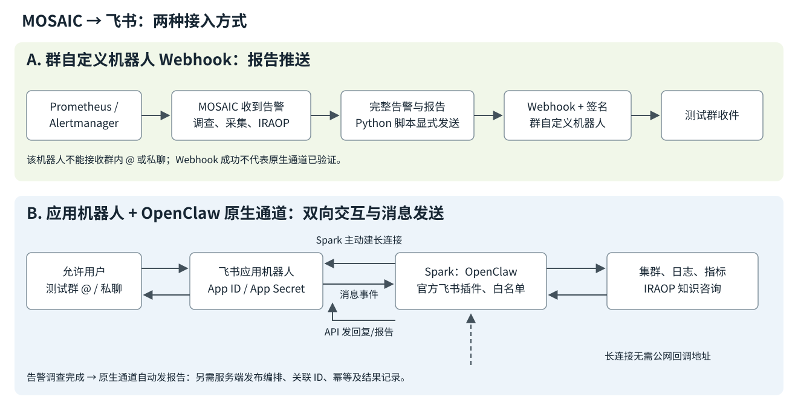

# MOSAIC 接入飞书：群 Webhook 与 OpenClaw 原生通道操作手册

本文供接手部署和验收的同事使用。Webhook 方式已有告警、调查报告和群内收件验证；原生通道已于 2026-11-01 验证群中 @ 后自动回复、主动发送和完整旧报告重投，记录见第 10 节。第 13 节保留本轮实际部署步骤、完整命令和补丁；第 14 节解释截图中每条消息是谁发给谁的。

## 1. 两种方式如何选择

| 项目 | 群自定义机器人 Webhook | OpenClaw 飞书原生通道 |
| --- | --- | --- |
| 创建入口 | 飞书群设置 → 群机器人 → 自定义机器人 | 飞书开发者后台 → 企业自建应用；新界面可选 Create Agent-Ready App |
| 飞书中的身份 | 当前群里的自定义机器人 | 一个开启机器人能力的飞书应用 |
| 凭据 | Webhook URL、签名密钥 | App ID、App Secret |
| 群报告推送 | 脚本向 Webhook 发 HTTP POST | OpenClaw 调用飞书消息 API 向指定 chat_id 发送 |
| 用户私聊 | 不支持 | 可按用户白名单开放 |
| 群中 @ 后继续问答 | 不支持接收用户消息 | 可按群、发送者白名单及 @ 要求接收 |
| 入站连接 | 无入站事件 | 本部署采用 Spark 主动建立的 WebSocket 长连接 |
| Spark 的公网入口 | 不需要 | 长连接方式不需要；需要能出站访问飞书 HTTPS/WSS |
| 发布应用、可用范围 | 群内创建即可，受群和组织策略约束 | 需要核对应用发布、可用范围及组织审批 |
| 本轮使用的客户端 | Python 标准库发送脚本 | OpenClaw 官方 `@openclaw/feishu@2026.6.10` |
| 是否使用飞书官方 CLI | 没有 | 原生通道也不依赖额外安装 lark-cli |
| 告警自动调查及调查完成后投递 | 需要单独的触发、调查和发布编排 | 同样需要；启用 IM 通道不会自动订阅 MOSAIC 网页中的报告 |
| 能否复用现有测试群 | 可以 | 可以，另把应用机器人加入该群 |
| 凭据能否互换 | Webhook/签名密钥不能用作 App ID/Secret | App ID/Secret 也不是已有自定义机器人的 Webhook |

两条路线可以在同一个测试群并存。验收时必须确认消息实际由哪一个机器人发送，防止把 Webhook 收件当成原生通道已经打通。

## 2. 工作链路和职责

Webhook 路线：



```text
Prometheus / Alertmanager
  → MOSAIC 收到告警
  → 发起调查：采集日志及指标、查询 IRAOP
  → 保存完整告警及分析报告
  → 显式执行 Python 报告发送脚本
  → HTTPS POST + 签名 → 群自定义机器人 Webhook
  → 测试群收件
```

原生通道路线：

```text
用户在测试群 @ / 私聊 → 飞书应用机器人
Spark 的 OpenClaw 飞书插件 → 主动向飞书建立 WebSocket 长连接
飞书应用机器人 → 经长连接传递消息事件 → OpenClaw
OpenClaw → MOSAIC 工具：集群、日志、指标及 IRAOP → OpenClaw
OpenClaw → 飞书消息 API → 应用机器人 → 测试群 / 私聊
告警调查运行完成事件 → 另需服务端发布编排 → OpenClaw 原生通道
```

| 执行者 | 必须完成的操作 | 完成后检查 |
| --- | --- | --- |
| 客户/测试群管理员 | 创建测试群；允许添加机器人 | 正确的群、成员和可见范围 |
| 群自定义机器人管理者 | 创建 Webhook 机器人、开启签名、交接凭据 | 发送结果及群内同一 Run ID |
| 飞书应用所有者 | 创建应用机器人、配置权限/事件、保存应用凭据、申请发布、加入群 | 应用已发布，目标用户可用，群内可找到应用机器人 |
| 飞书组织管理员 | 按组织策略批准应用、权限及使用范围 | 开发者后台显示相应发布结果 |
| Spark 管理员/实施者 | 维护 SSH 访问、Kubernetes Secret、持久 chart、插件、白名单及证据 | 版本、Pod、长连接、发送和接收日志 |
| 验收者 | 在目标群发送指定标记、核对机器人身份、报告内容及 Run ID | API 成功和群中可见分别留证 |

安装 MOSAIC 本身不会替客户创建或批准飞书应用。完成一次应用授权和服务部署后，正常消息处理不需要用户为每条告警重新登录开发者后台。

## 3. 凭据及接手人需要拿到的资料

| 信息 | 获取或交接方式 | 用途 |
| --- | --- | --- |
| Spark 地址、SSH 账号、接手人自己的 key 或密码 | 部署方内部交接 | 登录 Spark；不依赖前任操作者的私钥或本机 SSH socket |
| 当前 Kubernetes context、namespace、release | 部署方确认；本例 `kind-mosaic-poc`、`mosaic`、`mosaic` | 防止操作错集群 |
| MOSAIC UI 登录方式和访问隧道 | 参照主操作手册第 3 节 | UI/API 登录及观察调查记录 |
| 飞书组织、测试群和机器人名称 | 飞书应用/群管理员交接 | 核对正确的组织和收件群 |
| Webhook URL、签名密钥 | 凭据库或权限 `0600` 的独立文件 | Webhook 投递；文件键为 `FEISHU_WEBHOOK`、`FEISHU_SIGNING_SECRET` |
| 应用 App ID、App Secret | 应用「凭证与基础信息」；凭据库或另一份 `0600` 文件 | 原生通道；文件键为 `FEISHU_APP_ID`、`FEISHU_APP_SECRET` |
| 允许用户 open_id、群 chat_id | 应用 API、事件日志或后台取得并核对 | 白名单；不能拿邮箱、群名直接代替 ID |
| 真实部署 chart 和现有 values 的受保护位置 | Spark 管理员内部交接 | 升级时保留私有子 chart、Teams、IRAOP 和现场定制 |
| 原始验证证据及报告共享位置 | 授权的证据目录/存储 | 复核日志、API 响应和附件；外部版只使用去标识内容 |

两个凭据文件分开保管，不覆盖原 Webhook 文件。不得把密钥值写进 Git、PR、报告、截图或命令参数；通过文件或标准输入读取。文件路径可以交接，真正的读取权限由凭据管理者授予。

## 4. 路线 A：群自定义机器人 Webhook

### 4.1 客户在飞书中的操作

1. 电脑端进入测试群，打开右上角「…」→「设置」→「群机器人」。
2. 点击「添加机器人」→「自定义机器人」。
3. 机器人名称可以使用 `MOSAIC Alert Test`，描述填写接收 MOSAIC 告警和分析报告。
4. 开启签名校验，保存签名密钥。若启用关键词，测试消息使用 `test from Jeff Peng`；若启用出口 IP 白名单，填实际发送端的出口地址。
5. 保存 Webhook URL 和签名密钥，交接到授权发送者的凭据文件/凭据库。

若看不到群机器人入口，先由群主/管理员检查群管理权限及组织策略；若还没有测试群，先创建群并加入验收成员，再添加机器人。[飞书自定义机器人指南](https://open.feishu.cn/document/client-docs/bot-v3/add-custom-bot)

### 4.2 发送完整告警和分析报告

本仓库使用 [send_feishu_report.py](examples/alert-feishu/send_feishu_report.py)。在仓库根目录，先设置本轮证据目录、会话和 Run ID，再预览：

```bash
export EVIDENCE_DIR=/secure/evidence/current-run
export SESSION_KEY=agent:default:REPLACE_WITH_REAL_SESSION
export RUN_ID=REPLACE_WITH_REAL_RUN_ID

python3 docs/examples/alert-feishu/send_feishu_report.py \
  --alert "$EVIDENCE_DIR/alert.json" \
  --analysis "$EVIDENCE_DIR/analysis-reviewed.md" \
  --session-key "$SESSION_KEY" \
  --run-id "$RUN_ID" \
  --output "$EVIDENCE_DIR/feishu-payload.json"

python3 -m json.tool "$EVIDENCE_DIR/feishu-payload.json"
```

显式发送时加 `--send`，按脚本提示隐藏输入 Webhook 与签名密钥：

```bash
python3 docs/examples/alert-feishu/send_feishu_report.py \
  --alert "$EVIDENCE_DIR/alert.json" \
  --analysis "$EVIDENCE_DIR/analysis-reviewed.md" \
  --session-key "$SESSION_KEY" \
  --run-id "$RUN_ID" \
  --output "$EVIDENCE_DIR/feishu-payload.json" \
  --send \
  --response "$EVIDENCE_DIR/feishu-response.json"
```

签名算法：以 `timestamp + "\n" + secret` 为 HMAC-SHA256 的 key，对空消息计算摘要，再 Base64；请求体加入 `timestamp` 与 `sign`。脚本检查 HTTP 和飞书业务返回码，`code=0`（兼容旧 `StatusCode=0`）才算 API 接受。它是一次发送脚本，不是一个常驻告警监听器，也没有调用飞书官方 CLI。

官方请求体上限为 20 KB；脚本保守限制为 20,000 UTF-8 字节，计算签名字段后的完整大小，超限会报错，不截断完整报告。附件/长报告需使用获准且收件人可访问的存储，或另行通过应用机器人上传文件；此 Webhook 示例没有附件上传实现。发送超时后先核对群内是否已收到，再决定是否重发，避免重复通知。

### 4.3 留下收件证据

同时保存完整 payload、飞书 API 响应和目标群中的消息截图/链接。核对 `test from Jeff Peng`、Run ID、Alert ID 和完整分析内容；API 成功和群中实际可见是两个验收点，均不能代表用户已经阅读。

已有完整实测与证据：

- [2026-10-31 Pod/CPU 资源侧告警 → 日志 → IRAOP → 飞书](spark_e2e_alert_research_feishu_20261031.zh-CN.md)。该实验是 CPU/内存 Pod 的应用故障，不是 CPU 硬件损坏。
- [2026-10-31 GPU 遥测模拟告警 → 调查 → 飞书](spark_gpu_alert_research_feishu_20261031.zh-CN.md)。其中 GPU 信号注入、回放及生产指标的边界以原文和完整证据为准。

上述两份文档、完整报告、原始工具输出及收件确认继续保留；本手册不缩写或替换其证据。

## 5. 路线 B：创建飞书应用机器人

### 5.1 创建入口

1. 打开[飞书开发者后台](https://open.feishu.cn/app)，登录测试群所属组织的账号。
2. 新界面显示两种入口：蓝色 **Create Custom App** 和紫色 **Create Agent-Ready App**。
3. 本轮选择紫色 **Create Agent-Ready App**。其页面说明为 OpenClaw、Hermes 等 agent 预配置权限和事件；实际配置仍在创建后逐项核对。
4. 推荐名称 `MOSAIC Agent`，描述为「MOSAIC 告警调查、分析报告推送和运维问答」。平台也可能自动生成名称；后续加群时必须按后台实际机器人名搜索。
5. 若选择普通 Custom App，则在「添加应用能力」→「机器人」添加能力，并按下一节手动配置消息权限。

创建入口不在原测试群的「自定义机器人」页面。新建应用不会把已有 Webhook 转换成原生通道，也不会替换原群机器人。[飞书机器人概述](https://open.feishu.cn/document/client-docs/bot-v3/bot-overview)

### 5.2 权限

在「权限管理」核对**应用身份权限**。基础文字收发至少涉及：

| 权限标识 | 用途 |
| --- | --- |
| `im:message:send_as_bot` | 以应用机器人身份发送回复和报告 |
| `im:message.p2p_msg:readonly` | 接收用户给机器人的私聊消息 |
| `im:message.group_at_msg:readonly` | 接收群内用户 @ 机器人的消息 |

需要获取被引用的消息时使用相应消息读取权限；上传/下载图片和文件使用 `im:resource`；流式卡片与表情提示也有各自的权限。Agent-Ready 默认权限不只上述三项，本轮取得的**完整**权限清单另附原始字段表，不把三项核心权限冒充完整默认清单。

本次 OpenClaw 部署继续按 PR #74 关闭飞书文档、网盘、知识空间、多维表格等额外工具。飞书应用持有什么权限，与 OpenClaw 实际向模型开放什么工具，是两个配置层次。

### 5.3 应用凭据

打开应用「凭证与基础信息」，取得 App ID（通常以 `cli_` 开头）和 App Secret。保存在单独的文件：

```text
FEISHU_APP_ID=REPLACE_WITH_REAL_APP_ID
FEISHU_APP_SECRET=REPLACE_WITH_REAL_APP_SECRET
```

在客户 Mac 上创建并打开文件的示例：

```bash
export FEISHU_CREDENTIAL_DIR="$HOME/.config/mosaic/credentials"
mkdir -p "$FEISHU_CREDENTIAL_DIR"
chmod 700 "$FEISHU_CREDENTIAL_DIR"
touch "$FEISHU_CREDENTIAL_DIR/feishu-app.credentials"
chmod 600 "$FEISHU_CREDENTIAL_DIR/feishu-app.credentials"
open -e "$FEISHU_CREDENTIAL_DIR/feishu-app.credentials"
```

这里使用当前用户 home 下的私有目录，不需要 root 权限；也可以换成客户已有的凭据库或私有目录。只把路径交给授权实施者，不把值贴进聊天。`FEISHU_APP_SECRET` 不能用 Webhook 的签名密钥代替。

### 5.4 事件与长连接：与服务端配合的顺序

1. 完成机器人能力和凭据，先交给实施者配置并启动 Spark 上的通道。
2. 开发者后台进入「事件与回调」→「事件配置」。
3. 订阅方式选择 **使用长连接接收事件**，保存。
4. 点击「添加事件」，核对存在 **接收消息 v2.0**，事件标识为 `im.message.receive_v1`。
5. 如果提示「应用未建立长连接」，保持页面，先由实施者确认 Spark 的 gateway 已通过 App ID/Secret 建立 WebSocket，再回来保存；不用填写公网 HTTP 回调。
6. 若 Agent-Ready 已预配置这些项目，逐项确认即可；不要为了重复操作而删除已有事件。

Spark 需要出站访问飞书服务；长连接不需要把 Spark 的私网地址、MOSAIC UI 或 gateway 端口暴露到公网。[OpenClaw 2026.6.10 飞书指南](https://github.com/openclaw/openclaw/blob/v2026.6.10/docs/channels/feishu.md)

### 5.5 发布与可用范围

进入「应用发布」→「版本管理与发布」检查当前版本。尚未发布时创建版本，例如 `1.0.0`，更新说明写「接入 MOSAIC 告警报告和机器人问答」，可用范围包含自己和测试成员，再申请发布。按组织要求，由客户本人联系飞书管理员审批。Agent-Ready 是否已生成线上版本，以实际后台/API 为准，不能仅由创建完成推断。

能力、权限和事件配置变化后，需要按平台要求重新发布使配置生效。应用发布和组织审批是客户操作；实施者在 Spark 安装插件不能代替这些操作。[飞书应用发布要求](https://open.feishu.cn/document/client-docs/bot-v3/bot-overview)

### 5.6 加入原测试群

电脑端进入原测试群，右上角「…」→「设置」→「群机器人」→「添加机器人」，搜索并添加**刚创建应用的实际机器人名**。

搜索不到时依次检查：是否属于相同飞书组织、应用是否发布、添加者是否在可用范围内、群是否限制添加机器人。若群标注为「外部」，还需在应用中开启相应对外共享并满足平台要求；不能将内部群步骤直接套在外部群。[飞书对外共享说明](https://open.feishu.cn/document/develop-robots/add-bot-to-external-group?lang=zh-CN)

## 6. Spark 的持久部署

本轮基线为 Helm revision 15、OpenClaw `2026.6.10`；飞书来源为 [上游 PR #74](https://github.com/NVIDIA/AI-Factory-Operations-Agent/pull/74)，源 commit `e280d159a2745d7a1b459b8c4b06d4c741b5234c`。2026-11-01 核对 PR 仍未合并，因此必须明确使用含该改动的 chart，不能只对不含模板的版本增加 values。

### 6.1 创建应用 Secret

由 Spark 管理员将凭据安全注入 Kubernetes。若使用已有安全文件，示例命令为：

```bash
kubectl --context kind-mosaic-poc -n mosaic create secret generic mosaic-feishu \
  --from-env-file=/secure/credentials/feishu-app.credentials
```

本轮实际通过 SSH 标准输入传入 Secret 对象，凭据不放命令参数或远端明文临时文件。若同名 Secret 已存在，先比较是否属于本应用，禁止盲目覆盖。检查只能列名字和键，不能把 `-o yaml` 的 Secret 原文放到普通日志。

### 6.2 现场 values

```yaml
openclaw:
  feishu:
    enabled: true
    pluginVersion: 2026.6.10
    domain: feishu
    existingSecret: mosaic-feishu
    appIdKey: FEISHU_APP_ID
    appSecretKey: FEISHU_APP_SECRET
    allowedUserIds:
      - ou_REPLACE_WITH_VERIFIED_USER
    allowedGroupIds:
      - oc_REPLACE_WITH_TEST_GROUP
```

`ou_...` 与 `oc_...` 必须换成真实且已经核对的 ID。群列表为空时禁用群消息；用户和群均需白名单，不填 `*`。PR 默认要求群中 @，并按群及发送者隔离会话，避免不同成员共用同一上下文。

初次接入可从应用自身信息取得创建者/所有者 open_id；这是指定应用的信息查询，不需要导出全组织通讯录。群由客户加入应用机器人后，再读取机器人已加入的群并核对测试群。群名不是唯一标识，最终配置使用 chat_id。

### 6.3 升级前检查

1. 记录当前 release、revision、全部 Pod/镜像、应用 Secret 指纹和共享模型容器状态。
2. 从当前真正部署的 chart 回填飞书改动，保留私有 Research 子 chart、Teams、IRAOP、代理和已有现场配置。
3. 将应用凭据引用同时提供给 gateway 以及会读取同一配置的 OpenClaw CLI init 容器，避免初始化阶段缺环境变量。
4. 使用原有完整 values 进行 `helm lint` 和服务端 dry run。
5. 比较全部资源标识、已有 Secret 数据、RBAC 和工作负载 Pod template。本次现场 chart 将 UI 的 `checksum/config` 绑定到 OpenClaw seed，因此预期重建 OpenClaw 和 UI；UI 仅校验值变化，代理和其他工作负载 Pod template 保持一致。
6. 检查通过后才执行 Helm upgrade，并保存命令、退出状态和后续运行记录。

示例执行框架如下，真实 chart/values 路径由部署方内部交接：

```bash
helm --kube-context kind-mosaic-poc -n mosaic history mosaic
helm lint "$CHART_PATH" -f "$VALUES_PATH"
helm --kube-context kind-mosaic-poc -n mosaic upgrade mosaic "$CHART_PATH" \
  -f "$VALUES_PATH" --dry-run=server

helm --kube-context kind-mosaic-poc -n mosaic upgrade mosaic "$CHART_PATH" \
  -f "$VALUES_PATH" --atomic --wait --timeout 12m

kubectl --context kind-mosaic-poc -n mosaic rollout status deployment/openclaw \
  --timeout=600s
```

dry run、values 和 Helm manifest 可能含敏感内容，实际执行必须写入权限 `0600`、父目录 `0700` 的受保护文件，不直接贴到工单/PR。本轮的模板完整补丁、原 chart、部署 values、完整 dry run 均保留在 Spark 私有部署目录；普通公开证据只存去标识元数据。

本轮预检曾发现修改根 chart 版本号会连带改变代理配置校验值，已在部署前停止该方案，保留原版本号。实际补丁通过来源 commit 和 chart 文件 SHA-256 标识，不能仅靠 chart 版本字符串区分是否包含飞书。

## 7. 原生通道验收与中间证据

在验收前先确认创建者/测试用户白名单、测试群白名单和群内 @ 要求。用于验收的消息应真正从用户飞书客户端发出，不能由实施者伪造入站事件后声称已通过平台。

| 检查点 | 操作 | 必须看到的证据 |
| --- | --- | --- |
| 凭据有效 | 调用本应用 tenant token 接口，再取 bot 信息 | 业务码成功；不保存 token |
| 应用能力 | 核对 bot、应用信息和权限 | 机器人存在；消息相关权限、发布信息及事件配置可核对 |
| 入群 | 客户把应用机器人加入测试群 | 机器人已加入群的 API 结果含同一 chat_id |
| 长连接 | 启动 Spark gateway | Feishu provider 启动及 WebSocket 就绪日志，Pod 保持 Ready |
| 私聊入站 | 允许用户私聊机器人，带唯一标记 | 飞书事件、sender open_id、会话和原生回复关联 |
| 群入站 | 允许用户在允许群中 @ 机器人 | 同一 chat_id、sender、消息及会话日志；回复由新应用机器人发出 |
| 群内不 @ | 在测试群发一条普通消息 | 不触发模型调查；若上游仅推 @ 事件，也应明确注明这一前提 |
| 未授权用户/群 | 仅在具备测试身份/测试群时执行 | 明确的拒绝记录；无相应身份时保持未验证 |
| 原生主动发送 | 使用已加载的 OpenClaw 飞书发送功能向允许群发送带 Run ID 的测试报告 | 通道发送结果、飞书 message_id、群内同一 Run ID；不能用旧 Webhook 代发 |
| 保持现场能力 | 比较部署前后 Teams、IRAOP、UI、代理及模型状态 | 原有配置/凭据保留，未出现非预期重启或模型变更 |
| 重建后持久化 | 在基本收发通过后按维护窗口验证 Pod 重建 | 新 Pod 从持久 chart 安装同版本插件，仍能收发；未执行则标待验证 |

群中测试文本示例，@ 时从飞书候选列表选中实际机器人：

```text
@MOSAIC Agent 请回复“飞书原生通道已连接”，并保留标记：test from Jeff Peng；Run ID：REPLACE_WITH_RUN_ID
```

回复成功证明这条聊天的入站、处理和出站链路。要证明真实告警报告投递，还需让同一个告警调查运行完成后，经原生通道发送完整报告，并关联 fingerprint、sessionKey、run ID 和 message_id。

## 8. 从告警报告走向持续运行

群 Webhook 和原生通道都能承担报告的最后一跳。告警捕获、日志采集、IRAOP 咨询和报告投递的持续编排仍需单独实现：服务端监听或拉取告警、创建调查、等待运行完成、关联证据、选择收件群、发送、记录结果及幂等/重试状态。

MOSAIC 网页中的 Auto investigate 当前由前端触发；打开飞书原生通道不会把它自动改为后台告警服务，也不会让已有网页调查结果自动出现在飞书群。完整告警链路以[主操作手册](spark_alert_feishu_runbook.zh-CN.md)和两份实测文档的实际动作与证据为准。

## 9. 常见问题

| 现象 | 检查和处理 |
| --- | --- |
| 只看到原 Webhook 机器人 | 应用机器人需要另外添加到群；按实际应用名搜索 |
| 保存长连接时提示未建立连接 | 先由实施者启动 gateway 并确认连接；再回后台保存 |
| 原生机器人收不到 @ | 核对事件 `im.message.receive_v1`、发布、可用范围、群成员关系、用户/群白名单及真实 @ |
| 飞书 API 成功但群里没看到预期消息 | 核对应用身份、chat_id、Run ID、实际机器人名称；分别记录 API 和群内证据 |
| 文档里写了 Webhook 发送成功，能否认定原生也成功 | 不能。两条路线必须分别验证并标明消息发送身份 |
| 要不要安装 lark-cli | 本文两条路线均不依赖它。官方 CLI 是另一种调用飞书 API 的工具，不能替代机器人发布和通道部署 |
| 是否每个 alert 都要登录 | 不需要。服务持有应用凭据并维护连接；凭据轮换、权限变更或组织策略调整时再维护 |
| 群名相同但拿不到原生消息 | 群名不能唯一标识会话，核对真实 chat_id 和机器人是否实际入群 |
| 是否已经支持网页告警报告自动转到原生通道 | 以第 10 节实际验证状态为准；普通原生聊天回复不能替代该验收 |

## 10. 2026-11-01 本轮接入记录

以下状态随本轮操作更新。完整原始记录留在受保护目录；公开版本替换用户、群、地址等现场标识，保留全部字段、权限行、时间和结果。

| 步骤 | 当前结果 | 证据 |
| --- | --- | --- |
| 用户创建 Agent-Ready 应用 | 已完成，用户在聊天确认 | 创建入口截图及用户确认 |
| 用户保存独立应用凭据文件 | 已完成；文件模式 `0600`，两项非空 | 本地凭据字段存在性检查；密钥值不入证据 |
| 应用鉴权 | 成功，`code=0`；返回有效期 `7200` 秒 | `app-auth-check.json`；token 未落盘 |
| 查询 bot 信息 | 成功，`code=0` | `bot-info.json` |
| 查询应用自身信息 | 成功，`code=0` | `app-info.json`，含创建者/所有者、版本、权限和回调元数据 |
| 查询已加入群 | 首次 0 个群；客户确认入群后查询到 1 个匹配测试群，`has_more=false` | `bot-chats.json` 及用户入群确认 |
| 创建 Spark Secret | 已创建 `mosaic-feishu`，仅含两个规定键 | Spark `secret-created.json`，不含凭据值 |
| 持久 chart 回填及 dry run | 已通过 | 原有资源集合及 RBAC 不变，已有 chart 管理 Secret 数据不变；OpenClaw 和仅校验值变化的 UI 需重建 |
| 初次 Helm 部署 | 成功，revision 16，退出码 0 | `apply-result.json`；Feishu init 容器退出码 0 |
| 测试群白名单部署 | 成功，revision 17，退出码 0 | `group-enable/apply-result.json`；允许 1 个用户、1 个群 |
| 原生长连接 | 已观察到 `ws client ready`，机器人身份解析成功 | revision 17 gateway 日志，2026-11-01T12:58:36.508Z |
| 群中 @ 后回复 | 已通过；真实入站、分发、Qwen 回复及用户截图一致 | 入站 13:02:09.388Z、分发完成 13:02:16.535Z、卡片关闭 13:02:26.792Z；完整会话 6 行 |
| 原生主动发消息 | 已通过；用户截图确认 | `feishu-native-20261101-outbound-01`，OpenClaw 返回 `handledBy=plugin`，1 个平台消息 |
| 原生完整旧报告重投 | 已通过 API 发送及平台回读；用户确认已看到完整报告 | `feishu-native-20261101-report-01`，源消息 15,168 UTF-8 字节、11,504 字符，1 个平台消息 |
| 私聊、未授权身份/群、群内不 @ | 本轮未单独执行 | 不因群收发通过而推断这些检查已通过 |
| 原生通道的新告警全程自动投递 | 本轮未重新注入故障，也未部署该后台编排 | 本轮长报告重用此前已完成的实验报告，正文已明确标注 |
| 最终运行状态 | revision 17，7 个 Pod、全部普通容器 Ready，13 个应用 Secret 指纹/UID/键一致，共享模型状态一致 | 完整 final runtime、全部 Secret 比较记录及 Helm history 在证据目录；Secret 指纹公开版已脱敏 |

主操作手册第 7 节继续保留原 Webhook 命令和全部历史证据。后续如原生链路出现失败，同样保留失败响应、实际调整和复测结果，不用最后一次成功覆盖中间见证。

## 11. 参考资料

- [飞书机器人概述](https://open.feishu.cn/document/client-docs/bot-v3/bot-overview)
- [群自定义机器人使用指南](https://open.feishu.cn/document/client-docs/bot-v3/add-custom-bot)
- [接收消息事件](https://open.feishu.cn/document/server-docs/im-v1/message/events/receive)
- [机器人对外共享、权限和限制](https://open.feishu.cn/document/develop-robots/add-bot-to-external-group?lang=zh-CN)
- [OpenClaw 2026.6.10 飞书通道指南](https://github.com/openclaw/openclaw/blob/v2026.6.10/docs/channels/feishu.md)
- [MOSAIC 飞书原生通道 PR #74](https://github.com/NVIDIA/AI-Factory-Operations-Agent/pull/74)

## 12. 本轮 Agent-Ready 默认权限与回调完整快照

2026-11-01 从用户新建应用的自身信息 API 取得 36 项权限。下表保留全部 36 行及原始的 `scope`、`description`、`level`、`token_types` 四列；`level` 是 API 原始数字，本文不另行推断其含义。精确字符串（包括原始空白）保存在[完整 scopes JSON](examples/alert-feishu/native-evidence-20261101/agent-ready-scopes.json)。这是本轮该应用的观察结果，不表示未来所有 Agent-Ready 应用必定相同。

| scope | description | level | token_types |
| --- | --- | ---: | --- |
| `contact:contact.base:readonly` | 获取通讯录基本信息 | 1 | tenant |
| `docx:document:readonly` | 查看新版文档 | 2 | tenant |
| `im:chat:read` | 查看群信息 | 2 | tenant |
| `im:chat:update` | 更新群信息 | 2 | tenant |
| `im:message.group_at_msg:readonly` | 获取群组中用户@机器人消息 | 1 | tenant |
| `im:message.p2p_msg:readonly` | 读取用户发给机器人的单聊消息 | 1 | tenant |
| `im:message.pins:read` | 查看 Pin 消息 | 1 | tenant |
| `im:message.pins:write_only` | 添加、 取消 Pin 消息 | 1 | tenant |
| `im:message.reactions:read` | 查看消息表情回复 | 1 | tenant |
| `im:message.reactions:write_only` | 发送、删除消息表情回复 | 1 | tenant |
| `im:message:readonly` | 获取单聊、群组消息 | 1 | tenant |
| `im:message:send_as_bot` | 以应用的身份发消息 | 1 | tenant |
| `im:message:send_multi_users` | 给多个用户批量发消息 | 1 | tenant |
| `im:message:send_sys_msg` | 发送特定模板系统消息 | 2 | tenant |
| `im:message:update` | 更新消息 | 1 | tenant |
| `im:resource` | 获取与上传图片或文件资源 | 2 | tenant |
| `im:message.group_at_msg.include_bot:readonly` | 获取群组中其他机器人和用户@当前机器人的消息 | 1 | tenant |
| `application:application:self_manage` | 管理应用自身资源 | 1 | tenant |
| `cardkit:card:write` | 创建与更新卡片 | 1 | tenant |
| `cardkit:card:read` | 获取卡片信息 | 1 | tenant |
| `application:bot.menu:write` | 创建、更新、删除机器人菜单 | 1 | tenant |
| `im:chat.members:bot_access` | 订阅机器人进、出群事件 | 1 | tenant |
| `drive:drive.metadata:readonly` | 查看云空间中文件元数据 | 2 | tenant |
| `docs:document.comment:create` | 添加、回复云文档中的评论 | 2 | tenant |
| `docs:document.comment:delete` | 删除云文档中的评论 | 2 | tenant |
| `docs:document.comment:read` | 获取云文档中的评论 | 2 | tenant |
| `docs:document.comment:update` | 修改云文档中的评论 | 2 | tenant |
| `docs:document.comment:write_only` | 回复、修改、删除云文档中的评论 | 2 | tenant |
| `docx:document:write_only` | 编辑新版文档 | 2 | tenant |
| `docx:document.block:convert` | 转换文本为云文档块 | 2 | tenant |
| `im:chat:create` | 创建群 | 2 | tenant |
| `application:bot.basic_info:read` | 获取机器人的基本信息 | 2 | tenant |
| `wiki:node:read` | 查看知识空间节点信息 | 2 | tenant |
| `application:app_slash_command:read` | 查询 Slash Command | 1 | tenant |
| `application:app_slash_command:write` | 编辑 Slash Command | 1 | tenant |
| `offline_access` | 持续访问已授权的数据 | 2 | user |

同一 API 的回调元数据[完整 JSON](examples/alert-feishu/native-evidence-20261101/agent-ready-callback-info.json)为：

```json
{
  "callback_type": "websocket",
  "subscribed_callbacks": [
    "card.action.trigger"
  ]
}
```

这里的 `subscribed_callbacks` 是该 API 返回的回调字段，不能把它直接等同于全部事件订阅清单。`im.message.receive_v1` 仍需在后台事件配置或真实消息入站中核对。API 还返回了非空线上版本 ID 和 `status=1`；不以这个原始状态数字代替客户的后台发布与可用范围检查。

本轮随后实际收到用户群消息并成功回复，因此消息入站路径也已由真实事件验证。

## 13. 本轮如何把原生通道和测试群白名单部署到 Spark

### 13.1 先核对现场，不重新安装整套 MOSAIC

本轮开始时 `helm history` 最后一条为 revision 15、状态 deployed。真实 chart 已含 Teams、IRAOP 查询证据及 Research 代理修正，因此没有拿上游公开 chart 或文档 CI 的空 Research 子 chart 覆盖现场。

下列四个文件从 PR #74 回填，并补上与现场 Teams 初始化流程共存需要的环境变量引用。**完整逐行补丁**分别保存在：

| 文件 | 实际作用 | 完整补丁 |
| --- | --- | --- |
| `values.yaml` | 增加飞书开关、插件版本、域、Secret 键和两种白名单 | [values 完整补丁](examples/alert-feishu/native-evidence-20261101/spark/diff-values.yaml.patch) |
| `templates/validation.yaml` | 检查启用条件、Secret、域和明确 ID，拒绝空用户列表及 `*` | [validation 完整补丁](examples/alert-feishu/native-evidence-20261101/spark/diff-validation.yaml.patch) |
| `files/openclaw-seed/nemoclaw.json` | 生成飞书通道、会话隔离及插件配置，保留原 Teams/Slack 条件 | [配置模板完整补丁](examples/alert-feishu/native-evidence-20261101/spark/diff-nemoclaw.json.patch) |
| `templates/openclaw.yaml` | 加 `init-feishu-plugin`；gateway 及共享配置的 CLI init 容器通过 Secret 引入应用凭据 | [Deployment 完整补丁](examples/alert-feishu/native-evidence-20261101/spark/diff-openclaw.yaml.patch) |

完整准备脚本见 [prepare_remote.py 原文](examples/alert-feishu/native-evidence-20261101/spark/prepare_remote.py.txt)。它读取并备份原 chart 和完整 values，逐处检查补丁锚点，保留私有依赖；备份和包含凭据的 Helm 输出仅存 Spark 受保护目录。早期准备锚点或初始化环境布局不匹配时在部署前停止，未以这些失败草稿执行 Helm upgrade。

本轮制品的完整 SHA-256：

| 制品 | SHA-256 |
| --- | --- |
| 原 revision-15 chart | `7442198e4a3c79b95ea4f019268fc4dd36b9ec8aac347e00e60a355891a9be62` |
| 回填飞书后的 chart | `0ca66fe1c23da0f52db31d0a0ac2d9e744f23cf8269422b0fac3cc5a1347a43e` |

根 chart 版本号保持原值，因为现场模板把 chart 版本标签计入其他组件的配置校验值。区别本次制品时同时核对 SHA-256、release revision 和来源 commit；不要只看版本字符串。

### 13.2 凭据怎样从本机到 Pod

用户在飞书后台取得 App ID/Secret，保存在本机独立的 `feishu-app.credentials`，权限 `0600`。实施程序读取文件后在内存中构造 Kubernetes Secret，通过已授权 SSH 的标准输入传给 Spark 的 `kubectl create -f -`。新 Secret 名为 `mosaic-feishu`，只含 `FEISHU_APP_ID` 和 `FEISHU_APP_SECRET` 两个规定键。同名 Secret 如已存在且内容不同，程序拒绝覆盖。

Pod 使用下面这种引用，不把真实值写进 chart：

```yaml
env:
  - name: FEISHU_APP_ID
    valueFrom:
      secretKeyRef:
        name: mosaic-feishu
        key: FEISHU_APP_ID
  - name: FEISHU_APP_SECRET
    valueFrom:
      secretKeyRef:
        name: mosaic-feishu
        key: FEISHU_APP_SECRET
```

通道配置中保留环境变量引用：

```json
{
  "appId": "${FEISHU_APP_ID}",
  "appSecret": "${FEISHU_APP_SECRET}",
  "connectionMode": "websocket"
}
```

运行时由 Pod 环境提供值。初始化容器执行的官方插件安装命令为：

```bash
node /app/dist/index.js plugins install '@openclaw/feishu@2026.6.10' --force
```

完整 Secret 创建元数据见 [secret-created.json](examples/alert-feishu/native-evidence-20261101/spark/secret-created.json)。这些公开文件没有密钥值；只知道 Secret 名称不代表具备读取权限。

### 13.3 用户和群 ID 怎样取得，怎样进入白名单

应用凭据鉴权成功后，程序只查询该应用自身信息：

```text
POST https://open.feishu.cn/open-apis/auth/v3/tenant_access_token/internal
GET  https://open.feishu.cn/open-apis/bot/v3/info
GET  https://open.feishu.cn/open-apis/application/v6/applications/{app_id}?lang=zh_cn&user_id_type=open_id
GET  https://open.feishu.cn/open-apis/im/v1/chats?page_size=100&user_id_type=open_id
```

这里的 token 仅在内存中使用，不写入证据。应用信息返回的创建者与所有者 open_id 一致，因此第一次启用只放行该 ID。最初机器人未加入任何群，群列表为空，群功能禁用。

用户在飞书客户端把新应用机器人加入原测试群后，API 返回且仅返回一个名称匹配的测试群。实施程序核对用户入群确认，再取真实 chat_id，最终配置为 **1 个允许用户、1 个允许群**。实际 ID 保存在内部交接；公开证据用 `ou_ALLOWED_USER`、`oc_TEST_GROUP` 替代。

真实运行配置包含：

```json
{
  "enabled": true,
  "domain": "feishu",
  "connectionMode": "websocket",
  "configWrites": false,
  "dmPolicy": "allowlist",
  "allowFrom": ["ou_ALLOWED_USER"],
  "groupPolicy": "allowlist",
  "groupAllowFrom": ["oc_TEST_GROUP"],
  "groupSenderAllowFrom": ["ou_ALLOWED_USER"],
  "groupSessionScope": "group_sender",
  "requireMention": true,
  "tools": {
    "doc": false,
    "chat": false,
    "wiki": false,
    "drive": false,
    "perm": false,
    "scopes": false,
    "bitable": false,
    "base": false
  }
}
```

群白名单检查群是否允许；发送者白名单检查谁能触发；`requireMention` 要求 @；`group_sender` 按群与发送者分开上下文。完整生成片段见 [backport-parts 原文](examples/alert-feishu/native-evidence-20261101/spark/backport-parts.private.json)，完整运行配置及会话见 [最终 runtime-and-sessions.json](examples/alert-feishu/native-evidence-20261101/spark/captures/20261101T130529Z/runtime-and-sessions.json)。文件名中的 `.private` 保留了来源名称，公开副本已经脱敏。

### 13.4 实际两次 Helm 升级命令

下面路径中的 `$SPARK_HOME` 是公开版占位符，执行时对应登录账号的真实 home；实际脚本使用 `Path.home()`。真实制品与 values 位于 Spark 受保护目录，不能从公开文档依赖包代替下载。

```bash
export FEISHU_DEPLOY_ROOT="$HOME/.local/share/mosaic-feishu-native-20261101"
export CHART_PATH="$FEISHU_DEPLOY_ROOT/mosaic-stack-0.0.2-main.20261007233259.g4f4a6e75+teams71.20261029.iraop-evidence.20261031.2.research-tools.20261031.startup2.tgz"
```

第一次启用应用和创建者白名单，群尚未开放，revision 15→16：

```bash
"$HOME/.local/bin/helm" --kube-context kind-mosaic-poc -n mosaic \
  upgrade mosaic "$CHART_PATH" \
  -f "$FEISHU_DEPLOY_ROOT/values-feishu.private.json" \
  --atomic --wait --timeout 12m \
  --description 'Feishu PR74 backport; explicit app-owner allowlist; group onboarding pending'
```

用户完成入群后，加入唯一测试群白名单，revision 16→17：

```bash
"$HOME/.local/bin/helm" --kube-context kind-mosaic-poc -n mosaic \
  upgrade mosaic "$CHART_PATH" \
  -f "$FEISHU_DEPLOY_ROOT/group-enable/values-with-test-group.private.json" \
  --atomic --wait --timeout 12m \
  --description 'Feishu PR74: enable the user-confirmed test group and app-owner allowlist'
```

两次均先做服务端 dry run，并比较全部资源标识、chart 管理 Secret 数据及 RBAC。最终只重建 OpenClaw 与因共享 seed 校验值而重建的 UI。代理、IRAOP、OpenSearch 等 Pod 保持，模型容器 PID 与 StartedAt 保持。

两次升级都由 Spark 上脱离 SSH 会话的 Python 子进程执行，网络短暂断开不取消后台 Helm。这里没有创建另一个临时聊天服务来代替正式 gateway。Pod 启动时会从持久 chart 的 init 容器装载插件，凭据来自 Secret，白名单来自 Helm 配置。

原文脚本、命令和结果：

- [revision 16 执行脚本](examples/alert-feishu/native-evidence-20261101/spark/apply_remote.py.txt)、[完整命令数组](examples/alert-feishu/native-evidence-20261101/spark/helm-command.json)、[结果](examples/alert-feishu/native-evidence-20261101/spark/apply-result.json)。
- [revision 17 群启用脚本](examples/alert-feishu/native-evidence-20261101/spark/enable_group_remote.py.txt)、[完整命令数组](examples/alert-feishu/native-evidence-20261101/spark/group-enable/helm-command.json)、[结果](examples/alert-feishu/native-evidence-20261101/spark/group-enable/apply-result.json)。
- [首次准备核对结果](examples/alert-feishu/native-evidence-20261101/spark/prepare-summary.json)、[群启用准备核对结果](examples/alert-feishu/native-evidence-20261101/spark/group-enable/prepare-summary.json)、[最终运行与全部 Pod](examples/alert-feishu/native-evidence-20261101/spark/captures/20261101T130529Z/runtime.json)。

这些脚本是本轮**历史执行原文**，包含对 revision 15 或 16 的前置断言，不能在已经 revision 17 的机器上原样重跑。接手人日后升级应先从当前 release 取得受保护 values，并核对本次真实 chart；旧安装缓存不能直接当作当前部署来源。

### 13.5 如何观察安装和消息处理证据

管理员在 Spark 查看：

```bash
"$HOME/.local/bin/helm" --kube-context kind-mosaic-poc -n mosaic history mosaic
"$HOME/.local/bin/kubectl" --context kind-mosaic-poc -n mosaic get pods
"$HOME/.local/bin/kubectl" --context kind-mosaic-poc -n mosaic \
  logs deployment/openclaw -c init-feishu-plugin
"$HOME/.local/bin/kubectl" --context kind-mosaic-poc -n mosaic \
  logs deployment/openclaw -c gateway --since=10m
```

gateway 日志中应关联：`starting feishu`、机器人身份、`ws client ready`、`received message from`、`group session scope=group_sender`、`dispatching to agent`、`dispatch complete`。初始化安装成功、长连接成功和真实消息处理是不同检查点，不能只看 Pod Running。

本轮完整相关日志及会话均已保存：

- [revision 16 完整日志（凭据脱敏）](examples/alert-feishu/native-evidence-20261101/spark/gateway-revision16.private.log)：首次 bot probe 曾超时，随后后台重试恢复身份；不是以这次超时声称通过。
- [revision 17 完整日志（凭据脱敏）](examples/alert-feishu/native-evidence-20261101/spark/captures/20261101T130529Z/gateway.redacted.log)：有真实用户消息及回复。
- [全部会话、运行配置及安装版本](examples/alert-feishu/native-evidence-20261101/spark/captures/20261101T130529Z/runtime-and-sessions.json)：已读回 `2026.6.10`；群会话 6 行原始记录完整保留。
- [完整取证脚本](examples/alert-feishu/native-evidence-20261101/spark/capture_remote.py.txt)、[全部文件清单及哈希](examples/alert-feishu/native-evidence-20261101/manifest.json)。

SDK 错误日志可能包含请求对象，因此复制诊断日志时先替换所有已知凭据及 Bearer token，再归档或上传。公开版继续去标识，但不丢行、不删字段、不截断模型报告。完整 Secret 指纹只保留在私有交接，公开版保留对应列并明确标为已脱敏。

## 14. 截图里的三条消息，分别是谁发给谁

| 顺序 | 实际发送者 → 接收者 | 内容来源 | 是否调用 Qwen |
| --- | --- | --- | --- |
| 最上面的主动测试 | 实施者在 Spark 执行 OpenClaw 命令 → 飞书应用机器人 → 测试群 | 显式输入的连接测试文字，Run ID `feishu-native-20261101-outbound-01` | 没有 |
| 中间用户 @ | 用户 Jeff Peng → 测试群中的应用机器人 → 长连接 → Spark | 用户自己在飞书客户端发送，Run ID `feishu-native-20261101-01` | 收到后才进入处理 |
| 最下面的回复卡片 | Spark 的 Qwen → OpenClaw `default` agent → 飞书应用机器人 → 群中回复用户 | 模型自动生成 `Test received. All good on this end, Jeff.` | 有；卡片显示 `Qwen3.6-35B-A3B-NVFP4`、provider `llm` |

飞书机器人的显示名是应用在飞书中的身份；卡片中的 `default` 是 OpenClaw/MOSAIC agent 名称；Qwen 是生成回答的模型。它们是三个角色，不是三个人或三个各自独立回答的机器人。卡片不是飞书另起一个模型回答，也不是实施者手工代写。

主动发送实际使用 OpenClaw CLI：

```bash
"$HOME/.local/bin/kubectl" --context kind-mosaic-poc -n mosaic \
  exec deployment/openclaw -c gateway -- \
  node /app/dist/index.js message send \
  --channel feishu \
  --target 'chat:oc_REPLACE_WITH_TEST_GROUP' \
  --message 'test from Jeff Peng；Run ID：REPLACE_WITH_RUN_ID' \
  --json
```

实际执行程序将完整消息作为单个 argv 参数传入，不经 shell 拼接。完整发送脚本、源消息、全部返回字段和 message_id 分别留在[发送脚本原文](examples/alert-feishu/native-evidence-20261101/spark/send_native_remote.py.txt)及[主动发送证据](examples/alert-feishu/native-evidence-20261101/spark/outbound/feishu-native-20261101-outbound-01/send-result.json)。返回 `channel=feishu`、`handledBy=plugin`、`dryRun=false`；这次没有调用旧 Webhook。

## 15. 完整旧报告原生投递验收

本轮将 2026-10-31 已完成的 Pod 故障实验报告完整重投一次，在正文头部明确写「既有实验报告重投验证」，没有重新注入故障或重新执行调查。Delivery Run ID 是 `feishu-native-20261101-report-01`。用户已确认看到完整报告，确认记录在 [user-confirmations.json](examples/alert-feishu/native-evidence-20261101/user-confirmations.json)。

| 项目 | 原生短消息 | 完整旧报告重投 |
| --- | ---: | ---: |
| 发送源消息 UTF-8 字节数 | 147 | 15,168 |
| 发送源消息字符数 | 97 | 11,504 |
| 平台消息数 | 1 | 1 |
| 平台回读消息类型 | post | post |
| 回读 `content_v2` Markdown UTF-8 字节数 | 147 | 20,718 |
| 回读 `content_v2` Markdown 字符数 | 97 | 16,988 |
| 源文本与回读 Markdown 字节一致 | 是 | 否，存在富文本转换 |
| 完整富文本差异段数 | 0 | 346 |
| 非格式性源文字保留 | 是 | 是；代码围栏语言标签 `sh` 被转换去掉，数据文字未丢失 |
| 群内确认 | 用户截图 | 用户明确确认完整报告已收到 |

旧报告原始正文为 14,922 UTF-8 字节，本次增加重投说明后为 15,168 字节；没有对原报告正文截短。OpenClaw 将 Markdown 发送为飞书富文本 `post`，平台回读的 `content` 和 `content_v2` 是富文本结构，不能错误读取不存在的 `body.text` 然后认定内容为空。平台会规范化空白、链接及代码围栏格式，所以这里不声称长报告回读与源文件哈希一致。

完整证据：

- [完整发送源文本及 Run ID](examples/alert-feishu/native-evidence-20261101/platform/outbound-full-report-request.json)。
- [发送原文的 gzip 副本](examples/alert-feishu/native-evidence-20261101/spark/outbound/feishu-native-20261101-report-01/message.txt.gz)：保留 Markdown 行末双空格等原始空白；解压后的长度及哈希在 manifest 中逐项列出，没有为通过格式检查而删空白。
- [原生完整发送返回](examples/alert-feishu/native-evidence-20261101/spark/outbound/feishu-native-20261101-report-01/send-result.json)。
- [平台完整富文本回读](examples/alert-feishu/native-evidence-20261101/platform/platform-message-full-report.json)。
- [全部 346 个富文本差异段](examples/alert-feishu/native-evidence-20261101/platform/platform-full-report-richtext-diff.json)，保留每段源/目标文字及字符偏移，没有按类型合并丢行。
- [长度、哈希及回读校验](examples/alert-feishu/native-evidence-20261101/platform/platform-readback-verification.json)。

字节数、源哈希和差异偏移对应去标识前的传输记录；公开副本替换了现场标识，不能把公开文件重新求哈希后与原始源哈希混为一谈。要求配置文件/代码等字节级不变时，应另做原文文件附件及下载哈希验收，本轮未把富文本转换等同于文件传输验证。

本轮原生通道验证覆盖消息最后一跳和群内互动；新的告警从发现、自动调查、日志采集、IRAOP 咨询直到原生通道投递，仍需按第 8 节编排后单独验收。此前已经完成的 Webhook 全链路证据继续保留。
