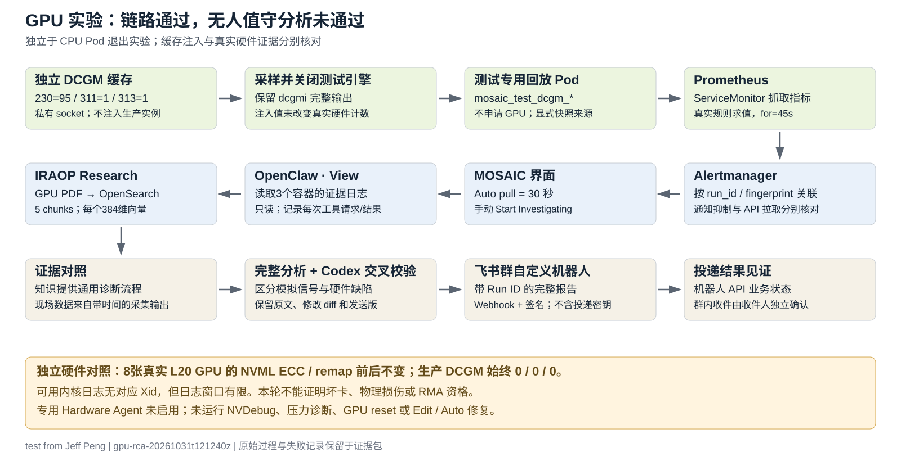

# GPU 遥测注入、告警与归因验证（2026-10-31）

**结论：GPU 测试信号的告警链路、只读取证和知识检索已走通；无人值守分析可靠性未通过。** Qwen 的原始输出出现事实错误和清空内核日志的建议。Codex 指出问题后得到的修订版仅用于定位缺陷，不算 MOSAIC 自主能力，也没有经过用户本人审核。

本篇与 [CPU 资源上的应用 Pod 故障实验](spark_e2e_alert_research_feishu_20261031.zh-CN.md) 分开记录。前篇不是 CPU 硬件损坏；本篇也没有让真实 GPU 发生物理故障。这里实际验证独立 DCGM 缓存注入、快照回放以及证据归因边界。测试输入已经标明 `simulation=true`，因此不是隐藏故障来源的盲测，更不是坏卡/RMA 判断准确率评测。

公开证据使用一致的地址、账号、GPU UUID/序列号及物理节点身份占位符；测量值、时间、错误文本、测试资源 UID 和告警指纹保留。完整内部原件另存本地证据包；密码、API key、Webhook 和签名密钥不进入交付物。

## 1. CPU 与 GPU 实验逐项对照

| 项目 | 前轮 CPU 资源上的 Pod 故障 | 本轮 GPU 遥测实验 |
| --- | --- | --- |
| Run ID | e2e-20261031t075722z | gpu-rca-20261031t121240z |
| 注入对象 | ConfigMap 缺少 /fixture/ready，应用进程真实退出23 | 私有 Unix socket 的独立 DCGM 缓存：230=95、311=1、313=1 |
| 实际运行变化 | Pod 进入 CrashLoopBackOff；实际 current/previous logs 和事件可见 | 缓存读到95/1/1；生产 DCGM 仍0/0/0；8张目标主机GPU的NVML计数不变 |
| 硬件/工作负载含义 | 应用启动失败；没有制造 CPU 硬件故障 | GPU 错误信号模拟；没有制造显存/芯片物理损坏 |
| 测试 Pod | mosaic-log-fixture；只申请CPU/内存 | gpu-telemetry-fixture；3个正常运行容器；只申请CPU/内存 |
| GPU 资源申请 | 0 | 0；未挂载GPU设备或主机日志目录 |
| 告警名称 | MosaicInjectedWorkloadFailure；并伴随既有KubePodCrashLooping | MosaicGpuTelemetrySimulation；初始info及后续warning各有独立指纹 |
| 告警依据 | 真实 CrashLoopBackOff 等待状态的 max_over_time | 真实抓取 mosaic_test_dcgm_xid_error ==95；该指标显式回放缓存快照 |
| 核心证据 | Pod退出码、previous/current logs、ConfigMap、事件、节点状态 | 隔离/生产DCGM对照、NVML前后全8GPU、可用内核日志、指标完整labels |
| Research知识集合 | mosaic-validation-20261031；2页、4chunks | mosaic-gpu-validation-20261031；2页、5chunks、每chunk384维 |
| 调查方式 | UI启动View；同会话补充取证；存在外部纠错 | UI首次自主11次工具；继续取证14次；明确事实纠错后再4次 |
| 飞书路线 | 独立验证脚本使用群自定义机器人 | 同一路线；本次投递“无人值守未通过”的验收记录，含去标识的未纠错中文原文 |
| Hardware Agent / 修复 | 不能替代GPU Hardware Agent或真实硬件归因验证 | 专用Hardware Agent关闭；未做NVDebug/BMC/压力诊断/reset/Edit/Auto |
| 结论范围 | 证明应用错误的信号链路与取证，不能证明CPU硬件RCA | 证明GPU测试信号链路与知识检索；原始分析可靠性未通过，不能报为无人值守成功 |
| 清理范围 | 4个精确UID资源，旧smoke rule保留 | 6个精确UID资源；2个测试引擎子进程已退出；知识集合留存 |

## 2. 本轮实际机制与操作权限



管理员先在目标主机读取 GPU/驱动/生产 DCGM，再启动仅本轮可访问的私有 DCGM 引擎。该引擎仍有 core 模块并可读取真实 GPU；模块 denylist 不代表禁止硬件轮询。注入只修改这个新引擎的缓存，未向生产 `127.0.0.1:5555` 注入。采样完成后结束新引擎，再由一个普通 CPU Pod 暴露已记录快照，指标前缀为 `mosaic_test_dcgm_*`。

因此 Prometheus 抓取、规则求值、Alertmanager 和 MOSAIC 是真实链路，错误来源是受控缓存快照回放。`nvml-witness` 和 `kernel-witness` 只是打印管理员此前采集的带时间原件；MOSAIC 实际做的是 `kubectl logs`，没有在主机上直接运行 `nvidia-smi` 或 `dmesg`。不能把取证快照当作当前实时硬件采样。

管理员的创建/删除权限与 MOSAIC View 工具权限分开。MOSAIC 全会话只用了只读 kubectl、observability 和 IRAOP 工具。详见 [review-provenance.json](examples/alert-feishu/gpu-evidence-20261031/review-provenance.json)、[native/tool-index.json](examples/alert-feishu/gpu-evidence-20261031/native/tool-index.json)。

## 3. 接手人前提与访问命令

| 需要交接的信息 | 作用/取得方式 |
| --- | --- |
| Spark地址、SSH账号和有效登录方式 | 从部署方内部映射取得。自己电脑建立隧道；另一人的127.0.0.1链接不能直接复用。 |
| 目标主机/集群及管理员授权 | 创建/删除本轮测试资源，以及读取驱动/内核日志；密码在SSH提示输入，本文不提供密码。 |
| MOSAIC UI登录 | 有权限者读取现有mosaic-ui-auth Secret或按部署方流程领取；与SSH密码分开。 |
| Prometheus/Alertmanager访问 | 复用已批准的监控入口。目标主机直接GET曾返回nginx403；本轮继续使用已配置且获准的Spark访问路径，不绕过403。 |
| 飞书测试群机器人 | 部署方提供Webhook和签名密钥，执行时经保护文件/Secret注入；不放聊天、Git、PDF或证据包。 |
| Research配置 | 本轮复用既有IRAOP API身份、384维CPU embedding和chat端点；新GPU PDF/集合需要明确入库，不依赖目录自动扫描。 |
| 验收标准 | 原始输出单独评分；外部引导/纠错只做缺陷定位；物理损坏、坏卡与RMA判断不由本轮模拟证明。 |

下面填入内部交接映射。`REMOTE_UI_PORT` 本轮实际用13001，以避开旧的失效13000转发；本机浏览器仍是13000。本轮隧道在一个持续运行的SSH会话内，UI Pod没有因此重启。完整实际命令记录于 [ui-bridge-current.json](examples/alert-feishu/gpu-evidence-20261031/ui-bridge-current.json)。

```bash
export SPARK_HOST='spark.example.invalid'
export SPARK_USER='YOUR_SPARK_USER'
export TARGET_HOST='target-node-1.example.invalid'
export TARGET_ADMIN='YOUR_AUTHORIZED_ADMIN'
export TARGET_CONTEXT='kubernetes-admin@kubernetes'
export RUN_ID='gpu-rca-20261031t121240z'
export TEST_NAMESPACE="mosaic-$RUN_ID"
export REMOTE_UI_PORT=13001

ssh -o ExitOnForwardFailure=yes -o ServerAliveInterval=20   -L "127.0.0.1:13000:127.0.0.1:$REMOTE_UI_PORT" "$SPARK_USER@$SPARK_HOST"   '$HOME/.local/bin/kubectl --context kind-mosaic-poc -n mosaic port-forward --address=127.0.0.1 svc/mosaic-ui 13001:3000'

# 另开终端检查。读取实际UI凭据后再做认证API检查；不要把密码回显或写入取证日志。
curl --noproxy '*' -fsS http://127.0.0.1:13000/api/health
ssh "$TARGET_ADMIN@$TARGET_HOST"
kubectl config current-context
nvidia-smi -L
nvidia-smi -q -x
nvidia-smi --query-compute-apps=pid,gpu_uuid,process_name,used_gpu_memory --format=csv
dcgmi --version
nv-hostengine --version
dcgmi dmon --host 127.0.0.1:5555 -i 0 -e 230,311,313 -c 2
```

## 4. 独立缓存注入：实际命令、读数与时间

此段是本轮执行记录，不是对任意生产 DCGM 的注入指南。只针对新建私有引擎；不能把 `--host` 换成生产5555。完整启动、三次注入、introspect、所有dmon行、NVML原件和退出状态在 [isolated-dcgm.json](examples/alert-feishu/gpu-evidence-20261031/isolated-dcgm.json)；所有失败尝试也保留。

```bash
DCGM_ENABLE_INJECTION_APIS=1 nv-hostengine --no-daemon --domain-socket /var/tmp/mosaic-gpu-rca-20261031t121240z-attempt3/engine.sock --pid /var/tmp/mosaic-gpu-rca-20261031t121240z-attempt3/engine.pid --log-filename /var/tmp/mosaic-gpu-rca-20261031t121240z-attempt3/engine.log --denylist-modules 1,2,3,4,5,6,7,8,9

dcgmi test --host unix:///var/tmp/mosaic-gpu-rca-20261031t121240z-attempt3/engine.sock --inject --gpuid 0 -f 230 -v 95 --offset 60
dcgmi test --host unix:///var/tmp/mosaic-gpu-rca-20261031t121240z-attempt3/engine.sock --inject --gpuid 0 -f 311 -v 1 --offset 60
dcgmi test --host unix:///var/tmp/mosaic-gpu-rca-20261031t121240z-attempt3/engine.sock --inject --gpuid 0 -f 313 -v 1 --offset 60
```

| 命令完成时间UTC | 引擎/操作 | 原始采样行 | Xid field230 | volatile DBE field311 | aggregate DBE field313 |
| --- | --- | --- | --- | --- | --- |
| 2026-10-31T13:30:13.208958+00:00 | 127.0.0.1:5555 / dmon | 1 | 0 | 0 | 0 |
| 2026-10-31T13:30:13.208958+00:00 | 127.0.0.1:5555 / dmon | 2 | 0 | 0 | 0 |
| 2026-10-31T13:30:16.869756+00:00 | unix:///var/tmp/mosaic-gpu-rca-20261031t121240z-attempt3/engine.sock / dmon | 1 | 0 | 0 | 0 |
| 2026-10-31T13:30:16.869756+00:00 | unix:///var/tmp/mosaic-gpu-rca-20261031t121240z-attempt3/engine.sock / dmon | 2 | 0 | 0 | 0 |
| 2026-10-31T13:30:18.906832+00:00 | unix:///var/tmp/mosaic-gpu-rca-20261031t121240z-attempt3/engine.sock / dmon | 1 | 95 | 1 | 1 |
| 2026-10-31T13:30:18.906832+00:00 | unix:///var/tmp/mosaic-gpu-rca-20261031t121240z-attempt3/engine.sock / dmon | 2 | 95 | 1 | 1 |
| 2026-10-31T13:30:18.906832+00:00 | unix:///var/tmp/mosaic-gpu-rca-20261031t121240z-attempt3/engine.sock / dmon | 3 | 95 | 1 | 1 |
| 2026-10-31T13:30:20.027429+00:00 | 127.0.0.1:5555 / dmon | 1 | 0 | 0 | 0 |
| 2026-10-31T13:30:20.027429+00:00 | 127.0.0.1:5555 / dmon | 2 | 0 | 0 | 0 |

`--offset 60` 是将缓存样本时间置于将来60秒，并非TTL、测试时长或Pod自动退出时间。测试引擎在采样后由本轮脚本结束。回放服务没有自过期；按原UID删除资源才会停止。三个注入数来自同一人为构造的缓存，不能互相当作物理故障的独立佐证。时间偏移语义见 [NVIDIA dcgmi test](https://docs.nvidia.com/datacenter/dcgm/latest/reference/command-line-reference/dcgmi/dcgmi-test.html)。

### 4.1 全部8张真实GPU的前后明细

| GPU索引 | 型号 | UUID占位符 | PCI位置 | 驱动版本 |
| --- | --- | --- | --- | --- |
| 0 | NVIDIA L20 | GPU-REDACTED-11 | PCI-REDACTED-0 | 550.127.08 |
| 1 | NVIDIA L20 | GPU-REDACTED-14 | PCI-REDACTED-1 | 550.127.08 |
| 2 | NVIDIA L20 | GPU-REDACTED-05 | PCI-REDACTED-2 | 550.127.08 |
| 3 | NVIDIA L20 | GPU-REDACTED-00 | PCI-REDACTED-3 | 550.127.08 |
| 4 | NVIDIA L20 | GPU-REDACTED-15 | PCI-REDACTED-4 | 550.127.08 |
| 5 | NVIDIA L20 | GPU-REDACTED-02 | PCI-REDACTED-5 | 550.127.08 |
| 6 | NVIDIA L20 | GPU-REDACTED-01 | PCI-REDACTED-6 | 550.127.08 |
| 7 | NVIDIA L20 | GPU-REDACTED-12 | PCI-REDACTED-7 | 550.127.08 |

以下每表保留前/后各8行。完整XML另见原件；`N/A`保留为不可用，不改写成0。这里只覆盖目标主机8张L20，不能扩展成监控所见16张GPU均已做主机级验证。

#### Volatile ECC计数

| 阶段 | GPU | sram_correctable | sram_uncorrectable_parity | sram_uncorrectable_secded | dram_correctable | dram_uncorrectable |
| --- | --- | --- | --- | --- | --- | --- |
| 注入前 | 0 | 0 | 0 | 0 | 0 | 0 |
| 注入前 | 1 | 0 | 0 | 0 | 0 | 0 |
| 注入前 | 2 | 0 | 0 | 0 | 0 | 0 |
| 注入前 | 3 | 0 | 0 | 0 | 0 | 0 |
| 注入前 | 4 | 0 | 0 | 0 | 0 | 0 |
| 注入前 | 5 | 0 | 0 | 0 | 0 | 0 |
| 注入前 | 6 | 0 | 0 | 0 | 0 | 0 |
| 注入前 | 7 | 0 | 0 | 0 | 0 | 0 |
| 注入后 | 0 | 0 | 0 | 0 | 0 | 0 |
| 注入后 | 1 | 0 | 0 | 0 | 0 | 0 |
| 注入后 | 2 | 0 | 0 | 0 | 0 | 0 |
| 注入后 | 3 | 0 | 0 | 0 | 0 | 0 |
| 注入后 | 4 | 0 | 0 | 0 | 0 | 0 |
| 注入后 | 5 | 0 | 0 | 0 | 0 | 0 |
| 注入后 | 6 | 0 | 0 | 0 | 0 | 0 |
| 注入后 | 7 | 0 | 0 | 0 | 0 | 0 |

#### Aggregate ECC计数

| 阶段 | GPU | sram_correctable | sram_uncorrectable_parity | sram_uncorrectable_secded | dram_correctable | dram_uncorrectable | sram_threshold_exceeded |
| --- | --- | --- | --- | --- | --- | --- | --- |
| 注入前 | 0 | 0 | 0 | 0 | 0 | 0 | No |
| 注入前 | 1 | 0 | 0 | 0 | 0 | 0 | No |
| 注入前 | 2 | 0 | 0 | 0 | 0 | 0 | No |
| 注入前 | 3 | 0 | 0 | 0 | 0 | 0 | No |
| 注入前 | 4 | 0 | 0 | 0 | 0 | 0 | No |
| 注入前 | 5 | 0 | 0 | 0 | 0 | 0 | No |
| 注入前 | 6 | 0 | 0 | 0 | 0 | 0 | No |
| 注入前 | 7 | 0 | 0 | 0 | 0 | 0 | No |
| 注入后 | 0 | 0 | 0 | 0 | 0 | 0 | No |
| 注入后 | 1 | 0 | 0 | 0 | 0 | 0 | No |
| 注入后 | 2 | 0 | 0 | 0 | 0 | 0 | No |
| 注入后 | 3 | 0 | 0 | 0 | 0 | 0 | No |
| 注入后 | 4 | 0 | 0 | 0 | 0 | 0 | No |
| 注入后 | 5 | 0 | 0 | 0 | 0 | 0 | No |
| 注入后 | 6 | 0 | 0 | 0 | 0 | 0 | No |
| 注入后 | 7 | 0 | 0 | 0 | 0 | 0 | No |

#### Aggregate不可纠正SRAM来源

| 阶段 | GPU | sram_l2 | sram_sm | sram_microcontroller | sram_pcie | sram_other |
| --- | --- | --- | --- | --- | --- | --- |
| 注入前 | 0 | 0 | 0 | 0 | 0 | 0 |
| 注入前 | 1 | 0 | 0 | 0 | 0 | 0 |
| 注入前 | 2 | 0 | 0 | 0 | 0 | 0 |
| 注入前 | 3 | 0 | 0 | 0 | 0 | 0 |
| 注入前 | 4 | 0 | 0 | 0 | 0 | 0 |
| 注入前 | 5 | 0 | 0 | 0 | 0 | 0 |
| 注入前 | 6 | 0 | 0 | 0 | 0 | 0 |
| 注入前 | 7 | 0 | 0 | 0 | 0 | 0 |
| 注入后 | 0 | 0 | 0 | 0 | 0 | 0 |
| 注入后 | 1 | 0 | 0 | 0 | 0 | 0 |
| 注入后 | 2 | 0 | 0 | 0 | 0 | 0 |
| 注入后 | 3 | 0 | 0 | 0 | 0 | 0 |
| 注入后 | 4 | 0 | 0 | 0 | 0 | 0 |
| 注入后 | 5 | 0 | 0 | 0 | 0 | 0 |
| 注入后 | 6 | 0 | 0 | 0 | 0 | 0 |
| 注入后 | 7 | 0 | 0 | 0 | 0 | 0 |

#### 行重映射状态

| 阶段 | GPU | remapped_row_corr | remapped_row_unc | remapped_row_pending | remapped_row_failure |
| --- | --- | --- | --- | --- | --- |
| 注入前 | 0 | 0 | 0 | No | No |
| 注入前 | 1 | 0 | 0 | No | No |
| 注入前 | 2 | 0 | 0 | No | No |
| 注入前 | 3 | 0 | 0 | No | No |
| 注入前 | 4 | 0 | 0 | No | No |
| 注入前 | 5 | 0 | 0 | No | No |
| 注入前 | 6 | 0 | 0 | No | No |
| 注入前 | 7 | 0 | 0 | No | No |
| 注入后 | 0 | 0 | 0 | No | No |
| 注入后 | 1 | 0 | 0 | No | No |
| 注入后 | 2 | 0 | 0 | No | No |
| 注入后 | 3 | 0 | 0 | No | No |
| 注入后 | 4 | 0 | 0 | No | No |
| 注入后 | 5 | 0 | 0 | No | No |
| 注入后 | 6 | 0 | 0 | No | No |
| 注入后 | 7 | 0 | 0 | No | No |

#### 完整备用bank分布

| 阶段 | GPU | row_remapper_histogram_max | row_remapper_histogram_high | row_remapper_histogram_partial | row_remapper_histogram_low | row_remapper_histogram_none |
| --- | --- | --- | --- | --- | --- | --- |
| 注入前 | 0 | 192 bank(s) | 0 bank(s) | 0 bank(s) | 0 bank(s) | 0 bank(s) |
| 注入前 | 1 | 192 bank(s) | 0 bank(s) | 0 bank(s) | 0 bank(s) | 0 bank(s) |
| 注入前 | 2 | 192 bank(s) | 0 bank(s) | 0 bank(s) | 0 bank(s) | 0 bank(s) |
| 注入前 | 3 | 192 bank(s) | 0 bank(s) | 0 bank(s) | 0 bank(s) | 0 bank(s) |
| 注入前 | 4 | 192 bank(s) | 0 bank(s) | 0 bank(s) | 0 bank(s) | 0 bank(s) |
| 注入前 | 5 | 192 bank(s) | 0 bank(s) | 0 bank(s) | 0 bank(s) | 0 bank(s) |
| 注入前 | 6 | 192 bank(s) | 0 bank(s) | 0 bank(s) | 0 bank(s) | 0 bank(s) |
| 注入前 | 7 | 192 bank(s) | 0 bank(s) | 0 bank(s) | 0 bank(s) | 0 bank(s) |
| 注入后 | 0 | 192 bank(s) | 0 bank(s) | 0 bank(s) | 0 bank(s) | 0 bank(s) |
| 注入后 | 1 | 192 bank(s) | 0 bank(s) | 0 bank(s) | 0 bank(s) | 0 bank(s) |
| 注入后 | 2 | 192 bank(s) | 0 bank(s) | 0 bank(s) | 0 bank(s) | 0 bank(s) |
| 注入后 | 3 | 192 bank(s) | 0 bank(s) | 0 bank(s) | 0 bank(s) | 0 bank(s) |
| 注入后 | 4 | 192 bank(s) | 0 bank(s) | 0 bank(s) | 0 bank(s) | 0 bank(s) |
| 注入后 | 5 | 192 bank(s) | 0 bank(s) | 0 bank(s) | 0 bank(s) | 0 bank(s) |
| 注入后 | 6 | 192 bank(s) | 0 bank(s) | 0 bank(s) | 0 bank(s) | 0 bank(s) |
| 注入后 | 7 | 192 bank(s) | 0 bank(s) | 0 bank(s) | 0 bank(s) | 0 bank(s) |

#### Retired pages原始可用性

| 阶段 | GPU | multiple_single_bit_retirement/retired_count | multiple_single_bit_retirement/retired_pagelist | double_bit_retirement/retired_count | double_bit_retirement/retired_pagelist | pending_blacklist | pending_retirement |
| --- | --- | --- | --- | --- | --- | --- | --- |
| 注入前 | 0 | N/A | N/A | N/A | N/A | N/A | N/A |
| 注入前 | 1 | N/A | N/A | N/A | N/A | N/A | N/A |
| 注入前 | 2 | N/A | N/A | N/A | N/A | N/A | N/A |
| 注入前 | 3 | N/A | N/A | N/A | N/A | N/A | N/A |
| 注入前 | 4 | N/A | N/A | N/A | N/A | N/A | N/A |
| 注入前 | 5 | N/A | N/A | N/A | N/A | N/A | N/A |
| 注入前 | 6 | N/A | N/A | N/A | N/A | N/A | N/A |
| 注入前 | 7 | N/A | N/A | N/A | N/A | N/A | N/A |
| 注入后 | 0 | N/A | N/A | N/A | N/A | N/A | N/A |
| 注入后 | 1 | N/A | N/A | N/A | N/A | N/A | N/A |
| 注入后 | 2 | N/A | N/A | N/A | N/A | N/A | N/A |
| 注入后 | 3 | N/A | N/A | N/A | N/A | N/A | N/A |
| 注入后 | 4 | N/A | N/A | N/A | N/A | N/A | N/A |
| 注入后 | 5 | N/A | N/A | N/A | N/A | N/A | N/A |
| 注入后 | 6 | N/A | N/A | N/A | N/A | N/A | N/A |
| 注入后 | 7 | N/A | N/A | N/A | N/A | N/A | N/A |

所有8张GPU的ECC/remap结构前后相等；这证明本轮样本中未见计数变化，不是硬件永远无故障的证明。可用dmesg/journal记录未见对应Xid，但环形日志可能已轮转。原始宽正则误匹配了一个接口名含ecc的网络日志行，该行不是ECC事件。见 [gpu-context.json](examples/alert-feishu/gpu-evidence-20261031/gpu-context.json)。

## 5. 真实抓取、规则求值与Alertmanager/MOSAIC

精确测试对象如下；完整命令和服务端返回在 [create-fixture-result.json](examples/alert-feishu/gpu-evidence-20261031/create-fixture-result.json)，初始完整配置在 [gpu-fixture.applied-input.json](examples/alert-feishu/gpu-evidence-20261031/gpu-fixture.applied-input.json)。初始info规则和协议修补前状态都保留，未用最终配置覆盖失败过程。

| 对象 | Namespace | Name | 实际本轮UID |
| --- | --- | --- | --- |
| Namespace |  | mosaic-gpu-rca-20261031t121240z | 6d5c3b77-5524-43b3-b93b-51ebcd968251 |
| ConfigMap | mosaic-gpu-rca-20261031t121240z | gpu-evidence | 6e37d906-ad8d-4fb1-8f57-b3c1dbdf2a04 |
| Pod | mosaic-gpu-rca-20261031t121240z | gpu-telemetry-fixture | 9fe844e0-2dc0-4634-b6a9-50f327bd645e |
| Service | mosaic-gpu-rca-20261031t121240z | gpu-telemetry-fixture | ee8f12b8-ac11-4d9f-b432-5f3d43e38ebb |
| ServiceMonitor | mosaic-gpu-rca-20261031t121240z | gpu-telemetry-fixture | 3f990380-2497-4153-a290-9f3c00465f8c |
| PrometheusRule | monitoring | mosaic-gpu-rca-20261031t121240z | 476cc14d-fc7f-4720-b5b1-cbc63528356b |

实际测试指标全文：

```text
# HELP mosaic_test_dcgm_xid_error Replayed isolated DCGM cache Xid, not a live hardware event
# TYPE mosaic_test_dcgm_xid_error gauge
mosaic_test_dcgm_xid_error{run_id="gpu-rca-20261031t121240z",node="target-node-1",gpu="0",gpu_uuid="GPU-REDACTED-11",simulation="true",evidence_source="isolated_dcgm_cache_snapshot"} 95
# HELP mosaic_test_dcgm_ecc_dbe_volatile_total Replayed isolated DCGM cache volatile DBE
# TYPE mosaic_test_dcgm_ecc_dbe_volatile_total gauge
mosaic_test_dcgm_ecc_dbe_volatile_total{run_id="gpu-rca-20261031t121240z",node="target-node-1",gpu="0",gpu_uuid="GPU-REDACTED-11",simulation="true",evidence_source="isolated_dcgm_cache_snapshot"} 1
# HELP mosaic_test_dcgm_ecc_dbe_aggregate_total Replayed isolated DCGM cache aggregate DBE
# TYPE mosaic_test_dcgm_ecc_dbe_aggregate_total gauge
mosaic_test_dcgm_ecc_dbe_aggregate_total{run_id="gpu-rca-20261031t121240z",node="target-node-1",gpu="0",gpu_uuid="GPU-REDACTED-11",simulation="true",evidence_source="isolated_dcgm_cache_snapshot"} 1
```

规则表达式、45秒pending条件以及最终warning配置来自 [test-severity-fix.json](examples/alert-feishu/gpu-evidence-20261031/test-severity-fix.json)。回放Pod的3个容器各请求CPU5m/内存8Mi、限制CPU50m/内存32Mi；合计请求15m/24Mi，限制150m/96Mi。它正常运行HTTP回放，不制造CPU崩溃，GPU语义来自采集/注入对象。

```bash
kubectl --context "$TARGET_CONTEXT" -n "$TEST_NAMESPACE" get pod gpu-telemetry-fixture -o json
kubectl --context "$TARGET_CONTEXT" -n "$TEST_NAMESPACE" logs gpu-telemetry-fixture -c telemetry --timestamps
kubectl --context "$TARGET_CONTEXT" -n "$TEST_NAMESPACE" logs gpu-telemetry-fixture -c nvml-witness --timestamps
kubectl --context "$TARGET_CONTEXT" -n "$TEST_NAMESPACE" logs gpu-telemetry-fixture -c kernel-witness --timestamps
kubectl --context "$TARGET_CONTEXT" -n "$TEST_NAMESPACE" get events -o json
kubectl --context "$TARGET_CONTEXT" -n monitoring get prometheusrule "mosaic-$RUN_ID" -o json
```

这些命令用于有相应权限的执行者。MOSAIC View 的本轮原生工具实际命令另见第8节；不能把管理员的写权限误认为MOSAIC默认权限。资源现已清理，命令复跑返回NotFound是预期。

| 遇到的问题 | 实际结果与修正 | 完整证据 |
| --- | --- | --- |
| 空Content-Type | Prometheus3.9.1拒绝抓取；仅本轮ServiceMonitor按UID添加spec.fallbackScrapeProtocol=PrometheusText0.0.4；配置重载后target=up | [monitoring-before-fix.json](examples/alert-feishu/gpu-evidence-20261031/monitoring-before-fix.json)；[test-scrape-protocol-fix.json](examples/alert-feishu/gpu-evidence-20261031/test-scrape-protocol-fix.json)；[monitoring-protocol-final.json](examples/alert-feishu/gpu-evidence-20261031/monitoring-protocol-final.json) |
| 初始info被抑制通知 | Alertmanager的InfoInhibitor抑制通知；没有证明它阻止MOSAIC API拉取。恢复UI后info/warning两条都导入；早期未导入同时存在隧道故障，不能归因于InfoInhibitor | [inhibition-interpretation-correction.json](examples/alert-feishu/gpu-evidence-20261031/inhibition-interpretation-correction.json) |
| severity变更 | 仅改测试rule为warning，产生新的fingerprint；旧info保留。没有修改全局抑制策略 | [test-severity-fix.json](examples/alert-feishu/gpu-evidence-20261031/test-severity-fix.json) |
| UI连接重置 | 核实UI Pod健康且未重启；改用Spark13001专用port-forward，本机仍13000 | [ui-bridge-current.json](examples/alert-feishu/gpu-evidence-20261031/ui-bridge-current.json) |
| DCGM discovery返回223 | 刻意禁用NvSwitch模块后通用discovery列出8GPU再报模块未加载；第一次子进程正常关闭，下一次仅核实GPU身份继续，未放开模块 | [attempt2-isolated-dcgm.json](examples/alert-feishu/gpu-evidence-20261031/attempt2-isolated-dcgm.json) |
| 浏览器异常日志认证头 | 一次网络异常自动包含Authorization头；存档前已删除敏感值，错误处理改为先脱敏。原始凭据内容不交付 | [browser-credential-redaction.json](examples/alert-feishu/gpu-evidence-20261031/browser-credential-redaction.json) |

| 测试告警 | 严重级别 | Fingerprint | 说明 |
| --- | --- | --- | --- |
| MosaicGpuTelemetrySimulation | info | 9d039033924e9122 | 初始信号；通知曾受InfoInhibitor抑制，后被MOSAIC导入 |
| MosaicGpuTelemetrySimulation | warning | d1e25281f02cec92 | 本轮唯一被调查的GPU告警；调查session见第8节 |

### 5.1 全部原有DCGM指标族

| 指标名 | 实际series数 |
| --- | --- |
| DCGM_FI_DEV_SM_CLOCK | 16 |
| DCGM_FI_DEV_MEM_CLOCK | 16 |
| DCGM_FI_DEV_MEMORY_TEMP | 16 |
| DCGM_FI_DEV_GPU_TEMP | 16 |
| DCGM_FI_DEV_POWER_USAGE | 16 |
| DCGM_FI_DEV_TOTAL_ENERGY_CONSUMPTION | 16 |
| DCGM_FI_DEV_PCIE_REPLAY_COUNTER | 16 |
| DCGM_FI_DEV_GPU_UTIL | 16 |
| DCGM_FI_DEV_MEM_COPY_UTIL | 16 |
| DCGM_FI_DEV_ENC_UTIL | 16 |
| DCGM_FI_DEV_DEC_UTIL | 16 |
| DCGM_FI_DEV_FB_FREE | 16 |
| DCGM_FI_DEV_FB_USED | 16 |
| DCGM_FI_DEV_FB_RESERVED | 16 |
| DCGM_FI_DEV_UNCORRECTABLE_REMAPPED_ROWS | 16 |
| DCGM_FI_DEV_CORRECTABLE_REMAPPED_ROWS | 16 |
| DCGM_FI_DEV_ROW_REMAP_FAILURE | 16 |
| DCGM_FI_DEV_VGPU_LICENSE_STATUS | 16 |
| DCGM_FI_PROF_GR_ENGINE_ACTIVE | 16 |
| DCGM_FI_PROF_PIPE_TENSOR_ACTIVE | 16 |
| DCGM_FI_PROF_DRAM_ACTIVE | 16 |
| DCGM_FI_PROF_PCIE_TX_BYTES | 16 |
| DCGM_FI_PROF_PCIE_RX_BYTES | 16 |

23个指标族各16条series。Xid/DBE ECC系列在本轮完整族列表中缺失；remap系列存在。原始模型用错误的`node`标签查询remap得到空匹配，之后用实际`Hostname`标签各得到1条零值series。两种情况必须区分。

```promql
DCGM_FI_DEV_UNCORRECTABLE_REMAPPED_ROWS{Hostname="target-node-1",gpu="0"}
DCGM_FI_DEV_CORRECTABLE_REMAPPED_ROWS{Hostname="target-node-1",gpu="0"}
DCGM_FI_DEV_ROW_REMAP_FAILURE{Hostname="target-node-1",gpu="0"}
```

NVSentinel的`dcgm_health_active_events`另有自己的labels；此目标instance只返回ConnectivityFailure一类0值，不能扩展成ECC/全部硬件健康正常。完整错误与正确标签的所有原生结果均保留在 [native/tool-index.json](examples/alert-feishu/gpu-evidence-20261031/native/tool-index.json)。

## 6. GPU知识库入库与实际检索

本轮另写了通用GPU取证流程PDF，内容只有诊断程序、模拟边界与公开验证码，没有本机注入读数或故障结论。文件 [mosaic-gpu-evidence-runbook.pdf](examples/alert-feishu/gpu-evidence-20261031/mosaic-gpu-evidence-runbook.pdf.gz) 为5909bytes、2页，SHA256=`a5907d666fab963214deff3650b52b1c3774adf64226baf3f4b5134b2364363a`。原件下载后哈希相同。

管理员将文件放入现有持久corpus，再一次调用IRAOP入库API；自动完成PDF提取、分块、embedding pipeline和OpenSearch保存。本轮不是人工逐片插入；也没有验证MOSAIC界面的上传按钮或目录watcher。IRAOP是Research服务，OpenSearch是其数据库/检索后端，后者不是另一个调查agent。

```bash
# 在Spark上，先把文件放入现有Kind节点corpus；该路径已挂载到IRAOP。
docker cp mosaic-gpu-evidence-runbook.pdf   mosaic-poc-control-plane:/var/local/mosaic-validation-20261031/corpus/mosaic-gpu-evidence-runbook.pdf

# 下段在IRAOP容器内调用现有API身份；不打印Authorization。
$HOME/.local/bin/kubectl --context kind-mosaic-poc -n mosaic exec -i deploy/iraop -- python3 - <<'PY'
import json, os, urllib.request
body = {"file_path": "/cm/shared/iraop-corpus/mosaic-gpu-evidence-runbook.pdf",
        "collection": "mosaic-gpu-validation-20261031"}
request = urllib.request.Request(
    "http://127.0.0.1:8000/api/v1/ingest/file",
    data=json.dumps(body).encode(),
    headers={"Content-Type": "application/json",
             "Authorization": "Bearer " + os.environ["IRAOP_API_KEY"]})
with urllib.request.urlopen(request, timeout=180) as response:
    print(response.status, response.read().decode())
PY
```

这是实际API形式；完整带新集合不存在断言、所有响应、完整mapping、全部chunk文本及全部向量在 [ingest_gpu_corpus.py](examples/alert-feishu/gpu-evidence-20261031/ingest_gpu_corpus.py)、[gpu-ingestion.json](examples/alert-feishu/gpu-evidence-20261031/gpu-ingestion.json)。本轮集合现在已经存在，不要把以上同名请求当成必须重复执行的初始化步骤。需要重测时使用新的集合名并保留原集合。

| Chunk ID | 页码 | chunk_index | 完整文本字符数 | embedding坐标数 |
| --- | --- | --- | --- | --- |
| mosaic-gpu-evidence-runbook.pdf#0 | 1 | 0 | 1042 | 384 |
| mosaic-gpu-evidence-runbook.pdf#1 | 1 | 1 | 718 | 384 |
| mosaic-gpu-evidence-runbook.pdf#2 | 2 | 2 | 972 | 384 |
| mosaic-gpu-evidence-runbook.pdf#3 | 2 | 3 | 989 | 384 |
| mosaic-gpu-evidence-runbook.pdf#4 | 2 | 4 | 584 | 384 |

表是索引摘要，原始证据完整保留5段正文及全部1920个向量坐标，没有以“384维”代替实际数组。第2页公开检索验证码为`GPU-CEDAR-7304`；第二次查询没有把代码值放进问题，实际返回代码及文件/页码来源。这个小集合证明检索路径，不构成完整GPU故障知识库。

### 6.1 第1次原生IRAOP调用

```json
{
  "question": "What is the generic GPU triage procedure for investigating Xid 95 errors and GPU telemetry anomalies? What should be checked in NVML, DCGM, and kernel logs when an Xid 95 is reported?",
  "collections": [
    "mosaic-gpu-validation-20261031"
  ]
}
```

| 返回来源文件 | 页码 | 集合 | doc_id | URL |
| --- | --- | --- | --- | --- |
| mosaic-gpu-evidence-runbook.pdf | 1 | mosaic-gpu-validation-20261031 | mosaic-gpu-evidence-runbook.pdf | /api/v1/documents/mosaic-gpu-evidence-runbook.pdf |
| mosaic-gpu-evidence-runbook.pdf | 2 | mosaic-gpu-validation-20261031 | mosaic-gpu-evidence-runbook.pdf | /api/v1/documents/mosaic-gpu-evidence-runbook.pdf |

完整回答、来源字段与调用时间不删减，见 [research/iraop-response-1.json](examples/alert-feishu/gpu-evidence-20261031/research/iraop-response-1.json)。知识回答提供通用流程；具体主机事实必须来自工具原件。

### 6.2 第2次原生IRAOP调用

```json
{
  "question": "In the MOSAIC GPU Evidence Triage runbook (MOSAIC-GPU-KB-20261031), what is the generic definition of Xid 95, how does isolated DCGM cache injection differ from live hardware evidence, how should volatile and aggregate ECC counters be reconciled with available kernel logs, and what is the public retrieval verification code on page 2? Do not analyze any specific incident.",
  "depth": "quick",
  "collections": [
    "mosaic-gpu-validation-20261031"
  ]
}
```

| 返回来源文件 | 页码 | 集合 | doc_id | URL |
| --- | --- | --- | --- | --- |
| mosaic-gpu-evidence-runbook.pdf | 1 | mosaic-gpu-validation-20261031 | mosaic-gpu-evidence-runbook.pdf | /api/v1/documents/mosaic-gpu-evidence-runbook.pdf |
| mosaic-gpu-evidence-runbook.pdf | 2 | mosaic-gpu-validation-20261031 | mosaic-gpu-evidence-runbook.pdf | /api/v1/documents/mosaic-gpu-evidence-runbook.pdf |

完整回答、来源字段与调用时间不删减，见 [research/iraop-response-2.json](examples/alert-feishu/gpu-evidence-20261031/research/iraop-response-2.json)。知识回答提供通用流程；具体主机事实必须来自工具原件。

## 7. 原始模型分析验收：无人值守未通过

首次点击UI的`Start Investigating`后，模型自行调用11次工具；这份原始英文报告已识别显式模拟信号，但出现错误的模块范围和60秒TTL/自动退出解释。首次流程先查Research再取证，并非产品已保证“先日志、后Research”的固定顺序。

随后Codex在同一View会话追问指定日志、通用知识检索和完整中文报告，新增14次工具，累计25次。这份中文输出仍有错误。再后来Codex明确指出事实问题，Qwen补查4个正确标签指标并给修订版；这一步是外部纠错，不计入无人值守基线。

| 阶段 | 新增工具数 | 累计原生消息 | 本阶段耗时秒（原始值） | 性质 |
| --- | --- | --- | --- | --- |
| 首次真实UI自主调查 | 11 | 15 | 40.655650792003144 | 没有外部事实纠错；原始结果单独保留 |
| 继续取证/知识查询追问 | 14 | 34 | 78.65738358296221 | Codex引导；不是无人值守基线 |
| 明确事实纠错后的修订 | 4 | 41 | 75.79730295902118 | Codex提供更正；没有用户本人审核 |

完整版本分别为 [首次自主英文原文](examples/alert-feishu/gpu-evidence-20261031/analysis-initial-autonomous.en.txt)、[补充阶段中文原文](examples/alert-feishu/gpu-evidence-20261031/analysis-model-original.zh-CN.txt.gz)、[完整Codex纠错提示](examples/alert-feishu/gpu-evidence-20261031/review/prompt.txt)、[Qwen纠错后完整修订版](examples/alert-feishu/gpu-evidence-20261031/review-api/model-corrected-report.zh-CN.txt)。全文差异为 [analysis-model-revision.full.diff](examples/alert-feishu/gpu-evidence-20261031/analysis-model-revision.full.diff.gz)；原始结果没有被修订版覆盖。

下列13项是本轮事后逐条核查，不是预注册统计评分或盲测准确率。每一行原始依据及适用限制都在 [original-model-quality-review.json](examples/alert-feishu/gpu-evidence-20261031/original-model-quality-review.json)；修订并不会把原始错误改判为满足。

| 核查项 | 原始表现 | 完整问题依据 | 适用限制 |
| --- | --- | --- | --- |
| 识别显式标注的模拟信号 | 满足 | Original reports identify the isolated cache and do not conclude bad GPU/RMA. | Alert and logs already label simulation; not a blind fault-classification benchmark. |
| GPU身份、字段与两引擎读数 | 满足 | Original Chinese report retains GPU0 UUID/PCI and injected95/1/1 vs production0/0/0. |  |
| 物理证据来源归属 | 不满足 | Original says witness containers collected NVML/kernel data; actually they print operator-collected timestamped snapshots. |  |
| DCGM模块denylist含义 | 不满足 | Original says all hardware modules disabled/cache-only. Core0 remains and still discovers/reads the real GPU. |  |
| 时间偏移与fixture存活 | 不满足 | Initial UI report claims60second injection TTL and clean self-exit. --offset60 is future sample timestamp; operator stops engine; replay Pod persists until cleanup. |  |
| 采样点数与实际时长 | 不满足 | Chinese report says10seconds with60second steps. Actual10points span540seconds. |  |
| 标签核对/空结果含义 | 不满足 | Wrong node label on production remap metrics returns no match; actual label is Hostname. Guessed mosaic_test_nvml_* metrics were never implemented. |  |
| 避免清空日志建议 | 不满足 | Chinese report suggests dmesg -C to obtain historical records. This clears kernel ring evidence; recommendation rejected, command never executed. |  |
| 来源页码精确性 | 不满足 | Missing-series paragraph is PDF page1, original report attributes it to page2. |  |
| CPU应用故障与硬件故障区分 | 不满足 | Chinese comparison calls prior run CPU-level failure/CPU hardware involvement; actual prior run is missing readiness ConfigMap file causing Pod exit23. |  |
| 实际IRAOP检索与公开验证码 | 满足 | Two actual IRAOP queries, each sources pages1/2; second returns public page2 code GPU-CEDAR-7304 without code in the question. |  |
| View实际工具无写操作 | 满足 | Original25 calls plus4 fact-check calls are read-only kubectl, observability and IRAOP; no reset/drain/clear/stress/repair tool executed. |  |
| 无人值守分析验收 | 不满足 | Corrected output follows explicit Codex facts/corrections; cannot count this as an independently successful MOSAIC production capability. |  |

最直接的问题是模型曾建议`dmesg -C`，它会清空内核环形日志，与获取历史证据目的相反。本轮没有执行此命令。实际操作建议应只读导出可用的`journalctl -k`及已有持久日志，并说明历史缺口。View没有执行写操作，并不能证明它写出的建议可靠。

在平时没有Codex的运维流程中，这些原始错误会直接保留。因此当前应将无人值守分析项视为未通过，不能仅把修订版发出去后报验收成功。本轮发送的是带失败结论的测试记录。

## 8. 全部原生工具与中间过程见证

| Session字段 | 实际值 |
| --- | --- |
| 调查fingerprint | d1e25281f02cec92 |
| Session key | agent:default:alert-alertmanager-d1e25281f02cec92 |
| Session ID | c826df3c-4868-4506-8913-64ae45bd8956 |
| 最终原生消息数 | 41 |
| 原生JSONL记录数 | 45 |
| 内部原始JSONL bytes | 191480 |
| 内部原始JSONL SHA256 | 4756dd47fbea66e0cddbec2ce9bed58a4ce2ec0f8ff815cb56c34f81b5c0a97f |
| 公开去标识JSONL bytes | 192355 |
| 工具请求数 | 29 |
| 工具结果数 | 29 |

公开副本经身份去标识，其字节数/哈希会与内部原始JSONL不同；每个公开文件的实际哈希见manifest。以下29行对应完整原生toolCallId；全部参数、所有原始返回文本、labels、时间和错误都在 [native/tool-index.json](examples/alert-feishu/gpu-evidence-20261031/native/tool-index.json)，原始JSONL为 [native/c826df3c-4868-4506-8913-64ae45bd8956.jsonl](examples/alert-feishu/gpu-evidence-20261031/native/c826df3c-4868-4506-8913-64ae45bd8956.jsonl)。额外保留纠错前原生快照，内部包可对比。返回空series仍可能isError=false；不能把工具HTTP成功当成正确取到了应查证据。

| 序号 | toolCallId | 工具 | isError | 请求时间 | 返回时间 |
| --- | --- | --- | --- | --- | --- |
| 1 | call_5e6e5ff9448c4b3dbefbff04 | iraop_list_collections | False | 2026-10-31T13:48:47.487Z | 2026-10-31T13:48:58.398Z |
| 2 | call_778a80c5b7a14661a71f5d88 | iraop_query | False | 2026-10-31T13:48:47.487Z | 2026-10-31T13:48:58.400Z |
| 3 | call_51038a7f4a664fc2b7cb51d7 | observability_query | False | 2026-10-31T13:48:47.487Z | 2026-10-31T13:48:58.402Z |
| 4 | call_a251fe7d95ee444d8f27a159 | observability_query | False | 2026-10-31T13:48:47.487Z | 2026-10-31T13:48:58.403Z |
| 5 | call_29375c6aaff6448287ed78c5 | run_kubectl | False | 2026-10-31T13:48:47.487Z | 2026-10-31T13:48:58.404Z |
| 6 | call_670fe57fd1a8431199cc4ffc | run_kubectl | False | 2026-10-31T13:49:04.145Z | 2026-10-31T13:49:04.606Z |
| 7 | call_e41def8b79a84e8eb2ac67a8 | run_kubectl | False | 2026-10-31T13:49:04.145Z | 2026-10-31T13:49:04.610Z |
| 8 | call_18cb155d7a854b2ebe6ac857 | run_kubectl | False | 2026-10-31T13:49:04.145Z | 2026-10-31T13:49:04.612Z |
| 9 | call_fd7b0409f4a9469893fdf874 | observability_query | False | 2026-10-31T13:49:04.145Z | 2026-10-31T13:49:04.614Z |
| 10 | call_fbc4128898da4678a539d327 | observability_query | False | 2026-10-31T13:49:04.145Z | 2026-10-31T13:49:04.616Z |
| 11 | call_8d9576613d8b476ea55053b7 | observability_query | False | 2026-10-31T13:49:04.145Z | 2026-10-31T13:49:04.618Z |
| 12 | call_b3ae8d2ad8904be6b45c6212 | run_kubectl | False | 2026-10-31T13:49:27.243Z | 2026-10-31T13:49:27.908Z |
| 13 | call_aa042be8cecf48c09ae0d465 | run_kubectl | False | 2026-10-31T13:49:27.243Z | 2026-10-31T13:49:27.929Z |
| 14 | call_9c367e4c44aa4a8eb37034bf | run_kubectl | False | 2026-10-31T13:49:27.243Z | 2026-10-31T13:49:27.932Z |
| 15 | call_02f4a3ffe347450bb45ce0f5 | run_kubectl | False | 2026-10-31T13:49:27.243Z | 2026-10-31T13:49:27.934Z |
| 16 | call_ab3b69f158514925961bc82a | run_kubectl | False | 2026-10-31T13:49:27.243Z | 2026-10-31T13:49:27.936Z |
| 17 | call_4392e9d63c2e4451a4003f4d | observability_metric_names | False | 2026-10-31T13:49:27.243Z | 2026-10-31T13:49:27.938Z |
| 18 | call_9cb0eaf1d0c34cf99e4f061c | observability_query | False | 2026-10-31T13:49:38.803Z | 2026-10-31T13:49:49.880Z |
| 19 | call_a753b9a1a7e64a9caabfcb8a | observability_query | False | 2026-10-31T13:49:38.803Z | 2026-10-31T13:49:49.881Z |
| 20 | call_62857a08d04a4fc98960fc1f | observability_query | False | 2026-10-31T13:49:38.803Z | 2026-10-31T13:49:49.882Z |
| 21 | call_cdfd009b0ccf4419805d9809 | observability_query | False | 2026-10-31T13:49:38.803Z | 2026-10-31T13:49:49.883Z |
| 22 | call_42e6dcf7f4c2482587692aa1 | iraop_query | False | 2026-10-31T13:49:38.803Z | 2026-10-31T13:49:49.887Z |
| 23 | call_e8734ca0510a4a00b76d126c | observability_query | False | 2026-10-31T13:49:57.881Z | 2026-10-31T13:49:58.065Z |
| 24 | call_37eeb76ea6e24ce5baace694 | observability_range_query | False | 2026-10-31T13:49:57.881Z | 2026-10-31T13:49:58.068Z |
| 25 | call_728fc491c05a4b8c859d2bb1 | observability_range_query | False | 2026-10-31T13:49:57.881Z | 2026-10-31T13:49:58.069Z |
| 26 | call_a212bb5a41714494b6c9f1c7 | observability_query | False | 2026-10-31T13:52:37.766Z | 2026-10-31T13:52:38.049Z |
| 27 | call_45c3d1abdab448ffa2fa939e | observability_query | False | 2026-10-31T13:52:37.766Z | 2026-10-31T13:52:38.051Z |
| 28 | call_6d20d81668fe4224aba8c84d | observability_query | False | 2026-10-31T13:52:37.766Z | 2026-10-31T13:52:38.053Z |
| 29 | call_251a0ef1352549f9bb1d65ff | observability_query | False | 2026-10-31T13:52:37.766Z | 2026-10-31T13:52:38.054Z |

浏览器实际启动及追问POST为 [browser/posts.json](examples/alert-feishu/gpu-evidence-20261031/browser/posts.json)；首次/补充会话历史、UI流及读数轮询均完整保留。完整DOM/截图含无关会话或内部地址，留在内部包；公开版保留选中会话的完整结构化证据。原生持久化中本轮没有发现旧实验那类oversized-details截断标记。

### 8.1 关键观测时间与所有状态样本

| 首次采样观察UTC | 状态 | 完整选中标签/指纹 |
| --- | --- | --- |
| 2026-10-31T13:40:21.082793+00:00 | Prometheus info pending | {"__name__":"ALERTS","alertname":"MosaicGpuTelemetrySimulation","alertstate":"pending","container":"telemetry","endpoint":"metrics","evidence_source":"isolated_dcgm_cache_snapshot","experiment":"gpu-telemetry-cache","gpu":"0","gpu_uuid":"GPU-REDACTED-11","instance":"private-address-07.example.invalid:8080","job":"gpu-telemetry-fixture","mosaic_test":"true","namespace":"mosaic-gpu-rca-20261031t121240z","node":"target-node-1","pod":"gpu-telemetry-fixture","run_id":"gpu-rca-20261031t121240z","service":"gpu-telemetry-fixture","severity":"info","simulation":"true","test_namespace":"mosaic-gpu-rca-20261031t121240z","test_pod":"gpu-telemetry-fixture"} |
| 2026-10-31T13:41:06.412268+00:00 | Prometheus info firing | {"__name__":"ALERTS","alertname":"MosaicGpuTelemetrySimulation","alertstate":"firing","container":"telemetry","endpoint":"metrics","evidence_source":"isolated_dcgm_cache_snapshot","experiment":"gpu-telemetry-cache","gpu":"0","gpu_uuid":"GPU-REDACTED-11","instance":"private-address-07.example.invalid:8080","job":"gpu-telemetry-fixture","mosaic_test":"true","namespace":"mosaic-gpu-rca-20261031t121240z","node":"target-node-1","pod":"gpu-telemetry-fixture","run_id":"gpu-rca-20261031t121240z","service":"gpu-telemetry-fixture","severity":"info","simulation":"true","test_namespace":"mosaic-gpu-rca-20261031t121240z","test_pod":"gpu-telemetry-fixture"} |
| 2026-10-31T13:42:54.162896+00:00 | Prometheus warning pending | {"__name__":"ALERTS","alertname":"MosaicGpuTelemetrySimulation","alertstate":"pending","container":"telemetry","endpoint":"metrics","evidence_source":"isolated_dcgm_cache_snapshot","experiment":"gpu-telemetry-cache","gpu":"0","gpu_uuid":"GPU-REDACTED-11","instance":"private-address-07.example.invalid:8080","job":"gpu-telemetry-fixture","mosaic_test":"true","namespace":"mosaic-gpu-rca-20261031t121240z","node":"target-node-1","pod":"gpu-telemetry-fixture","run_id":"gpu-rca-20261031t121240z","service":"gpu-telemetry-fixture","severity":"warning","simulation":"true","test_namespace":"mosaic-gpu-rca-20261031t121240z","test_pod":"gpu-telemetry-fixture"} |
| 2026-10-31T13:43:39.854796+00:00 | Prometheus warning firing | {"__name__":"ALERTS","alertname":"MosaicGpuTelemetrySimulation","alertstate":"firing","container":"telemetry","endpoint":"metrics","evidence_source":"isolated_dcgm_cache_snapshot","experiment":"gpu-telemetry-cache","gpu":"0","gpu_uuid":"GPU-REDACTED-11","instance":"private-address-07.example.invalid:8080","job":"gpu-telemetry-fixture","mosaic_test":"true","namespace":"mosaic-gpu-rca-20261031t121240z","node":"target-node-1","pod":"gpu-telemetry-fixture","run_id":"gpu-rca-20261031t121240z","service":"gpu-telemetry-fixture","severity":"warning","simulation":"true","test_namespace":"mosaic-gpu-rca-20261031t121240z","test_pod":"gpu-telemetry-fixture"} |
| 2026-10-31T13:46:13.056443+00:00 | MOSAIC导入 info | {"fingerprint":"9d039033924e9122"} |
| 2026-10-31T13:46:13.056443+00:00 | MOSAIC导入 warning | {"fingerprint":"d1e25281f02cec92"} |

这是首次被采样器观察到的时间，不把它冒充服务内部事件发生时间。所有前/中/后样本都在 [chain-samples.jsonl](examples/alert-feishu/gpu-evidence-20261031/chain-samples.jsonl)及前两次采样文件；每个公开样本只排除了无关告警，选中series/labels/数值/错误不删减。[monitoring-before-cleanup.json](examples/alert-feishu/gpu-evidence-20261031/monitoring-before-cleanup.json)还保留每5秒查询的完整pending/firing历史矩阵。

| 时间/间隔 | 实际含义 |
| --- | --- |
| 注入offset60秒 | 缓存样本时间在将来；不是TTL |
| Prometheus scrape5秒 | 本轮ServiceMonitor采样频率 |
| rule interval5秒 | 测试规则组求值频率 |
| for45秒 | 满足表达式后持续45秒进入firing |
| UI polling30000ms | Auto pull配置；首次调查由UI按钮发起 |
| 原生range step60秒 | 模型查询结果每点间隔60秒 |
| range结果10点 | 1793454057至1793454597，跨度540秒；不是10秒 |
| NVML前后快照 | 独立时间点采集，不是连续监测也不是活跃硬件诊断 |

## 9. 飞书投递：传的是未通过记录

本次投递使用已有群自定义机器人，不是OpenClaw原生飞书双向通道，也不是产品内置自动消息编排。验证脚本组合完整alert JSON、明确的失败验收说明和去标识的Qwen补充阶段中文原文；该原文的事实错误没有被改掉。首次自主英文原文、纠错提示、完整修订版及diff也在本文证据中。

| 动作 | 结果 | 完整证据 |
| --- | --- | --- |
| 原始敏感payload | 自动审批拒绝，发送动作未执行；原因是包含内部主机/GPU身份的敏感数据外发缺少具体授权 | [feishu-approval-rejection.json](examples/alert-feishu/gpu-evidence-20261031/feishu-approval-rejection.json) |
| 去标识副本第1次API调用 | 业务code11232，frequency limited；未当作成功，也未快速重试 | [feishu-response-attempt1.json](examples/alert-feishu/gpu-evidence-20261031/feishu-response-attempt1.json) |
| 冷却后第2次API调用 | 业务响应成功；身份去标识，保留原始错误事实 | [feishu-response-attempt2.json](examples/alert-feishu/gpu-evidence-20261031/feishu-response-attempt2.json) |
| 实际投递内容 | 16359 UTF-8 bytes（签名前）；未截断 | [feishu-payload-deidentified.json](examples/alert-feishu/gpu-evidence-20261031/feishu-payload-deidentified.json) |
| payload记录校核 | 第2次wrapper补正了11/14/4阶段说明，起始计划hash旧值与实际重建payload不同；保留计划值和实际16359bytes/hash，未覆盖记录 | [feishu-attempt2-payload-reconciliation.json](examples/alert-feishu/gpu-evidence-20261031/feishu-attempt2-payload-reconciliation.json) |
| 群内收件 | 用户已确认本轮Run ID一致 | [feishu-send-result.json](examples/alert-feishu/gpu-evidence-20261031/feishu-send-result.json) |

第二次实际未签名消息SHA256=`8b9b1fa6e42491f760e347326e58e79cff391b39895c3f9f952502778e8ead1a`。签名请求中的Webhook/签名密钥/签名值不保存到证据。详见 [deidentified-feishu-validation-report.zh-CN.txt](examples/alert-feishu/gpu-evidence-20261031/deidentified-feishu-validation-report.zh-CN.txt.gz) 与 [feishu-response-attempt2.json](examples/alert-feishu/gpu-evidence-20261031/feishu-response-attempt2.json)。消息性质为测试失败验收，不是已完成生产硬件修复的通知。

接手人需要自己的获准机器人凭据。通用发送脚本支持先dry run，编码超过20000bytes会拒绝，不能截断报告；不要直接执行本轮一次性发送证据脚本重发旧Run ID。

```bash
python3 docs/examples/alert-feishu/send_feishu_report.py   --alert alert-deidentified.json --analysis validation-report-deidentified.txt   --session-key 'THE_ACTUAL_SESSION_KEY' --run-id 'A_NEW_RUN_ID'   --evidence-url 'https://YOUR_APPROVED_EVIDENCE_LOCATION'   --output payload-for-review.json

# 核对去标识内容与目标群后，增加 --send --response bot-response.json。
# 使用受保护的环境/Secret提供凭据，或按脚本隐藏提示输入。不要把凭据置于命令行。
```

## 10. 清理与共享部署保留

| 原对象 | 实际删除的原UID |
| --- | --- |
| Namespace | 6d5c3b77-5524-43b3-b93b-51ebcd968251 |
| ConfigMap | 6e37d906-ad8d-4fb1-8f57-b3c1dbdf2a04 |
| Pod | 9fe844e0-2dc0-4634-b6a9-50f327bd645e |
| Service | ee8f12b8-ac11-4d9f-b432-5f3d43e38ebb |
| ServiceMonitor | 3f990380-2497-4153-a290-9f3c00465f8c |
| PrometheusRule | 476cc14d-fc7f-4720-b5b1-cbc63528356b |

按原UID/标签先校验后删除6个对象，没有通配删除；所有删除命令、返回及NotFound核验在 [cleanup-result.json](examples/alert-feishu/gpu-evidence-20261031/cleanup-result.json)。清理后Prometheus/Alertmanager本轮源均0，才Resolve两条本轮UI卡片。没有把UI Resolve当作源告警清理。

| 最终检查 | 结果 | 证据 |
| --- | --- | --- |
| 本轮Kubernetes资源 | 6个精确UID对象均不存在 | [cleanup-result.json](examples/alert-feishu/gpu-evidence-20261031/cleanup-result.json) |
| 本轮Prometheus/Alertmanager源 | 0 / 0 | [related-cleared.json](examples/alert-feishu/gpu-evidence-20261031/related-cleared.json) |
| UI两条卡片 | 仅Resolve 9d039033924e9122及d1e25281f02cec92；remainingRelated=0 | [ui-cleanup/summary.json](examples/alert-feishu/gpu-evidence-20261031/ui-cleanup/summary.json) |
| 原生历史 | 41条消息仍可读取，hasActiveRun=false | [ui-cleanup/retained-history-api.json](examples/alert-feishu/gpu-evidence-20261031/ui-cleanup/retained-history-api.json) |
| UI访问 | health200 / 未认证401 / 认证200 | [related-cleared.json](examples/alert-feishu/gpu-evidence-20261031/related-cleared.json) |
| 生产DCGM/真实NVML | 原生产进程保留；独立引擎已退出；最终读数见完整原件 | [root-final.json](examples/alert-feishu/gpu-evidence-20261031/root-final.json) |
| 原smoke规则 | 保留原UID，未被本轮patch/delete | [root-final.json](examples/alert-feishu/gpu-evidence-20261031/root-final.json) |
| Spark部署 | Helm revision 15；7 Pods | [spark-final-runtime.json](examples/alert-feishu/gpu-evidence-20261031/spark-final-runtime.json) |
| 共享LLM | PID 128852；StartedAt 2026-09-15T07:17:31.481993911Z；未重启/更换 | [spark-final-runtime.json](examples/alert-feishu/gpu-evidence-20261031/spark-final-runtime.json) |
| Research持久原件/集合 | 旧控制库4chunks保留，新GPU库5chunks及5909bytes PDF保留；没有销毁Kind持久性重测 | [spark-final-runtime.json](examples/alert-feishu/gpu-evidence-20261031/spark-final-runtime.json) |

## 11. 无Codex介入的下一轮验收草案

以下是待实施项，不把当前会话纠错当作实现，也不声称本轮已向上游提交了这些产品代码。应先在独立分支实现可审查改动，再用原始输出重测。

| 需要产品承担的约束 | 可核验的行为 | 下一轮验收 |
| --- | --- | --- |
| 空匹配与零值分开 | 工具结果保留seriesCount、labels、observedAt和dataAvailability；错误标签不能解释成0错误 | 故意用node与实际Hostname不符，报告应声明unknown/selector mismatch |
| 指标来源和采集时间明确 | 把live/snapshot/synthetic来源、时间、GPU身份随事实传递；引用具体toolCallId | 回放Pod日志不能被说成agent在主机直接执行了NVML |
| 数字、单位与引用可核对 | 报告里的数值/跨度/单位对应结构化工具结果；页码对应检索chunk | 10点、60秒step应报告540秒跨度；offset不能变成TTL |
| 只读与建议安全分开 | View工具继续禁止变更；对清空日志/reset/drain等建议做检查并降级为待复核 | dmesg -C类建议不得作为获取历史证据的步骤，也不得自动投递为可执行结论 |
| 证据不足时降级 | 没有支持证据时输出unknown/insufficient evidence，停止自动维修或无审核外发 | 缺失Xid/ECC系列或有限kernel窗口不能给出硬件绝对无故障/RMA判断 |
| 首次/引导/修订有来源版本 | 保存首次模型输出与后续引导/修订，明确是否有外部事实提示 | 只以首次无纠错输出验收；追加修订不把原始失败改成通过 |
| 业务链路明确编排 | 产品内完成alert→采集→Research→报告→合格校验→通知；失败可观察 | 不能靠Codex临时补命令、修标签或在外部脚本拼装合格结果 |
| 真实硬件归因单独评估 | 使用经许可的真实故障或脱敏历史日志与硬件诊断真值；正常样本也纳入 | 单独测试ECC增长/旧aggregate、Xid/PCIe/driver/应用原因；本轮不代表已通过 |
| Hardware Agent独立启用 | 确认诊断后端、Base Command Manager/BMC/设备支持、许可与只读取证流程 | 真实NVDebug/BMC证据与当前OpenClaw+IRAOP分开验收 |
| 独立运行与盲测 | 固定版本/提示/知识/标签，运行中只记录不纠错；明确前端Auto investigate与后台服务触发差异 | 即使无人看UI，也要验证产品实际具备相应后台触发；不要假设浏览器关闭后前端逻辑继续 |

用户需要提供或确认的是实际目标访问授权、获准的真实故障/脱敏日志及其诊断真值、是否可做占用检查和维护窗口；飞书真实群收件需群成员确认。已有SSH/监控/API身份先复用，不要求重新把密码发聊天。真实硬件正例、Hardware Agent、压力诊断、物理修复和RMA都仍未验证。

## 12. 原始文件与来源

原始模型文本、diff、带原样CR/尾随空格的错误输出以及PDF使用gzip无损保存，文件名附.gz；解压可逐字节还原去标识后的全文。没有删除换行、错误行或数据分布。manifest同时列出压缩前后字节数/哈希，避免为通过空白检查而改写原始证据。

所选证据的原始/公开字节数、SHA256、身份去标识和明确排除范围见 [manifest.json](examples/alert-feishu/gpu-evidence-20261031/manifest.json)。完整原始研究回答、三个模型版本、41条原生消息、全部29次工具调用、5个chunk的全部向量、所有采样/错误/创建/patch/删除命令及飞书业务响应均保留。无关全局Pod/镜像/会话库存、含内部身份的DOM/截图与真实凭据不作为公开数据。

技术语义采用 [NVIDIA DCGM Error Injection](https://docs.nvidia.com/datacenter/dcgm/latest/learn/dcgm-error-injection.html)、[NVIDIA nv-hostengine](https://docs.nvidia.com/datacenter/dcgm/latest/reference/command-line-reference/nv-hostengine.html)、[NVIDIA Xid Catalog](https://docs.nvidia.com/deploy/xid-errors/analyzing-xid-catalog.html)；Xid95的类别解释不能替代本轮真实硬件证据。抓取Content-Type行为参见 [Prometheus 3 migration](https://prometheus.io/docs/prometheus/3.14/migration/)，ServiceMonitor字段参见 [Prometheus Operator API](https://prometheus-operator.dev/docs/api-reference/api/)。实际安装CLI/CRD和观测输出优先于对“最新版本”的推测。
