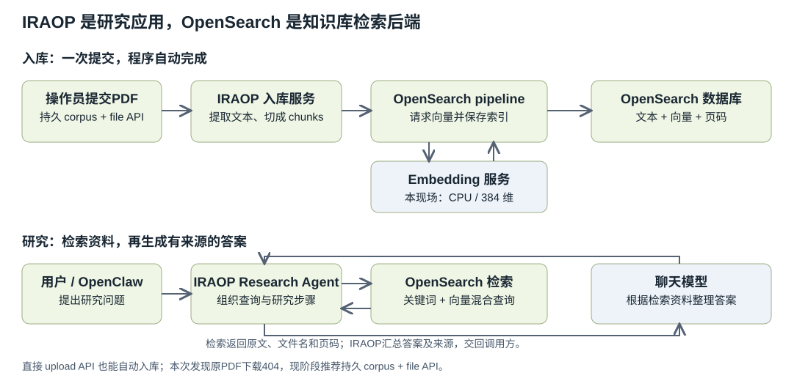

<!-- SPDX-FileCopyrightText: Copyright (c) 2026 NVIDIA CORPORATION & AFFILIATES. All rights reserved. -->
<!-- SPDX-License-Identifier: Apache-2.0 -->

# Research 补测、自动入库、飞书收件与上游 PR

2026-10-31。当前Spark继续使用revision15。**本篇新增验证：全部4条实际向量记录、文档无答案时拒绝编造、缺失集合的真实错误、上传自动入库，以及飞书群实际收件。运行修复已提交[NVIDIA PR #86](https://github.com/NVIDIA/AI-Factory-Operations-Agent/pull/86)，远端Tests/build成功，尚未合并。**

前一份[完整协议实测](spark_research_protocol_validation_20261031.zh-CN.md)的235份证据、[revision12记录](spark_live_validation_20261031_followup.zh-CN.md)和[最初27项记录](spark_live_validation_20261031.zh-CN.md)全部保留。下列表格作为索引，原始完整响应、全部字段/文本/向量、全部选定消息和真实脚本均在本篇附件，不以汇总代替原件。

## 1. Search Agent 到底验证过什么

| 环节 | 已验证事实 | 边界 |
| --- | --- | --- |
| PDF入库 | 真实2页PDF，4chunks，0errors，下载哈希一致 | 控制语料，未宣称内置业务知识库 |
| 真实搜索 | OpenSearch返回原文/来源，问题未提供正确控制码 | 完整代理和8条模型追踪在前一篇 |
| 原生HTTP/MCP | 正确控制码、文件名和页码 | 原生请求，未替换factory或模型 |
| 页面调用 | 真实iraop_query返回答案及sources；本篇再测成功/错误各一次 | View只读会话，原生JSONL保留详情 |
| 文档没有目标答案 | 明确回答无法提供GPU序列号，未认定GPU损坏 | 有2个来源不代表所问答案存在 |
| 集合不存在 | HTTP502；真实UI/MCP工具isError=true | 没有新建空集合或改搜其他集合 |
| 上传自动入库 | 一次POST完成2页解析、4条384维向量、0errors | 后端API；原件下载404是发现的缺口 |
| Pod恢复 | IRAOP重建后不重复入库仍可读 | Kind/PVC灾难恢复未测 |
| 飞书报告 | 真实发送、API成功、用户确认相同run ID收件 | 显式发送；未实现后台自动报告器 |
| 独立进度卡 | 当前a011dcc8镜像过滤IRAOP进度，限制已定位 | 普通答案和来源可见，进度展示未通过 |

这些结论针对IRAOP/Research文档检索。控制PDF和quick模式通过不代表真实业务文档质量、复杂deep多代理研究、任意故障归因或生产修复已验收。MCP传输成功、研究完成、获得目标答案、故障修复分别核对。

## 2. 入库由谁自动执行

OpenSearch承担数据库和检索职责；IRAOP的入库程序负责PDF解析和切片。入库阶段不依赖聊天模型逐片推理。操作员发起一次入库后，程序自动推进，结束时检查status、errors和实际索引记录，不需要逐页/逐片人工处理。



### OpenSearch和IRAOP的关系与开源边界

| 部分 | 负责什么 | 当前交付及开源情况 |
| --- | --- | --- |
| OpenSearch | 保存chunk文本、向量及页码等元数据，执行关键词/向量检索 | 独立的开源数据库和检索引擎，[Apache-2.0许可证](https://github.com/opensearch-project/OpenSearch/blob/main/LICENSE.txt)；本现场版本2.17.0 |
| IRAOP Research服务 | PDF入库接口；以DeepAgents/LangGraph等组织研究过程，调用检索工具及聊天模型，返回答案和来源 | 本现场使用私有NGC镜像f804535b；完整服务源码未在MOSAIC公开仓库发布，不能因为可读取镜像内Python文件就称其为开源项目 |
| MOSAIC的IRAOP部署与接入代码 | Helm选择和配置Research模块，OpenClaw通过MCP调用IRAOP工具 | [公开Helm依赖配置](https://github.com/NVIDIA/AI-Factory-Operations-Agent/blob/main/helm/mosaic-stack/Chart.yaml)及[OpenClaw接入插件](https://github.com/NVIDIA/AI-Factory-Operations-Agent/blob/main/helm/mosaic-stack/files/openclaw-seed/extensions/iraop/index.ts)带Apache-2.0声明；本次PR #86修改这些公开部分 |
| Embedding服务和聊天模型 | 分别生成向量和整理研究答案 | 属于独立依赖，不能把OpenSearch的许可证套用于模型、权重或整套IRAOP服务 |

因此，IRAOP使用OpenSearch作为知识库检索后端，并额外依赖Agent框架和模型服务。OpenSearch不是内置的Research Agent，IRAOP也不是OpenSearch本体或其发行版。引用开源库不意味着整个应用都已公开源码；私有IRAOP服务的许可和再分发范围须以其交付条款为准。

已验证的稳定文件路径是：先将原件放持久corpus，再调用/api/v1/ingest/file。/api/v1/ingest/upload也会在一次上传内自动入库，本篇实际验证；仅把PDF复制到目录不会自动发起入库，当前未验证目录watcher。界面上传按钮是否连接同一接口须按部署版本另验，本篇上传结论明确指后端API。

### 原来的4条记录确实在库里

实际索引`collection_mosaic-validation-20261031`，原PDF为3781bytes，SHA256=`e65f46b9daa87b4420336d989b0951ac6d2d6fd0a479bdcaeda42862cd92e820`。全部chunk元数据：

| id | source_file | page_number | chunk_index | contentCharacters | embeddingDimensions |
| --- | --- | --- | --- | --- | --- |
| mosaic-validation-control.pdf#0 | mosaic-validation-control.pdf | 1 | 0 | 851 | 384 |
| mosaic-validation-control.pdf#1 | mosaic-validation-control.pdf | 1 | 1 | 50 | 384 |
| mosaic-validation-control.pdf#2 | mosaic-validation-control.pdf | 2 | 2 | 890 | 384 |
| mosaic-validation-control.pdf#3 | mosaic-validation-control.pdf | 2 | 3 | 341 | 384 |

完整mapping、settings、全部文本和4×384=1536个向量坐标均在[vector-storage-proof.json](examples/alert-feishu/continued-evidence-20261031/vector-storage-proof.json)。chunk是文本切片，OpenSearch内部shard是另一层存储分片；不能把4条chunk记录称为4个shard。

### 一次上传自动入库，以及原件下载缺口

使用相同PDF字节，上传到事前确认不存在的独立集合mosaic-upload-check-20261031t071049z，文件名同样独立。没有重入库原控制集合。完整响应：

```json
{
  "status": 200,
  "body": "{\"file\":\"mosaic-upload-check-20261031t071049z.pdf\",\"pages_extracted\":2,\"chunks_indexed\":4,\"chunks_deleted_before_index\":0,\"errors\":0,\"status\":\"ok\",\"error\":null,\"failed_chunks\":[],\"failed_chunks_truncated\":false}"
}
```

| id | source_file | page_number | chunk_index | contentCharacters | embeddingDimensions |
| --- | --- | --- | --- | --- | --- |
| mosaic-upload-check-20261031t071049z.pdf#0 | mosaic-upload-check-20261031t071049z.pdf | 1 | 0 | 851 | 384 |
| mosaic-upload-check-20261031t071049z.pdf#1 | mosaic-upload-check-20261031t071049z.pdf | 1 | 1 | 50 | 384 |
| mosaic-upload-check-20261031t071049z.pdf#2 | mosaic-upload-check-20261031t071049z.pdf | 2 | 2 | 890 | 384 |
| mosaic-upload-check-20261031t071049z.pdf#3 | mosaic-upload-check-20261031t071049z.pdf | 2 | 3 | 341 | 384 |

**发现的缺口：** 上传成功后，/api/v1/documents/mosaic-upload-check-20261031t071049z.pdf返回404。该路径处理临时PDF并完成索引，但没有留下可下载原件。不能以chunks_indexed成功代替“用户能打开引用PDF”的验收。原有控制PDF采用持久corpus+file入库，原件下载哈希一致的结论仍有效。

客户现阶段继续采用持久corpus+file入库。上传原件保存属于IRAOP服务端待改进项，不在本次OpenClaw/LLM代理修复中，不能把PR #86写成已修复上传保存。

测试结束时脚本仅删除自己新建的确切索引，清理acknowledged=true，原控制集合仍4条。该删除是测试脚本清理，正常入库不会因HTTP请求结束而自动删除向量。完整下载/清理/原集合数量字段：

```json
{
  "sourcePdfDownload": {
    "status": 404,
    "body": "{\"detail\":\"Document 'mosaic-upload-check-20261031t071049z.pdf' not found\"}",
    "bytes": 74,
    "sha256": null
  },
  "cleanup": {
    "acknowledged": true
  },
  "isolatedIndexExistsAfterCleanup": false,
  "originalControlCountAfter": {
    "count": 4,
    "_shards": {
      "total": 1,
      "successful": 1,
      "skipped": 0,
      "failed": 0
    }
  }
}
```

全部新记录/向量、mapping和所有响应字段：[upload-ingestion-proof.json](examples/alert-feishu/continued-evidence-20261031/upload-ingestion-proof.json)；实际上传/精确清理脚本：[upload_ingestion_probe.py](examples/alert-feishu/continued-evidence-20261031/upload_ingestion_probe.py)。

## 3. 两个原生HTTP负例的完整返回

没有修改factory、模型、embedding或追踪开关。两次前后集合列表均为mosaic-validation-20261031、doc_count=4、store_size=36.2kb，全部响应如下：

```json
{
  "status": 200,
  "body": "[{\"name\":\"mosaic-validation-20261031\",\"doc_count\":4,\"store_size\":\"36.2kb\"}]"
}
```

```json
{
  "status": 200,
  "body": "[{\"name\":\"mosaic-validation-20261031\",\"doc_count\":4,\"store_size\":\"36.2kb\"}]"
}
```


### unanswerable-gpu-serial

```json
{
  "question": "Using only collection mosaic-validation-20261031, what is the exact hardware serial number of the failed GPU for the existing synthetic alert fingerprint 0fa8cbd733f54a5a? Perform a real document search. If the indexed documents do not explicitly provide that serial number or do not establish a failed GPU, say that the answer is unavailable. Do not infer a number or diagnose hardware from the synthetic alert. Cite the document filename and page for anything you actually find.",
  "depth": "quick",
  "collections": [
    "mosaic-validation-20261031"
  ]
}
```

```json
{
  "at": "2026-10-31T07:13:48.271753+00:00",
  "case": "unanswerable-gpu-serial",
  "elapsedSeconds": 39.48710160283372,
  "status": 200,
  "body": "{\"answer\":\"# Research Results: GPU Serial Number for Alert Fingerprint 0fa8cbd733f54a5a\\n\\n## Answer\\n\\n**The answer is unavailable.** The indexed documents in collection `mosaic-validation-20261031` do not contain the alert fingerprint `0fa8cbd733f54a5a`, do not contain any GPU hardware serial number, and do not establish a failed GPU.\\n\\n## What Was Found\\n\\nThe collection contains a single document: `mosaic-validation-control.pdf`, which has 2 pages.\\n\\n### Page 1 Content Summary (mosaic-validation-control.pdf, Page 1)\\n\\nThe document is a \\\"MOSAIC Validation Runbook\\\" (Reference: MOSAIC-KB-20261031). Key relevant passage:\\n\\n> \\\"A vector(1) alert is a deliberate delivery-path test. **It does not show a GPU, driver or application fault.** Verify the Prometheus state, Alertmanager fingerprint and the same MOSAIC alert before interpreting it.\\\"\\n\\nThe document also describes the alert injection mechanism:\\n\\n> \\\"An alert injected directly through the Alertmanager API bypasses Prometheus rule evaluation. Missing Prometheus ALERTS samples for that injected run ID are expected. Do not claim a new PrometheusRule was evaluated.\\\"\\n\\nAnd the repair demo scenario:\\n\\n> \\\"For an isolated user-level repair demo, the named service fails when its ready marker is absent. Read the exact service state and logs before repair. Repair only the registered demo wrapper; verify the marker and service result afterward.\\\"\\n\\n### Page 2 Content Summary (mosaic-validation-control.pdf, Page 2)\\n\\nPage 2 covers \\\"Operator Decision and Evidence\\\" including:\\n\\n- Public verification code: CEDAR-NEBULA-E720C8C9\\n- Repair operation modes (view mode, edit mode with HITL, auto mode)\\n- Automatic alert investigations remain read-only\\n- Completion evidence requirements (tool arguments, toolCallId, exit status, service state, logs)\\n\\n## Why the Requested Information Is Not Available\\n\\n1. **No alert fingerprint `0fa8cbd733f54a5a`**: This specific fingerprint does not appear anywhere in the indexed content of this collection.\\n\\n2. **No GPU serial numbers**: A search for \\\"serial\\\", \\\"serial number\\\", \\\"GPU serial\\\", \\\"hardware serial\\\", and \\\"NVMe serial\\\" returned no serial numbers or GPU identifiers anywhere in the document.\\n\\n3. **No failed GPU established**: The document explicitly states the alert is a \\\"deliberate delivery-path test\\\" and \\\"does not show a GPU, driver or application fault.\\\" The only \\\"failure\\\" described is a user-level service that fails due to a missing ready marker -- this is a synthetic demo scenario, not a hardware fault.\\n\\n4. **This is a synthetic validation corpus**: The document self-identifies as \\\"authored validation corpus | test from Jeff Peng.\\\" The alert system is a test harness for validating tool use and workflow, not a record of real hardware events.\\n\\n## Sources\\n\\n[1] mosaic-validation-control.pdf (Page 1) - MOSAIC Validation Runbook, describes vector(1) alert as delivery-path test with no GPU/driver/application fault\\n[2] mosaic-validation-control.pdf (Page 2) - Operator Decision and Evidence, repair operation modes and completion evidence requirements\\n\",\"depth\":\"quick\",\"collections_searched\":[\"mosaic-validation-20261031\"],\"sources\":[{\"source_file\":\"mosaic-validation-control.pdf\",\"page_number\":1,\"collection\":\"mosaic-validation-20261031\",\"doc_id\":\"mosaic-validation-control.pdf\",\"url\":\"/api/v1/documents/mosaic-validation-control.pdf\"},{\"source_file\":\"mosaic-validation-control.pdf\",\"page_number\":2,\"collection\":\"mosaic-validation-20261031\",\"doc_id\":\"mosaic-validation-control.pdf\",\"url\":\"/api/v1/documents/mosaic-validation-control.pdf\"}]}",
  "expected": "The corpus contains no GPU serial or proof of a GPU fault; clearly decline to invent either."
}
```


### missing-collection

```json
{
  "question": "Using only the specified collection, search for MOSAIC-KB-20261031 Operator Decision and Evidence. Return the public verification code and exact source filename/page only if they are actually retrieved. If the collection is missing or search fails, report that failure without inventing an answer.",
  "depth": "quick",
  "collections": [
    "mosaic-validation-no-such-collection-20261031"
  ]
}
```

```json
{
  "at": "2026-10-31T07:13:48.984595+00:00",
  "case": "missing-collection",
  "elapsedSeconds": 0.7124317521229386,
  "status": 502,
  "body": "{\"detail\":\"Research agent failed (often OpenSearch hybrid search, NVIDIA API, or missing ingest). Details: Hybrid search failed. Ensure the opensearch-init Job completed (embedding_pipeline + hybrid_search_pipeline) and indices contain documents with embeddings. OpenSearch: NotFoundError(404, 'index_not_found_exception', 'no such index [collection_mosaic-validation-no-such-collection-20261031]', collection_mosaic-validation-no-such-collection-20261031, index_or_alias)\"}",
  "expected": "Missing collection must not yield a verified sourced research answer."
}
```

无序列号问题返回HTTP200和2个来源，语义上拒绝编造；“有sources”不等于目标答案存在。回答自述的每个内部搜索词没有另行逐次取证，不把模型自述当独立工具事件。

缺失集合返回HTTP502和实际index_not_found原因，属于后端失败的可见呈现，不能归类为成功检索。没有为此新建集合或回退搜索其他集合。

全部耗时/字段/预期：[negative-results/observations.json](examples/alert-feishu/continued-evidence-20261031/negative-results/observations.json)；完整脚本：[native_negative_cases.py](examples/alert-feishu/continued-evidence-20261031/native_negative_cases.py)。

## 4. 页面成功、页面错误与进度通道

本篇再完成两个真实View会话。IRAOP后端MCP使用SSE，浏览器聊天/事件流使用NDJSON；记录器已按application/x-ndjson捕获。

| case | sessionKey | sessionId | toolCallId | 秒 | 消息数 | Gateway isError | 来源数 | 有正确码 | 匹配fetch行数 | 匹配CDP行数 |
| --- | --- | --- | --- | --- | --- | --- | --- | --- | --- | --- |
| live-telemetry | agent:default:session-2026-10-31t07-17-54-806z | 7039a9ab-1b60-4d8b-8962-222b0a4245f2 | call_236c3e8807114a05bb4c7445 | 13.824609916948248 | 4 | False | 2 | True | 1 | 0 |
| ui-missing-collection | agent:default:session-2026-10-31t07-25-37-974z | 7f9d0e86-e0e8-44af-b3db-1fcb8ce78617 | call_2e542a06a32243dc8dab979c | 11.167661582992878 | 4 | True | 0 | False | 1 | 0 |


### live-telemetry完整工具返回

```json
{
  "answer": "## Answers Based on Indexed Document\n\n**Reference:** `mosaic-validation-control.pdf`, page 2\n\n### Public Verification Code\n\nThe public verification code printed in the **Operator Decision and Evidence** section is:\n\n> **CEDAR-NEBULA-E720C8C9**\n\n### Can an Automated Alert Investigation Directly Repair a Service?\n\n**No.** Per the document:\n\n> *\"Automatic alert investigations remain read-only.\"*\n\nAn automated alert investigation cannot directly repair a service. To perform a repair, you must use **a separate authorized interactive repair conversation**, preserving the alert ID, investigation session key, research sources, and repair session key.",
  "depth": "quick",
  "collections_searched": [
    "mosaic-validation-20261031"
  ],
  "sources": [
    {
      "source_file": "mosaic-validation-control.pdf",
      "page_number": 2,
      "collection": "mosaic-validation-20261031",
      "doc_id": "mosaic-validation-control.pdf",
      "url": "/api/v1/documents/mosaic-validation-control.pdf"
    },
    {
      "source_file": "mosaic-validation-control.pdf",
      "page_number": 1,
      "collection": "mosaic-validation-20261031",
      "doc_id": "mosaic-validation-control.pdf",
      "url": "/api/v1/documents/mosaic-validation-control.pdf"
    }
  ]
}
```

全部历史：[live-telemetry/history-api.json](examples/alert-feishu/continued-evidence-20261031/live-telemetry/history-api.json)、[live-telemetry/history-gateway.json](examples/alert-feishu/continued-evidence-20261031/live-telemetry/history-gateway.json)；完整请求/轮询：[live-telemetry/requests.json](examples/alert-feishu/continued-evidence-20261031/live-telemetry/requests.json)、[live-telemetry/polls.json](examples/alert-feishu/continued-evidence-20261031/live-telemetry/polls.json)。


### ui-missing-collection完整工具返回

```json
{
  "status": "error",
  "tool": "iraop_query",
  "error": "Error executing tool query: Research agent failed (often OpenSearch hybrid search, NVIDIA API, or missing ingest). Details: Hybrid search failed. Ensure the opensearch-init Job completed (embedding_pipeline + hybrid_search_pipeline) and indices contain documents with embeddings. OpenSearch: NotFoundError(404, 'index_not_found_exception', 'no such index [collection_mosaic-validation-no-such-collection-20261031]', collection_mosaic-validation-no-such-collection-20261031, index_or_alias)"
}
```

全部历史：[ui-missing-collection/history-api.json](examples/alert-feishu/continued-evidence-20261031/ui-missing-collection/history-api.json)、[ui-missing-collection/history-gateway.json](examples/alert-feishu/continued-evidence-20261031/ui-missing-collection/history-gateway.json)；完整请求/轮询：[ui-missing-collection/requests.json](examples/alert-feishu/continued-evidence-20261031/ui-missing-collection/requests.json)、[ui-missing-collection/polls.json](examples/alert-feishu/continued-evidence-20261031/ui-missing-collection/polls.json)。

- 完整原生JSONL：[native-transcripts/7039a9ab-1b60-4d8b-8962-222b0a4245f2.jsonl](examples/alert-feishu/continued-evidence-20261031/native-transcripts/7039a9ab-1b60-4d8b-8962-222b0a4245f2.jsonl)；全部工具详情：[native-transcripts/7039a9ab-1b60-4d8b-8962-222b0a4245f2.jsonl.tools.jsonl](examples/alert-feishu/continued-evidence-20261031/native-transcripts/7039a9ab-1b60-4d8b-8962-222b0a4245f2.jsonl.tools.jsonl)。

- 完整原生JSONL：[native-transcripts/7f9d0e86-e0e8-44af-b3db-1fcb8ce78617.jsonl](examples/alert-feishu/continued-evidence-20261031/native-transcripts/7f9d0e86-e0e8-44af-b3db-1fcb8ce78617.jsonl)；全部工具详情：[native-transcripts/7f9d0e86-e0e8-44af-b3db-1fcb8ce78617.jsonl.tools.jsonl](examples/alert-feishu/continued-evidence-20261031/native-transcripts/7f9d0e86-e0e8-44af-b3db-1fcb8ce78617.jsonl.tools.jsonl)。

每个会话匹配到的1条fetch记录是session.message里的工具调用，不是IRAOP子代理进度。/api/ui/events的心跳证明NDJSON连接存在，不能把心跳或普通工具行算进度送达。完整选定聊天/UI流的所有chunk/状态/字段保留；包含其他告警的全量流原件仅内部保留：

- [live-telemetry/ui-and-chat-streams.json](examples/alert-feishu/continued-evidence-20261031/live-telemetry/ui-and-chat-streams.json)、[live-telemetry/selected-ui-events.json](examples/alert-feishu/continued-evidence-20261031/live-telemetry/selected-ui-events.json)、[live-telemetry/cdp-streams.json](examples/alert-feishu/continued-evidence-20261031/live-telemetry/cdp-streams.json)。

- [ui-missing-collection/ui-and-chat-streams.json](examples/alert-feishu/continued-evidence-20261031/ui-missing-collection/ui-and-chat-streams.json)、[ui-missing-collection/selected-ui-events.json](examples/alert-feishu/continued-evidence-20261031/ui-missing-collection/selected-ui-events.json)、[ui-missing-collection/cdp-streams.json](examples/alert-feishu/continued-evidence-20261031/ui-missing-collection/cdp-streams.json)。

### 当前安装镜像的进度限制

现场UI镜像为a011dcc8。只读核对实际构建产物，聊天流的工具名过滤仅接受observability_、grafana_、dcgm_前缀，IRAOP工具未纳入允许集合。普通iraop_query结果和来源可见，独立进度卡会被过滤。这项结论针对当前安装镜像，不推断最新上游默认镜像仍有同一问题。

OpenClaw和UI机器token在远端内存比较一致，未输出或保存值；向实际事件入口提交空对象收到400 Invalid subagent event，证明认证/参数拒绝路径可达，未发布伪事件。400不是每条真实事件POST成功的证明。修复应在MOSAIC UI端保持toolCallId/会话隔离后加入相应通道，不能取消会话过滤。

闭源构建源码/chunk/source map完整留在内部，公开版只存实际文件hash和元数据。

完整凭据布尔比较：[machine-token-comparison.json](examples/alert-feishu/continued-evidence-20261031/machine-token-comparison.json)；入口探测：[event-route-auth-probe.json](examples/alert-feishu/continued-evidence-20261031/event-route-auth-probe.json)；完整文件hash/元数据：[ui-subagent-source-metadata.json](examples/alert-feishu/continued-evidence-20261031/ui-subagent-source-metadata.json)、[ui-chunk-source-metadata.json](examples/alert-feishu/continued-evidence-20261031/ui-chunk-source-metadata.json)、[ui-stream-source-metadata.json](examples/alert-feishu/continued-evidence-20261031/ui-stream-source-metadata.json)、[chat-stream-app-source-metadata.json](examples/alert-feishu/continued-evidence-20261031/chat-stream-app-source-metadata.json)。

## 5. 飞书真实发送与群内收件

用户已创建MOSAIC Alert Test群自定义机器人，并指定本机凭据文件。本次发送完整脱敏告警、审核分析、完整IRAOP答案和全部来源，含test from Jeff Peng、sessionKey/toolCallId与唯一run ID，签名前5445 UTF-8 bytes，没有截断。凭据仅在内存使用，文件权限已收紧为600，未加入Git或证据包。

这是操作员显式报告投递，不依赖PR #74的原生双向通道，不要求Spark公网回调，没有实现“调查结束自动发群”。完整API业务响应、发送结果和用户收件确认：

```json
{
  "StatusCode": 0,
  "StatusMessage": "success",
  "code": 0,
  "data": {},
  "msg": "success"
}
```

```json
{
  "at": "2026-10-31T07:27:42.584307+00:00",
  "group": "MOSAIC Alert Test",
  "runId": "feishu-continued-validation-20261031T071049Z",
  "botApiAccepted": true,
  "groupReceiptConfirmed": true,
  "completeResponseFile": "feishu-response-attempt1.json",
  "credentialValuesSaved": false,
  "confirmationSource": "Explicit user reply: 已看到，Run ID 一致",
  "confirmationAt": "2026-10-31T07:30:35.253520+00:00"
}
```

```json
{
  "at": "2026-10-31T07:30:35.253520+00:00",
  "group": "MOSAIC Alert Test",
  "runId": "feishu-continued-validation-20261031T071049Z",
  "question": "请在飞书群「MOSAIC Alert Test」核对：是否已看到包含“test from Jeff Peng”、Run ID 为 feishu-continued-validation-20261031T071049Z 的完整告警与分析报告？",
  "answer": "已看到，Run ID 一致",
  "questionItemId": "[\"request_user_input_async\",\"call_bf98884c733e406f8715d69733c955b1\",0]",
  "source": "user"
}
```

API成功且用户核对同一run ID，本次投递验收通过；没有自动重试，没有把HTTP200单独当收件。准备阶段metadata中的prepared-not-sent保留为原始准备快照，最终状态以发送结果/用户收件为准。

完整未签名payload：[feishu-payload-reviewed.json](examples/alert-feishu/continued-evidence-20261031/feishu-payload-reviewed.json)；完整审核分析：[feishu-analysis-reviewed.zh-CN.txt](examples/alert-feishu/continued-evidence-20261031/feishu-analysis-reviewed.zh-CN.txt)；完整告警：[feishu-alert-reviewed.json](examples/alert-feishu/continued-evidence-20261031/feishu-alert-reviewed.json)；实际执行器/原输出：[send_reviewed_feishu_once.py](examples/alert-feishu/continued-evidence-20261031/send_reviewed_feishu_once.py)、[feishu-send-attempt1.log](examples/alert-feishu/continued-evidence-20261031/feishu-send-attempt1.log)。Webhook/密钥不在这些材料中，操作步骤仍见[主手册第7章](spark_alert_feishu_runbook.zh-CN.md#7-将告警与分析发到飞书)。

## 6. 三份PR与当前交接

| PR | 内容 | 版本/状态 |
| --- | --- | --- |
| fork #1 | 文档、操作示例脚本、完整证据、生成文档包 | 不独自包含Research运行修复 |
| fork #2 | 已回填Spark的证据检查/LLM工具协议修复 | c3a2048；保留已部署快照 |
| NVIDIA upstream #86 | 基于最新main的运行修复/Helm/必要文档测试，另同步安装生成器 | 55441ac；OPEN，Tests/build成功，未合并 |

上游main为7cbca70，新分支保留其definePluginEntry入口及其他更新。兼容选项和安装页面选项都默认关闭，Research取消时不会残留启用，完整请求追踪不默认开启。

上游完整CI命令275项、273通过、2项可选跳过；独立inference的4项通过；两张chart lint、Sphinx-W、文档包新鲜度和暂存差异检查通过。真实安装页面四种状态通过。第一次旧文档包不一致和初始指南锚点失败的原始输出保留，修正后重跑通过。

完整12文件/PR元数据：[upstream-pr-validation.json](examples/alert-feishu/continued-evidence-20261031/upstream-pr-validation.json)；完整实际补丁：[upstream-final.diff](examples/alert-feishu/continued-evidence-20261031/upstream-final.diff)；完整测试输出：[upstream-full-tests-attempt1.log](examples/alert-feishu/continued-evidence-20261031/upstream-full-tests-attempt1.log)、[upstream-full-tests-attempt2.log](examples/alert-feishu/continued-evidence-20261031/upstream-full-tests-attempt2.log)、[upstream-inference-tests.log](examples/alert-feishu/continued-evidence-20261031/upstream-inference-tests.log)；构建输出：[upstream-docs-build-attempt1.log](examples/alert-feishu/continued-evidence-20261031/upstream-docs-build-attempt1.log)、[upstream-docs-build-attempt2.log](examples/alert-feishu/continued-evidence-20261031/upstream-docs-build-attempt2.log)；浏览器四个完整命令/状态：[upstream-builder/observations.json](examples/alert-feishu/continued-evidence-20261031/upstream-builder/observations.json)。

Spark仍为revision15，原Teams定制和12个应用Secret保留，共享模型未因上游提交而重启。最新main分支的CI验证与既有Spark实际运行记录分别保留，没有将新main整套部署声称为已在Spark重装验收。

尚待处理：业务PDF与普遍检索质量、deep多代理、上传原件保存/引用下载、当前旧UI的独立进度、自动报告发布器、新告警写入403/规则RBAC、整机/Kind/PVC恢复和生产修复。换客户环境时，自己的群/凭据与访问授权仍需准备。

新增完整公开证据82份，另有manifest，逐项保存原始/公开大小、SHA256和隐私过滤。全部向量坐标、响应、选定会话和失败尝试见[manifest.json](examples/alert-feishu/continued-evidence-20261031/manifest.json)；此前235份证据不变。闭源源码和其他告警的全量页面/流仅内部留存，原始凭据不进入普通证据包。
